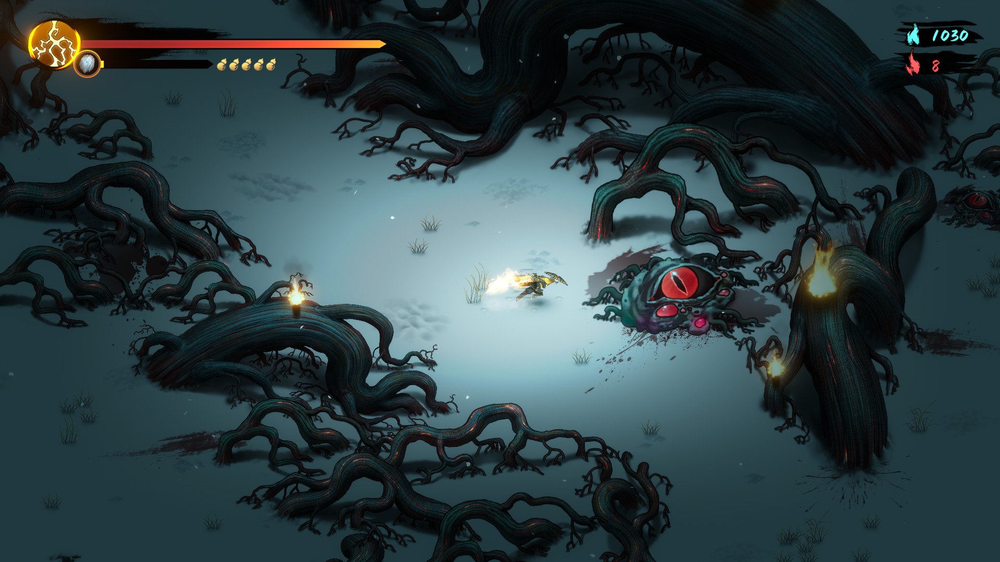

# 美术阅读入口 · 暖雪 Steam 本体

优先读 [战斗](../systems/战斗.md) 理解画面职责，再读 [圣物](../systems/圣物装配.md) 与 [构筑](../systems/宗派与秘籍.md) 理解玩家需要辨认的信息。

## 素材与状态清单（迁移项目建议）

| 资产族 | 表达任务 | 状态／变体 | 评审方法 |
|---|---|---|---|
| 玩家／敌人轮廓 | 高密度画面中区分行动主体 | 待机、攻击、受击、死亡 | 缩小与去色后是否可辨 |
| 攻击与危险提示 | 显示方向、范围、结果 | 预告、执行、命中／未命中 | 奖励特效出现时是否仍可见 |
| 圣物图标与槽位 | 区分物品身份与当前用途 | 未装配、已装配、候选、替换 | 是否只靠颜色表达含义 |
| 构筑说明与状态 | 让玩家理解触发原因 | 条件不满足、可触发、生效中 | 玩家能否指出哪个效果生效 |
| 奖励与神兵展示 | 强调稀有与联动价值 | 新掉落、比较、选定 | 不遮挡危险、不混淆数值和条件 |
| 天赋／收集界面 | 显示跨局进展 | 未解锁、可获得、已获得／已读 | 两类进展是否可区别 |

这些数量与状态按目标项目裁剪，不代表原作素材清单；分辨率、字体、图层、帧数和动画时长未核实。

## 当前图文证据边界

**看哪里**：左上为长条状态区与葫芦图标，右上为两类资源计数；角色附近场景亮度较高，周围树根压暗。**说明什么**：这一帧把战斗区域与固定 HUD 分开，支持讨论信息布局与场景对比。**不能说明什么**：图片未标构建号，也不是我们实机截取；不能证明当前本体所有场景均采用同样布局，或用静态帧验证打击感。

来源：[Steam 官方商店](https://store.steampowered.com/app/1296830/?l=schinese)，2026-10-16 读取；图片为研究引用，默认不进入公开素材包。案例里的 SVG 是原创机制图，能解释系统关系，不能充当原作 UI 参考。没有逐帧观察前不评价动画质量、命中特效时长或操作响应。

还需采证：拾取圣物完整界面、四槽切换前后、秘籍选项、神兵比较、天赋锁定条件、收集页面；每张保留平台与版本。图文引用要明确研究用途和公开状态。
