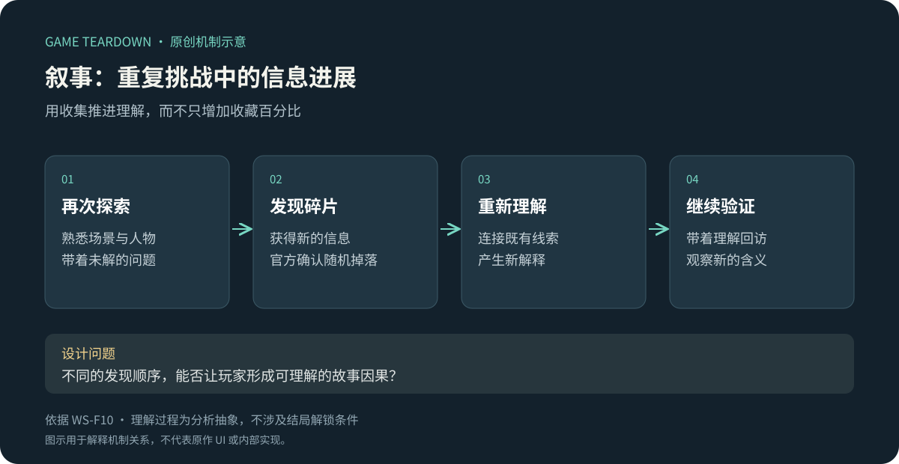
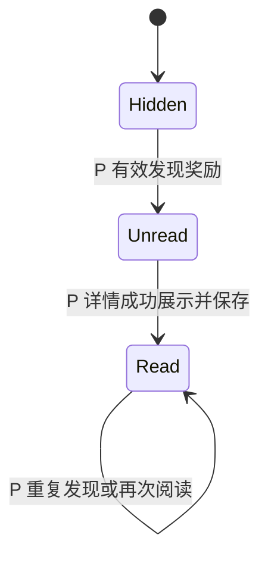

# 叙事收集：让重复挑战同时推进理解

> `warm-snow-narrative` · Steam 本体 · 资料级研究。

**WS-F10**：官方介绍将随机获得的记忆碎片作为逐步了解世界真相的渠道。[Steam 产品页／不断重生制敌](https://store.steampowered.com/app/1296830/?l=schinese)。本批不揭露结局，不假定所有碎片获得条件相同。

原创分析图；“形成解释”表示玩家理解过程，不是已验证的剧情解锁规则。

## 策划分析

重复挑战可能在战力之外留下另一种进展：对世界的理解。设计时应检查新信息是否改变玩家对已见场景的解释，而不只是增加收藏百分比。内容随机出现也可能打乱理解顺序，因此每段文字既要能独立读懂，又要与整体故事形成联系。

## 开发／美术参考（建议）

将已发现条目、已读状态与剧情条件分离，防止“看过文档”等同“满足结局条件”。重复获取应按明确规则处理；存档迁移后保留已发现内容。界面区分新获得、未读、已读与缺失线索，避免用同一个红点表达所有状态。

## 迁移与验证

适合重复探索且有世界观线索可相互解释的游戏；短流程叙事不宜为了延长时间而随机阻挡必要信息。验证可以让玩家在不同收集顺序下复述事件因果，观察误解来源。

未知：碎片清单、概率、特定触发、查看入口、完整结局条件。关联：[章节](章节与首领.md)、[永久成长](永久成长.md)；注意叙事碎片与天赋资源不混为同一种物品。

## 可开发参考规格 P · LORE v1

目标：收集、阅读和推理之间有清楚的状态区别。以下条目、获取规则、界面和条件全部为 P，不泄露或伪造暖雪剧情；依赖[公共契约](../../_framework/参考实现公共契约.md)。切片只做3条占位线索与一个档案组合，不改战斗结局。

### 数据与配置 P

`EntryConfig{id,title,bodyKey,groupId,orderHint}`；`EntryState{id,discoveredAt,readAt|null}`；`CollectionProfile{entries,processedRewardIds,revision}`。正文从本地化文本表取，缺键显示明确占位并报诊断，不显示另一条内容。

| 条目 | 演示内容主题 P | 获取方式 |
|---|---|---|
| clue_gate | 一张记录大门开关时间的纸 | 第一次完成n1固定获得 |
| clue_letter | 一封与该时间不符的信 | 完成n2时，从尚未发现的letter/mark等权抽1 |
| clue_mark | 现场遗留标记的描述 | 同上；都已发现则不抽、不补金币 |

三条合为case_gate。首次收齐只解锁一段“线索已齐，可自行比较”的索引摘要，不自动宣判真相。条目内容是占位自创文本，不沿用原作剧情。跨局永久保留，死亡不回收已完成节点授予的线索。

### 规则与流程 P

| 规则 | 条件／输入 | 状态／反馈 |
|---|---|---|
| LORE-R01 | 房间奖励提交时携带entryId | 首次发现创建state，readAt=null；重复领取仅返回已拥有，不生成第二份物品 |
| LORE-R02 | 打开条目详情且内容加载成功 | 标记已读并保存；只浏览列表不标已读 |
| LORE-R03 | 三条discovered均存在 | 档案组状态变Complete；不要求readAt；不触发结局、战力或货币奖励 |
| LORE-R04 | 已读保存失败 | 本次界面可阅读，列表仍保留未读标记并允许重试；不能影响已发现状态 |
| LORE-R05 | 未发现条目 | 列表仅显示未知条目与总数，不显示正文标题防剧透；总数3是参考参数 |

图中阅读状态与档案Complete独立。打开旧条目不会改变房间、天赋或武器状态。

### 接口、UI与资产 P

`Discover(entryId,rewardId)` 由奖励服务调用；`ReadEntry(entryId)` 返回title/body和保存结果；`GetCollection()`返回仅允许公开的条目字段及discoveredCount。跨局获取使用档案状态过滤掉已拥有条目，过滤后池空则返回 noNewEntry，不调用空随机池。

LORE-UI01：档案列表显示未知／未读／已读三态；LORE-UI02：阅读页正文可滚动、字号可调、返回保留列表位置；LORE-UI03：获得提示仅显示标题与稍后阅读，不强制打断战斗。需要3个占位插图、纸张底板、未读图标，文本对比清晰；音效只在新发现触发一次。组进度与未读数分开，不能用一个红点混写。

### 验收与内容检查 P（未运行）

| ID | 给定→操作→预期 | 追踪 |
|---|---|---|
| LORE-T01 | 首次完成n1→得到gate未读；重放奖励→仍1条 | R01 |
| LORE-T02 | 仅浏览列表→未读不变；打开加载成功详情→已读 | R02 |
| LORE-T03 | 3条已发现但均未读→组Complete但未读数3 | R03 |
| LORE-T04 | letter/mark均拥有→再过n2→无新线索且无替代货币 | 池规则 |
| LORE-T05 | 打开未发现条目ID→NOT_FOUND，不返回正文 | R05 |

内容验收：任意单条可独立理解；两条之间有可比较的信息；不依赖固定阅读顺序才能理解主语；总字数超过一屏时仍能方便返回。真正叙事质量需真人复述测试，不能用“收藏率高”代替理解成立。
