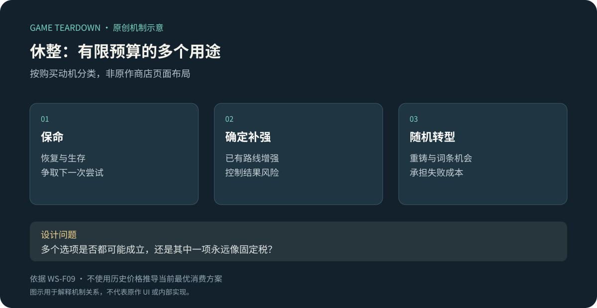
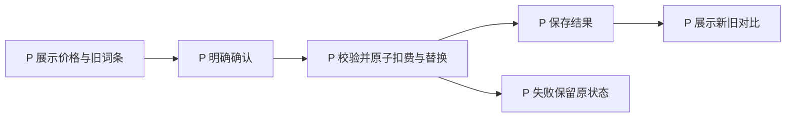

# 商店与休整：把即时补强放进有限预算

> `warm-snow-economy` · Steam 本体 · 历史资料级研究。

**WS-F09**：2022 本体指南记录商店补给，以及休息处的武器重铸、品质提升、词条洗炼和机关强化。这些消费争用局内资源。[原作者指南／幕间指南](https://steamcommunity.com/sharedfiles/filedetails/?id=2749004660&l=schinese)。不把历史价格与升级概率写成当前规则。

原创分析图；“保命／补强／转型”是购买动机分类，不是原作商店栏位。

## 策划分析

休整价值不只在让玩家喘息，而是让战斗经验影响下一次消费：缺伤害、缺生存、缺关键联动，理应导向不同选择。如果无论构筑如何都先点同一项，说明某个选项可能是固定税，而不是有意义的取舍。

局内经济要把“确定收益”和“随机转型机会”放在可比较的位置。判断重铸是否值得，需要知道后续获得资源的机会和剩余关卡，不应单看一件武器的理论上限。

## 开发／美术参考（建议）

每次购买校验价格版本、余额与目标状态后一次提交结果。重试不能再次扣费或重复刷新结果。随机改造的预览、确认、最终结果应清楚分开；界面提示本次改变哪些字段及原属性是否保留。测试资源恰好够、不足、连续点击与读档恢复。

## 迁移与未知

适合有局内可支配资源与多个有效消费方向的游戏。通过相同种子比较玩家预算分配，记录是否出现稳定唯一解。未知：当前售价、次数成长、刷新／保底／返还规则。关联：[神兵](神兵词条.md)、[圣物](圣物装配.md)、[章节](章节与首领.md)。

## 可开发参考规格 P · ECO v1

范围：一个休整节点、一次性治疗与武器词条重铸。原作还有其他消费；本参考切片明确只实现两种服务，证明预算和事务闭环。以下定价、权重、次数皆为 P，依赖[公共契约](../../_framework/参考实现公共契约.md)。

### 数据与配置 P

`RestShop{runId,nodeId,offers[],rerollCount,purchasedOfferIds,revision}`。局内币 `run_coin` 初始0，由LVL和META发放，run结束清零、不转换永久资源。商店币余额只属于当局。

| 服务 | 价格／限制 P | 结果 |
|---|---|---|
| heal | 20币；每节点1次；满血不可买 | 回复30HP且不超上限 |
| reroll | 第n次价格 `20+10n`，n从0起；每节点最多3次 | 当前武器两词条整组替换，基础模板与实例ID保留 |

重铸池：edge（近战+500基点）、vital（maxHp+10）、sword（飞剑+500基点），等权重各1、无放回抽2项；排序后保存。允许与原组合相同，界面事先声明“不保证变化”；不设保底、不提供结果保留选项，确认即替换。未装备武器不能购买重铸。vital卸除和增加按WPN规则，不提供免费治疗。

### 规则 P

| 规则 | 条件／动作 | 状态／反馈 |
|---|---|---|
| ECO-R01 | LVL.state=Resting→开商店 | 返回当前价格和购买次数，展示余额与限制 |
| ECO-R02 | 购买治疗 | 校验未买、hp<max、币≥20；同事务扣20、加血、标已售 |
| ECO-R03 | 预览重铸 | 展示将替换词条、可能不变、费用；不提前生成随机结果 |
| ECO-R04 | 确认重铸 | 校验武器revision与余额，抽结果并扣费、替换、次数+1一次提交；结果保存后才播放揭示 |
| ECO-R05 | 次数用尽或无武器 | 按钮禁用附原因；请求绕过UI仍拒绝，不抽随机、不扣币 |
| ECO-R06 | 离开休整 | 商店关闭；该节点不能返回；购买未响应则先确认结果，不能把未确认事务丢在身后 |

例：余额50且未重铸→首次20，余30；再次30，余0；第三次40不足，因此次数仍2、词条不变。满血买治疗不扣款。付款恰好足够允许归零。

### 接口与异常 P

`GetRestShop(runId,nodeId)` 返回offer及priceVersion；`BuyService(offerId,targetInstanceId,expectedWeaponRevision)` 返回wallet与target快照。所有购买走公共requestId去重；重复请求返回同一随机结果。WPN消费 `WeaponReforged`重算属性；UI不根据动画决定词条。配置热更在下一局生效，此局固定priceVersion。背包数量不变，不能因为“满包”阻止对当前实例重铸。

ECO-UI01 商店卡显示价格、次数、余额不足差额；ECO-UI02 重铸确认列明被覆盖的两词条；ECO-UI03 结果页可跳过动画但必须能查看新旧对比。资产为2服务图标、3词条图标、已售／不足／处理中／成功四态；随机结果相同也如实写“词条未变化”，不伪装提升。

### 验收 P（未运行）

| ID | 给定→操作→预期 | 追踪 |
|---|---|---|
| ECO-T01 | 50币→重铸两次→余0，第三次拒绝且次数=2 | R04/05 |
| ECO-T02 | 同requestId网络重发→只扣一次、返回完全相同词条 | R04、公共事务 |
| ECO-T03 | 旧武器revision→确认→STALE，币与词条都不变 | R04 |
| ECO-T04 | hp90/max100且20币→买治疗→100/100且0币，第二次已售 | R02 |
| ECO-T05 | 满血→调用治疗→拒绝，购买次数不消耗 | R02 |
| ECO-T06 | 随机结果与旧一致→确认→正常收费并如实显示未变化 | R03/04、UI03 |

统计购买率时分开记录“无需求”“付不起”“次数耗尽”，否则不能判断某个服务是否无用。可调费用与收益，但修改必须连同上述算例和测试一起更新。
