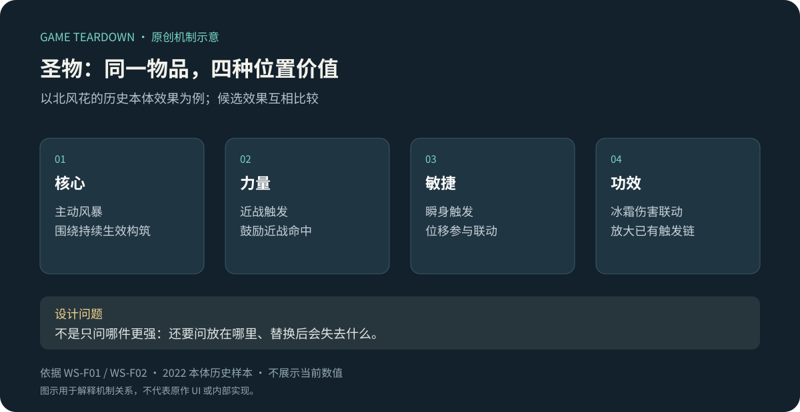
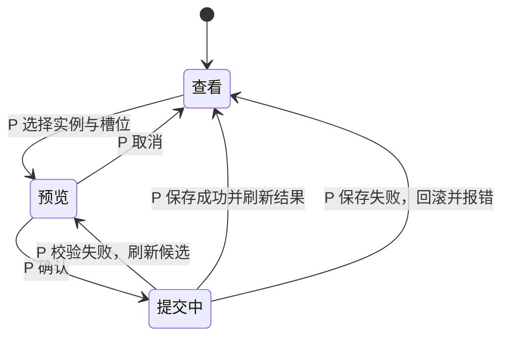

# 圣物装配：同一物品的价值由位置决定

> 案例 `warm-snow-relics` · Steam 本体 · 资料级研究 · 2026-10-16。重点案例。具体词条以 2022 本体历史样本解释，不代表当前数值。

## 已知事实

**WS-F01**：圣物有四种位置效果；装入核心、力量、敏捷、功效槽会承担不同作用。[Steam 官方介绍](https://store.steampowered.com/app/1296830/?l=schinese)、[原作者本体指南／圣物篇](https://steamcommunity.com/sharedfiles/filedetails/?id=2749004660&l=schinese)。

**WS-F02**：历史指南中的“北风花”，不同位置分别围绕主动风暴、近战触发、瞬身触发、冰霜伤害联动展开。同一个主题可以通过不同战斗事件参与构筑。此处不复刻概率与系数。[同一指南](https://steamcommunity.com/sharedfiles/filedetails/?id=2749004660&l=schinese)

## 机制图解

原创机制示意，依据 WS-F01/02；四个面板表达候选装配效果，不表示一个物品同时占四槽，也不是原作 UI。背包容量与物品存储规则尚未核验。

## 设计解释

玩家判断的不只是“新物品是否更强”，还包括“它在哪个位置最适合当前打法”以及“被换下的效果是否支撑另一条触发链”。这把一维装备比较变成了位置分配问题。对局内随机掉落而言，一个物品有多个用途，理论上能增加可用落点；实际减少多少无效掉落，仍需记录样本验证。

四槽并不自动产生四倍深度。如果多数效果都只是同类百分比，玩家可能仍按数值排序；只有触发条件与收益对象真正不同，换槽才会改变行为。另一个代价是阅读负担：每次掉落可能要理解四段说明，还要记住其他三个槽在做什么。

## 开发参考（建议，不是原作实现）

将圣物定义与装配实例分开：`RelicDefinition {id, effectsBySlot}`；`Loadout {slotId: instanceId}`。效果订阅事件，如近战命中、瞬身结束、造成冰霜伤害；最终事件名和叠加顺序由目标项目定义。

| 事件 | 建议状态变化 | 必须验证的不变量 |
|---|---|---|
| 预览换槽 | 计算候选效果，不改正式装配 | 预览不能触发战斗效果 |
| 确认替换 | 原槽效果解绑，新效果生效 | 不能重复注册同一个触发器 |
| 放弃／关闭 | 保留原装配 | 无资源或属性副作用 |
| 读取存档 | 重建有效装配与效果 | 失效物品 ID 有可解释的恢复策略 |

这张表是迁移项目的验收建议；原作是否支持预览、拖拽或战中换槽仍待实机证据。循环触发还应测试：A 产生冰霜伤害，B 监听冰霜伤害，两者不能因无界递归导致卡死。

## 美术与交互参考

建议在候选效果上突出“触发动作—结果”，并让当前装配位置可见；颜色之外使用槽名和图标区分。换装比较应同时说明获得与失去的作用。所需状态包括当前装配、候选位置、被替换效果、确认结果；这是设计建议，尚无证据认定原作已完整实现。

## 迁移与验证

适合物品数量有限、希望提高组合价值的肉鸽项目。若玩家只能极短暂地阅读或装备量极大，应减少每件物品的解释长度，或先从两种位置用途开始验证。

原型实验：固定掉落序列，比较“单效果装备”与“多位置效果”的选择次数、理解错误、换装用时和最终构筑差异。不能只比较面板战力。关联：[宗派与秘籍](宗派与秘籍.md)、[神兵词条](神兵词条.md)、[战斗](战斗.md)。

未知：当前物品数量、重排限制、精炼流程、背包容量、同名圣物限制与当前 UI；需要本体物品拾取和换装录屏。

## 模块规格：对象、规则与实现边界

本节给出可供策划／开发／美术评审的规格。**F** 是来源支持的原作规则；**P** 是独立复现参考方案；**U** 是尚未核实。P 方案选择了“停战整理、预览后确认”的交互，仅用于建立实现闭环，不能据此声称原作也如此。

### 职责与对象

模块负责装配位置、当前有效效果、换装比较和结果反馈；掉落生成、永久仓储、出售／精炼、伤害基础结算由外部模块负责。

| 对象／术语 | 定义 | 来源性质 |
|---|---|---|
| 圣物定义 | 一类圣物及各槽位效果描述 | F：WS-F01 |
| 槽位 | 核心、力量、敏捷、功效 | F：WS-F01 |
| 圣物实例 | 唯一 instanceId，引用一份定义 | P：用于区分同类物品实例 |
| 装配快照 | 四槽映射与 revision | P：用于比较与提交校验 |
| 效果实例 | 由装备实例＋槽位派生的有效效果 | P：防止重复绑定 |
| 换装提案 | 基于某个快照产生的目标映射 | P：预览不立即改变正式状态 |

### 规则表

| R-ID | 性质 | 前置与输入 | 结果与边界 | 反馈 |
|---|---|---|---|---|
| REL-R01 | F | 一件圣物放入某槽 | 按该槽对应效果解释其用途；四位置效果不同 | 原作完整反馈待核验 |
| REL-R02 | P | 玩家处于停战整理阶段 | 允许创建换装提案；战斗中入口禁用 | 说明当前为何不可整理 |
| REL-R03 | P | 实例存在且可装配到目标槽 | 一个实例最多占一个槽，一个槽最多一个实例 | 高亮来源与目标位置 |
| REL-R04 | P | 预览目标有旧实例 | 旧实例进入候选暂存区；预览不改变正式装配 | 并列显示获得／失去效果 |
| REL-R05 | P | 点击确认，revision 与实例状态仍有效 | 一次提交新映射并重建效果；不消耗货币 | 成功后展示已生效结果 |
| REL-R06 | P | 取消、关闭或目标非法 | 丢弃提案，正式快照不变 | 取消安静返回；非法说明原因 |
| REL-R07 | P | 提交后保存失败 | 恢复提交前正式快照与效果，报告失败 | 不播放成功反馈，允许重试 |
| REL-R08 | U | 同名圣物、精炼、战中切换 | 原作限制及流程未核实 | 不能进入原作机制筛选标签 |

REL-R04 的暂存区是背包已有实例的预览投影，不创建副本。参考版本采用[公共契约](../../_framework/参考实现公共契约.md)的100实例背包：装备中仍占格，因此替换不额外占容量；新掉落满包进入待领取。一个定义最多同时装一件，重复定义的另一实例不能一起装；此限制为 P，原作仍 U。

### 流程与状态

此图全部为参考交互；原作证据仅支持四槽规则。提交中禁止重复发起。刷新候选时保留用户目标，但重新核算可用实例，不能自动确认另一个物品。

### 数据与配置（P）

| 字段 | 类型／单位 | 合法性与缺失处理 | 原作值／参考值 |
|---|---|---|---|
| slotId | 枚举 | core/power/agility/utility；其他值拒绝 | 槽位含义 F；英文 ID 为 P |
| relicId / instanceId | 稳定字符串 | 不为空；实例必须引用有效定义 | P |
| effectBySlot | 槽位→效果定义 | 每个可装槽必须有描述和效果；缺失禁用该选择 | P |
| trigger / condition | 事件名／条件表达式 | 事件必须注册，条件不能引用不存在字段 | P；原作内部表达式 U |
| coefficient | 数值／依效果声明单位 | 原作未核实为 null；参考配置见下表，不允许空值开始原型 | 原作数值 U；演示值 P |
| stackingPolicy | replace / add / capped | 下表效果均replace，同实例换槽先移除旧效果 | P |
| revision | 非负整数 | 提交必须匹配当前值；成功递增 | P |
| instanceRetention | 暂存／装配 | 提交前后实例总集合不变 | P；非原作背包规则 |

### 最小可实施效果包 P

使用自创占位圣物 `training_frost`，不冠名北风花以免误认原作数值。开局背包提供一件，四槽都空；四槽规则相同但只能选择一个落点。全部使用COM的逻辑tick与触发深度上限。

| 槽位 | 事件与完整效果 P | 限制与数值 |
|---|---|---|
| core | 按Q施放一次冰霜环，当前玩家周围2m全部存活敌人各10基础伤害 | 立即判定，冷却5秒；可在Idle触发；无目标仍进入冷却；不消耗飞剑 |
| power | 近战直接命中后，给同一目标追加5基础冰霜伤害 | 每次attackId每目标一次；追加伤害不再次算作近战事件 |
| agility | 闪避结束时向周围2m敌人造成5基础冰霜伤害 | 每次dodgeId一次；不会追加无敌时长 |
| utility | 所有来源冰霜伤害增加2000基点 | 与同类别伤害增益相加；无独立触发事件 |

冰霜是伤害标签，此切片不附带减速或冻结，避免留下未定义控制规则。core按Q时用COM动作状态校验，但不改变近战／飞剑动作状态；同tick多种输入优先闪避、近战、飞剑、Q，只执行第一个合法主动动作。冷却跟随实例而非槽位保存，换槽不会重置；离开战斗时按正常逻辑时间推进，到大厅新run重置。换装不消耗货币；同名限制不影响未装备物品保留。

### 事件契约（P）

| 接口 | 输入 | 输出／失败 | 所有权 |
|---|---|---|---|
| previewEquip | snapshotRevision, instanceId, slotId | proposedLoadout, gainedEffects, lostEffects / invalidTarget | 只读正式状态 |
| commitEquip | requestId, expectedRevision, proposal | newRevision / staleRevision, missingInstance, saveFailed | 装配模块拥有装配状态 |
| loadoutChanged | newRevision, effectiveEffects | 战斗模块按版本替换效果集合 | 接收者不得再次扣资源或移动物品 |
| persistenceResult | requestId, success | 完成或恢复旧快照 | 存档模块只报告持久化结果 |

`requestId` 同一请求重复到达返回既有结果；失败后的新尝试使用新 ID。`loadoutChanged` 只在保存成功后对外通知，避免外部先播放成功而随后回滚。这个顺序是参考方案的明确决策。

### UI 与资产状态（P）

| UI-ID | 元素 | 状态 | 表达要求 |
|---|---|---|---|
| REL-UI01 | 四槽区域 | 空／已装／候选目标 | 名称与符号双编码，不只靠颜色 |
| REL-UI02 | 效果比较 | 原效果／候选／条件未满足 | 区分触发条件、效果结果和失去内容 |
| REL-UI03 | 确认按钮 | 可用／非法／提交中 | 禁用原因明确；提交中不重复响应 |
| REL-UI04 | 结果反馈 | 成功／校验失败／保存失败 | 成功音效只在成功分支触发 |
| REL-UI05 | 暂存区 | 正常／候选替换／满包掉落待领取 | 可追溯被替换物，不隐式销毁；换装本身不扩容 |

资源需求：圣物身份图标、四槽符号、选中／禁用状态、成功／失败轻量反馈。具体数量随收录物品数计算；字号、分辨率、动效时长由目标设备评审决定，不伪造原作规格。

### 验收用例（已设计，未运行原型）

| T-ID | 对应规则 | 给定／操作 | 预期结果 |
|---|---|---|---|
| REL-T01 | R01 | 同一圣物分别查看四槽 | 四槽描述引用各自效果定义；人工对照原图核验 |
| REL-T02 | R03/R04 | 将已装实例提议放入另一槽 | 候选不重复占槽；正式状态不变 |
| REL-T03 | R06 | 预览后取消 | revision、实例集合、有效效果均不变 |
| REL-T04 | R05 | 确认后连续点击／重复请求 | 只产生一个新 revision 与一次结果反馈 |
| REL-T05 | R05 | 预览后目标实例被外部移除 | 返回 missingInstance，不改变其他槽 |
| REL-T06 | R07 | 持久化失败 | 旧映射与旧效果恢复，没有成功音效 |
| REL-T07 | R03/R05 | 连续替换再恢复原装配 | 触发器数量与初始相同，无累计属性漂移 |
| REL-T08 | R08 | 原图显示与参考方案不同的限制 | 修改 F/U 记录，不拿 P 覆盖事实 |

### 补充验收与研究边界

REL-T09（P）：training_frost从power换core→近战不再追加冰伤；Q对2m内两敌各造成10基础冰伤，5秒内再次Q无效。REL-T10（P）：背包100实例且正在替换→允许替换，实例总数仍100；新掉落进入待领取。REL-T11（P）：同定义第二实例尝试装备→INVALID且旧映射不变。用例均未运行。

原作研究仍需当前本体拾取／装配／精炼录屏与同名限制。上述P方案已决定参考切片的效果、叠加、容量与恢复；可据此实现切片，不代表完整圣物内容包、原作复刻准确性或商业平衡已验收。
