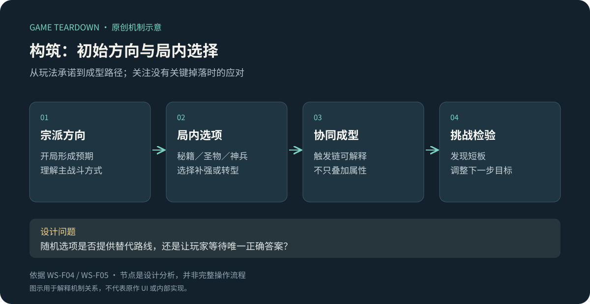
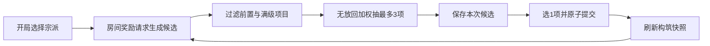

# 宗派与秘籍：先给方向，再让局内选择修正路线

> `warm-snow-build` · Steam 本体 · 资料级研究。重点案例。

**WS-F04**：官方本体介绍列出六宗派、十二种核心玩法，并说明宗派、神兵与圣物存在联动。该数字是当前访问到的产品文案，不作全部更新内容盘点。[Steam 产品页](https://store.steampowered.com/app/1296830/?l=schinese)

**WS-F05**：2022 本体原作者指南区分通用秘籍与宗门秘籍，并记录不同构筑的搭配。[指南／秘籍与构筑章节](https://steamcommunity.com/sharedfiles/filedetails/?id=2749004660&l=schinese)

原创机制关系图。初始方向与后续补强是分析结构，不表示各步骤只能发生一次。

## 策划分析

宗派为玩家提供开局的理解框架，秘籍与装备则允许在局内逐步形成路线。分析重点应是“初始承诺与随机选择是否相容”：如果玩家选择一种战斗方式，却长期只能拿到无关效果，随机性可能变为等待正确答案。

应区分启动组件、增强组件、保护组件和补救组件。这里是供研究者分类的分析方法，不是原作 UI 分类。只推荐最强配装会漏掉关键设计：关键组件没出现时，玩家能否利用已有掉落继续推进。

## 开发参考（建议）

为选项记录作用对象、前置条件、互斥标签和叠加规则；生成候选与应用选择分离。不要在没有证据时写出原作权重、保底和重抽算法。

建议用例：互斥效果不能同时生效；选择提交后重复输入不重复叠加；读档后构筑与说明一致；候选池为空时有明确回退。若设计允许转型，应定义旧效果去留和资源返还，不能留给 UI 临时处理。

## 美术与交互

选择面板最需要传达“这项改变我哪个动作”。迁移建议为选项加动作图标和一句触发结果，详情保留完整规则；未拥有关键前置时解释限制。持续生效、条件触发、一次性奖励应有不同表达。

## 适用性与验证

适合有多次重复游玩与逐步学习空间的单机肉鸽。内容量不足时，复杂选项池反而会让选择同质化。原型中记录玩家第一次形成可解释构筑的时点、弃用选项原因、无关键组件时的替代路线；别以选项总数代替深度。

未知：当前宗派解锁条件、秘籍选择数量、重复／升级规则、重抽和候选权重。关联：[圣物](圣物装配.md)、[神兵](神兵词条.md)、[永久成长](永久成长.md)。

## 可开发参考规格 P · BLD v1

目标是实现“开局选方向→局内三选一→效果改变动作”的独立参考切片。下列宗派、秘籍、概率和解锁均为 **P**，不使用原作名称伪装配置。遵循[公共契约](../../_framework/参考实现公共契约.md)，战斗效果对接 COM；天赋解锁不是本模块职责。

### 对象与配置 P

`RunBuild{runId, sectId, ownedRanks:Map<bookId,int>, offerSeq, pendingOffer, revision}`。宗派配置 `sectId、startingEffects[]、allowedTags[]`；秘籍配置 `bookId、allowedSects[]、maxRank、weight、requires[]、excludes[]、effectsByRank[]`。前置引用必须存在且无环；权重为正整数；效果等级长度必须等于 maxRank。

| 样例 | 最大级／权重 | 完整效果 P |
|---|---|---|
| sect_blade | 开局二选一之一 | 近战增伤2000基点；不能局中改宗 |
| sect_sword | 开局二选一之二 | 飞剑增伤2000基点；与上项互斥 |
| book_edge | 2／10；仅blade | 每级近战增伤1000基点，替换旧级配置 |
| book_focus | 2／10；仅sword | 每级飞剑增伤1000基点 |
| book_guard | 1／10；通用 | 最大生命+20，获得时当前生命也+20且不超新上限 |
| book_heal | 1／10；通用 | 每完成房间回复10HP，上限maxHp；死亡不触发 |

加法增伤先汇总，同类不相乘。blade＋edge2 的总增伤是4000基点。候选不足时才提供 `fallback_heal`：立即回复20HP，不存入 ownedRanks，可反复选择，即使满血也可选择但显示“当前无治疗收益”。

### 流程和规则 P

图全为 P，明确候选存档先于展示，避免反复打开刷新结果。

| 规则 | 条件／动作 | 状态与反馈 P |
|---|---|---|
| BLD-R01 | 创建新run | 宗派确定后锁定；未选择不能入第一房间；选择不消耗资源 |
| BLD-R02 | 同一rewardId请求秘籍奖励 | 无未决选项才生成；已存在则返回原候选，不推进随机序列 |
| BLD-R03 | 生成候选 | 过滤不适用宗派、未满足前置、互斥、满级；无放回按权重抽最多3项；不足3项追加一个fallback，仍不足保留少于3项，不重复填充 |
| BLD-R04 | 选中合法offerId中的bookId | 等级+1或执行fallback；清除pendingOffer，标记奖励消费；重算快照；无其他费用 |
| BLD-R05 | 返回／退出 | 不丢弃待选奖励；返回房间出口前必须完成选择；重进展示相同候选 |
| BLD-R06 | 旧版本／非法选择 | 返回STALE或INVALID，不消耗奖励、不提升等级；UI刷新当前选项 |

状态 `NoOffer→Pending→Applied→NoOffer`；提交过程中禁用选项，事务失败回Pending。run结束清除局内 ownedRanks，但保留统计；不返还资源，因为无购买成本。

### 接口与 UI P

`CreateOffer(runId,rewardId)` 返回 `offerId, options[{id,nextRank,description,delta}], revision`；`Choose(offerId,optionId)` 返回新构筑与 effectDiff。COM 在下一房间开始读取新快照；若供给即时治疗，则作用于房间结束状态，保存与选择同事务。不能在战斗未清算时同时加血。

| UI-ID | 必须展示 | 资产与反馈 |
|---|---|---|
| BLD-UI01 | 选宗派时操作方向与初始增益 | 2张方向卡＋近战／飞剑图标，选中描边，不照搬原作神像 |
| BLD-UI02 | 候选触发条件、当前→下一级、前置 | 卡片正常／悬停／提交／已选态；不足3项居中，禁止空白可点槽 |
| BLD-UI03 | 构筑已持有清单与生效原因 | 等级数字与分组；已达上限显示“满级” |

### 验收 P（未运行）

| ID | 给定→操作→预期 | 追踪 |
|---|---|---|
| BLD-T01 | blade开局→反复生成候选→不出现focus | R01/03 |
| BLD-T02 | edge已2级→生成→edge被过滤；全部满级→仅fallback | R03 |
| BLD-T03 | 三选一已显示→退出重进→顺序和选项保持一致 | R02/05 |
| BLD-T04 | 同一选择提交两次→只升1级，重复返回原结果 | R04/06 |
| BLD-T05 | blade＋edge2→打20基础伤害无防御敌人→28伤害 | R04、COM公式 |
| BLD-T06 | hp90/max100→选guard→hp110/max120；再次不再出现guard | R03/04、UI02 |

调参指标：有收益候选占比、fallback比例、选择耗时、玩家能否解释组合。样例池为接口验证而缩小，不代表足够支撑正式游戏重玩性；拓展时每条新秘籍必须给触发、叠加、失效与测试。
