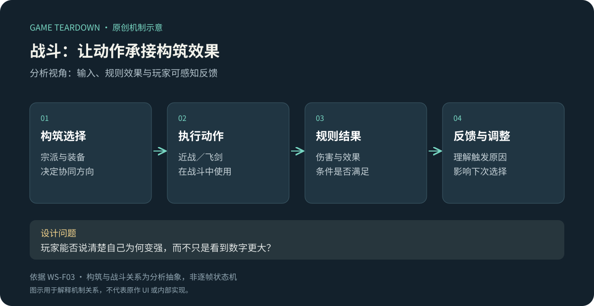
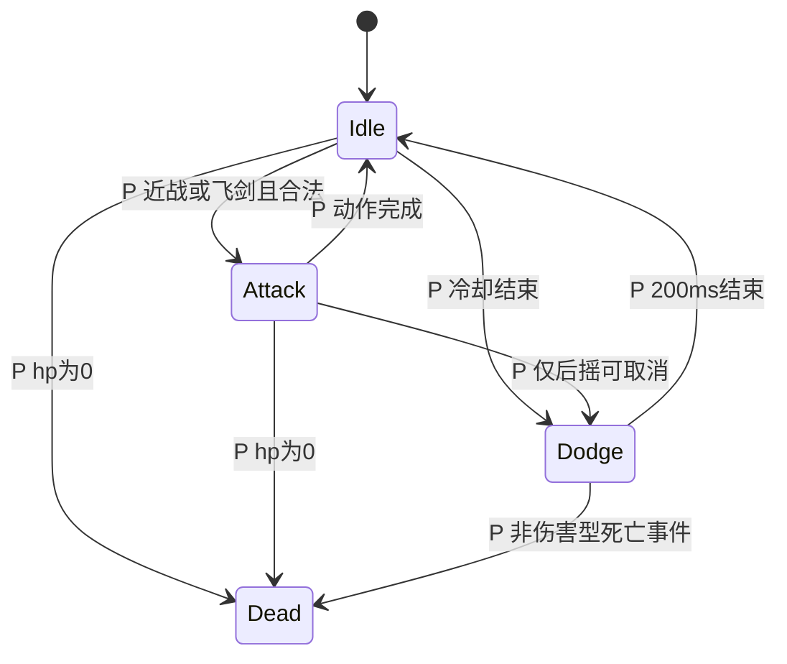

# 战斗：近战与飞剑共同承接构筑

> `warm-snow-combat` · Steam 本体 · 资料级研究。重点案例。

**WS-F03**：官方将近战、不同属性的飞剑和圣物加成共同描述为战斗核心。[Steam 产品页／飞剑系统](https://store.steampowered.com/app/1296830/?l=schinese)。历史玩家实战记录展示近战取向、飞剑取向与元素构筑，但其强度排序只是作者个人经验。[2022-03-14 原作者实战记录](https://steamcommunity.com/app/1296830/discussions/0/4507545977830811695/)

原创分析图，依据 WS-F03；箭头说明设计关系，不是逐帧战斗顺序或原作内部状态机。

## 决策与取舍

这类设计的价值在于让装配改变“怎么打”，而不仅改变伤害值。观察时应区分三个问题：玩家能否执行动作、当前构筑是否鼓励该动作、反馈是否让玩家察觉效果触发。三者任一缺失，复杂构筑都可能退化成看不懂的伤害数字。

即时输入、敌人攻击窗口、伤害资源和移动避险共同构成可研究的秒级循环。但当前未采样操作视频，因此不报告无敌帧、前后摇、自动索敌优先级、输入缓存或准确冷却时间。

## 开发参考（建议）

将动作执行、命中结算、构筑触发、表现播放分开描述。候选事件为 `attackStarted → hitResolved → effectsResolved → feedbackRequested`，但不要假定原作采用这一架构。核心问题是连锁触发的顺序、重复命中去重和表现与规则结果的一致性。

建议验收：目标死亡与飞剑命中同帧时只结算一次合法结果；更换构筑后旧效果不残留；暂停／恢复不多执行一次结算；低帧率不改变持续效果的累计时长。这些是目标项目测试要求，非本游戏已存在的缺陷。

## 美术与交互

先对照真实战斗截图观察玩家、敌人、危险提示和收益特效的优先级，再讨论风格。技能动效需要表达攻击方向、作用范围和结果；掉落光效属于奖励层，应避免遮挡伤害来源。当前只采用商店展示图作视觉参考，不能据静态图判断打击感或可读性始终合格。

## 迁移条件与验证

适合希望用同一套动作承载多种流派的动作游戏；不应把这种主动操作密度直接照搬到放置游戏。用固定敌群测试不同构筑的操作变化，并让玩家复述主要触发链；若只能解释“数字更大”，需要重新审视机制区分度。

关联：[圣物](圣物装配.md)、[构筑](宗派与秘籍.md)、[章节](章节与首领.md)。未知：当前输入映射、取消窗口、飞剑回收全流程、Boss 逐阶段规则。补证方式：本体教程及两种构筑的完整战斗录屏。

## 可开发参考规格 P · COM v1

**范围**：一个俯视战斗房间，近战、有限飞剑、回收、闪避与构筑触发。以下全部为独立参考方案，不宣称复刻暖雪的时序或数值。依赖[公共契约](../../_framework/参考实现公共契约.md)。UI 与验收可交付开发；完整怪物库、平衡和打击感须后续制作测试。

### 对象与数据

| 对象／字段 | 类型与演示配置 P | 合法性／归属 |
|---|---|---|
| Actor | actorId、team、hp=100、position(x,y)、facing | hp 整数 [0,maxHp]；战斗域拥有 |
| Action | id、startupMs、activeMs、recoveryMs、damage、range、angle | 时间为 50ms 倍数；范围>0；角度(0,360] |
| melee | 100/100/200ms；damage=20；range=1.5m；angle=90° | 每次动作对每目标最多命中一次 |
| sword | 前摇50ms／发射50ms／后摇100ms；damage=12；speed=12m/s；life=1000ms | 不穿透；首个敌人或障碍终止 |
| SwordPool | capacity=6、available=6、returning=0 | 总额守恒；回收时长300ms |
| dodge | duration=200ms、distance=2m、cooldown=800ms | 演示全程免伤；碰墙停；无攻击 |
| Trigger | eventKind、priority、effectId、internalCooldownMs | 同优先级按 effectId 排序；冷却≥0 |

坐标单位为米，动画自行映射像素；移动速度 4m/s。键盘原型 WASD 移动、鼠标朝向、左键近战、右键飞剑、R 回收、Space 闪避；手柄与移动端输入映射不在此切片范围。目标方向取输入朝向，无自动索敌。松开移动立即停；不设输入缓存。

### 状态与规则

图为 P 参考状态机；只解释动作互斥。暂停是外层冻结，不清除动作进度。

| 规则 | 条件与输入 | 结果／反馈 P |
|---|---|---|
| COM-R01 | 活着且 Idle，按攻击 | 固定朝向进入前摇；近战有效期判扇形；目标在范围且夹角≤45°命中 |
| COM-R02 | 飞剑可用>0且 Idle | 发射时扣1；从起点到终点连续检测，最近碰撞优先，等距离按 actorId；击中或过期计入待回收，不自动返还 |
| COM-R03 | 任意存活动作状态，按回收 | 回收发出时的全部在外飞剑，立即取消其伤害并记批次；300ms后归还；回收途中再次按键无效；允许近战与移动 |
| COM-R04 | Idle或攻击后摇且闪避就绪 | 以移动方向闪避，零输入则朝向；取消后摇，开始800ms冷却；前摇／有效期不接受闪避 |
| COM-R05 | 每个50ms tick | 先输入和移动→碰撞→按 eventId 结算直接伤害→存活判断→构筑触发→表现；同 tick 玩家与敌人可同时死亡，关卡按失败处理 |
| COM-R06 | 触发效果产生伤害 | 带 rootEventId、depth；depth上限4，超过丢弃且记录诊断；同 effectId 每 rootEventId 最多一次，避免触发环 |
| COM-R07 | hp=0 | 移除攻击判定、停移动、取消飞剑和触发；发 ActorDied 一次，死亡对象不能成为新目标 |

伤害使用公共公式。例：近战基础20，增伤2500基点、乘区10000、目标防御3，伤害=`floor(20×1.25−3)=22`；原型不含暴击，免伤优先于伤害公式。剑池每 tick 检查 `可用+飞行中+待回收+回收中=6`，失败停止战斗并报配置／状态错误，不自动补剑。

### 接口与异常

输入 `StartRoom(roomId, seed, loadoutSnapshot)`，返回 battleId 和初始状态；每 tick 接受 `InputFrame(sequence, moveVector, facing, actionFlags)`，同 sequence 去重。输出 `HitResolved{attackId,targetId,damage,damageType}`、`ActorDied{actorId,killerId}`、`RoomCombatEnded{outcome,tick}`。装备域在入房时提供只读效果快照，房间中不换装；房间域决定后续奖励。

房间内只保存入口快照；退出／崩溃重入从同入口状态和种子重开，未完成战利品不保留，已完成房间奖励不回退。暂停冻结所有逻辑计时；失焦自动暂停。非法输入忽略并计数，不扣剑、不进入冷却。大量特效只降表现，不跳过逻辑命中。

### UI／资产 P

| ID | 信息与状态 | 制作要求 |
|---|---|---|
| COM-UI01 | 血量／受伤／死亡 | 条形＋数字；受伤闪白100ms；死亡禁止伤害浮字继续堆积 |
| COM-UI02 | 6格剑池／飞行／回收进度 | 形状区分空、可用、回收中；回收结束短音一次 |
| COM-UI03 | 闪避冷却／可用 | 800ms径向进度；按键失败只轻提示，不播放成功动作 |
| COM-UI04 | 攻击范围与命中 | 敌方危险层高于我方收益特效；训练模式可显示判定扇形 |

屏幕资源参考现有 Steam 图；上述 HUD 状态和时长都是 P。训练场显示伤害分解与触发链开关，正式游玩默认隐藏。

### 验收与调参

| 测试 | 给定→操作→预期 | 追踪 |
|---|---|---|
| COM-T01 | 一个敌人停在扇形内→连续跨2个有效tick→只受一次20基础伤害 | R01 |
| COM-T02 | 6剑全部发出→再射→无第7剑；回收中再回收→300ms后恰好6剑 | R02/03、UI02 |
| COM-T03 | 前摇按闪避无效、后摇按闪避成功→冷却只从成功时开始 | R04 |
| COM-T04 | 反伤A触发B再触发A→每 rootEventId 的A仅一次，无无限链 | R06 |
| COM-T05 | 同tick双方最后一点血被击中→两方死亡、房间失败 | R05/07 |
| COM-T06 | 暂停1秒后恢复→剑位置与剩余冷却不跨越暂停时间 | 公共时间契约 |

用例已设计，未运行。可调旋钮：剑池决定爆发窗口，回收时长决定换手节奏，后摇取消决定容错。先固定数值测玩家是否理解“近战／射剑／回收”选择，再调伤害；未经实测不承诺体验优秀。
