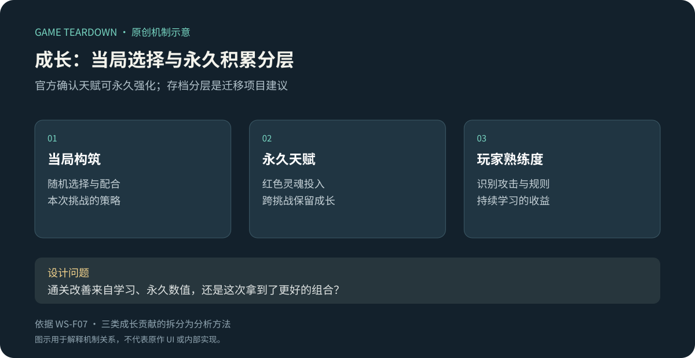
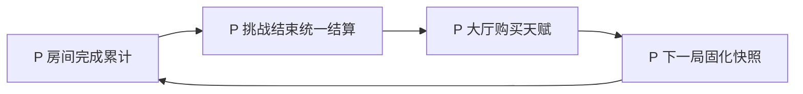

# 永久成长：给重试积累，但保留当局决策价值

> `warm-snow-progression` · Steam 本体 · 资料级研究。

**WS-F07**：官方说明可以消耗红色灵魂分配天赋树点数，永久加强能力。[Steam 产品页／不断重生制敌](https://store.steampowered.com/app/1296830/?l=schinese)。天赋使用的资源与叙事记忆碎片应区分，不采纳混写两者的评测描述。

原创分析图。永久天赋有官方依据；存档分层是建议，不是原作内部结构。图中不推断所有物品死亡后如何处理。

## 策划分析

永久成长可以让失败保留进展，但也会影响难度判断：通关改善可能来自熟练度、永久属性或更好的当局掉落。设计复盘应把三者拆开，否则容易用加数值掩盖不清楚的战斗反馈。

建议把增加能力上限与解锁选择分开衡量。前者可能降低重复尝试门槛，后者可能扩展构筑空间。当前没有核对全树节点，不能断言原作两者占比或最优加点。

## 开发与美术参考（建议）

永久档与当局档应有明确职责。天赋购买按“校验条件→扣资源→激活→保存”形成完整事务；重复输入、保存失败和版本迁移不能导致扣钱未生效。UI 应能解释可学／前置不足／资源不足／已学状态，并明确本次提升影响哪个层面。

## 验证与边界

测试同一玩家在固定构筑下的挑战表现，再比较不同永久成长档位，才能分辨学习与数值补偿。适合重复挑战；若游戏追求每局完全对等或极短完整流程，永久增益未必必要。

未知：天赋当前节点、总成本、返还／重置规则、失败结算资源保留条件。关联：[构筑](宗派与秘籍.md)、[章节](章节与首领.md)。

## 可开发参考规格 P · META v1

目标是验证“每次挑战留下可购买的永久选择”，以下资源名、节点、费用、失败收益都是 **P**。原作 WS-F07 只支持永久天赋的存在。采用[公共契约](../../_framework/参考实现公共契约.md)。范围为3节点单级天赋、结算与重置；不含原作全树。

### 数据与数值 P

`Profile{profileId,soul:int,learned:Set<nodeId>,revision}` 与 `Run{runId,profileSnapshot,earnedSoul,settled}` 分开。新档soul=0，无已学节点。每通过普通房间增加 earnedSoul=2，首领房间=5；存活通关与死亡均结算已完成房间累计值，未完成房间不产出。主动放弃也结算，防止用户因退出方式而失去已完成进展。

| 节点 | 费用 | 前置 | 效果 P |
|---|---:|---|---|
| life_1 | 5灵魂 | 无 | 下一局基础最大生命+10，开局满血 |
| supply_1 | 8灵魂 | life_1 | 下一局初始局内币+20 |
| choice_1 | 10灵魂 | life_1 | 下一局额外获得1次秘籍选择，在第一房间前结算 |

这些是设计样例名称。每节点maxRank=1；费用正整数；前置DAG无环；效果使用固定ID，禁止任意表达式脚本。资源上限为公共64位容量；超限发待领取记录。

### 规则与状态 P

| 规则 | 条件／动作 | 状态／反馈 |
|---|---|---|
| META-R01 | 房间成功首次结算 | earnedSoul累加；仅暂存本局，不立刻变成可花余额 |
| META-R02 | run结束且未结算 | 以runId为奖励去重键；全部earnedSoul到账，settled=true；显示本次与总余额 |
| META-R03 | 大厅且无进行中run→购买 | 校验前置、未学、余额；扣费用并激活同事务；失败无变化 |
| META-R04 | 创建run | 固化当前永久效果；之后本局只读快照，不动态随档案改变 |
| META-R05 | 大厅→重置 | 免费全量退还已购节点的实际支付额，清空已学；需二次确认；不得通过当前新价格倒算 |
| META-R06 | 购买或重置保存失败 | 整体回滚，UI保留旧余额与节点，不显示成功特效 |

状态为 `Locked→Available→Learned`，资源不足是Available的禁用原因；重置后按前置重新计算所有节点状态。不能通过点击Locked节点隐式购买所有前置。

### 接口、UI 与资产 P

`RecordRoomReward(runId,roomId,amount)` 仅关卡域调用；amount必须来自固定配置而非客户端。`SettleRun(runId,outcome)`、`LearnNode(nodeId)`、`ResetTree()` 分别返回奖励、节点快照和退款明细；事件 `ProfileProgressChanged` 只刷新大厅，下局创建时再次校验版本。

META-UI01 天赋树：锁定／余额不足／可学／已学四态＋前置连线；META-UI02 结算：房间来源、获得数、到账余额，待领取另列；META-UI03 重置弹窗：退款合计与“下一局生效”。需要3节点图标、4种框、连线亮暗、一次解锁音；不可用亮色单独表达已学。

### 验收 P（未运行）

| ID | 给定→操作→预期 | 追踪 |
|---|---|---|
| META-T01 | 完成2普通房、第三房死亡→结算→到账4；同run再结算仍4 | R01/02 |
| META-T02 | soul=5→买life→余额0且life已学；连续点击不负数 | R03 |
| META-T03 | soul=100且无life→买supply→LOCKED且余额不变 | R03 |
| META-T04 | 买life和supply共13→免费重置→退13且两节点消失 | R05 |
| META-T05 | run已创建→尝试学节点→拒绝；新局创建→对应效果仅应用一次 | R03/04 |

平衡观察失败后离下一目标还有几局、通关率是否被属性主导。免费重置降低试错成本但削弱长期消耗，这是本参考版本的明确取舍；若改成收费需另修规则和用例。原作是否允许重置仍为 U。
