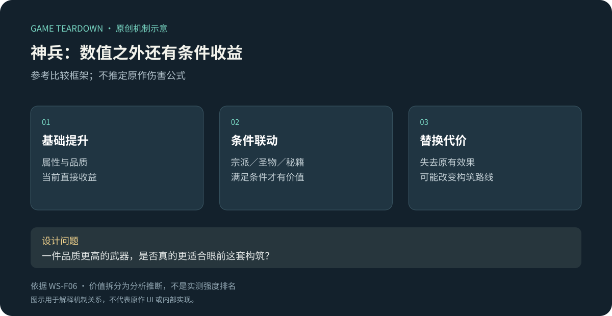
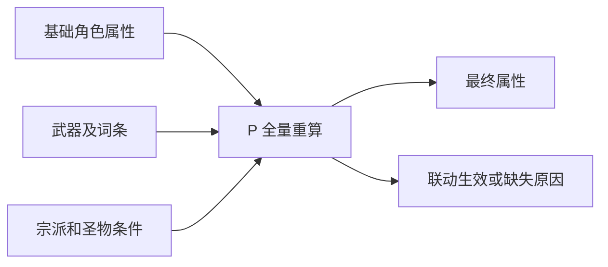

# 神兵词条：基础强度与条件协同并存

> `warm-snow-weapons` · Steam 本体 · 资料级研究。

**WS-F06**：神兵可以与特定宗派联动；2022 本体指南还按圣物联动、秘籍／特殊、宗派专属组织神兵。[官方介绍](https://store.steampowered.com/app/1296830/?l=schinese)、[原作者指南／神兵谱](https://steamcommunity.com/sharedfiles/filedetails/?id=2749004660&l=schinese)。不把指南分类宣称为游戏菜单分类。

原创分析图：基础提升与联动收益是比较框架，并非已验证的伤害公式。

## 设计取舍

武器比较不应只看品质。条件型收益可能在当前构筑中完全不触发，也可能打开新的玩法。可借鉴点是让一次掉落同时回答“现在是否更强”和“能否支持转型”。代价是玩家需要理解多个系统，否则容易把高品质等同于正确选择。

## 开发参考（建议）

定义基础属性、词条、条件效果、当前激活原因。重算时从基础配置生成最终结果，避免反复穿脱造成加成累积。测试应覆盖前置圣物移除、宗派条件不满足、换装后旧事件残留、保存与恢复。

## 美术与交互

建议对未满足的联动条件明确说明原因，并区分“可激活”和“已激活”。属性比较与玩法变化应分层呈现，不能让绿色箭头替代所有决策。原作实际是否有此提示待截图核验。

## 迁移与缺口

适合已有稳定战斗事件与装备替换节奏的游戏。首个原型只验证少量条件效果是否改变选择，不先堆满词条库。未知：当前词条池、品质层级、重铸概率和完整交易限制。预算取舍见 [商店与休整](商店与休整.md)，联动对象见 [圣物](圣物装配.md)。

## 可开发参考规格 P · WPN v1

目标：能比较、替换一把武器，并在宗派或圣物条件变化后正确解释联动。以下全为 P，按[公共契约](../../_framework/参考实现公共契约.md)执行。只做单武器槽与局内装备；不包含交易、强化继承、词条锁定和原作完整词库。

### 对象与配置 P

`WeaponInstance{instanceId,templateId,affixIds[],rollVersion}`，`WeaponSlot{instanceId|null}`，`EffectCondition{kind:sect|relic,refId}`。一个实例只在背包中保存一份；已装备标记从槽位引用派生。

| 配置 | 样例 P | 规则 |
|---|---|---|
| training_blade | 近战增伤1000基点；词条槽2 | 两槽效果从配置取，不重复随机叠加 |
| affix_edge | 近战增伤500基点 | 同实例不可重复；可和宗派加法汇总 |
| affix_vital | maxHp+10 | 卸下扣上限，当前HP夹至新上限；穿上不直接治疗 |
| synergy_blade | 条件sect_blade；飞剑增伤1000基点 | 条件不满足不生效，但描述仍展示 |

原型掉落固定 training_blade＋edge＋vital；重铸由 ECO 返回完整替换词条列表，不在本模块再次随机。未装备时无基础与联动效果。配置ID缺失禁止入房并返回INVALID，不悄悄当白板武器。

### 规则、状态与接口 P

| 规则 | 条件／动作 | 结果与可见反馈 |
|---|---|---|
| WPN-R01 | 非战斗且拥有实例→预览 | 展示基础、词条、联动三部分；不改变实际属性 |
| WPN-R02 | 确认替换 | 新槽位引用一次写入；旧武器保留背包、变未装备；按基础快照重算属性 |
| WPN-R03 | 宗派／圣物改变 | 重新逐项求条件，得到active/reason；禁止以旧最终值再次加成 |
| WPN-R04 | 卸下 | 槽位置null，基础拳击仍可用；从基础重新计算，HP按上限夹取 |
| WPN-R05 | 战斗中／目标不存在／背包版本过期 | 拒绝操作，不更换、不掉物；反馈LOCKED/NOT_FOUND/STALE |

状态 `Browsing→Previewing→Committing→Browsing`；返回取消预览；保存失败回Previewing、维持旧槽位。`PreviewEquip(instanceId)` 返回 `before,after,effects[{active,reason}]`；`Equip(instanceId,expectedRevision)` 返回完整 `LoadoutChanged` 事件。事件交给战斗快照和UI；原型战斗内禁止处理换装。

图为 P，不声称原作采用这种计算架构。

### UI／资产与验收 P

WPN-UI01：左右比较卡，分别列基础变化和联动变化，绿色数值之外显示“需sect_blade”；WPN-UI02：装备中、未装备、锁定角标；WPN-UI03：确认中的禁用按钮及保存失败重试。需要一把占位武器图、三种效果图标、条件满足／不满足双色加文字；成功一次轻音，失败不播放装备音。

| 测试 | 给定→操作→预期 | 追踪 |
|---|---|---|
| WPN-T01 | 无增伤角色→穿样例→近战增伤1500基点；穿脱10次仍如此 | R02/03 |
| WPN-T02 | 无blade宗派→预览→联动未激活并显示原因；换blade→飞剑+1000基点 | R03、UI01 |
| WPN-T03 | 当前110/max110→卸vital→100/100；再穿→100/110 | R04 |
| WPN-T04 | 换装保存失败→重进→仍为旧武器；两把实例都存在 | R02/05 |

用例未运行。调参先观察“条件满足的低基础武器”是否有可解释的选择理由；不要用单一综合战力替代联动说明。原作品质与概率仍为 U，此演示没有擅自补成原作数据。
