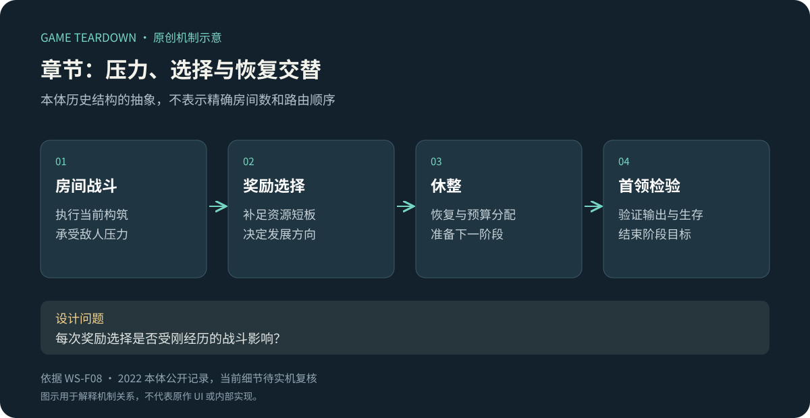
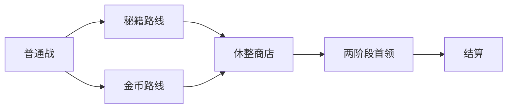

# 章节与首领：战斗、奖励、休整交替形成单局节奏

> `warm-snow-levels` · Steam 本体 · 历史资料级研究。

**WS-F08**：本体历史评测与指南记录房间清战、奖励路线、章节首领和休整区域组成的流程。不同章节具有不同敌人与场景主题。[原始评测／关卡](https://steamcommunity.com/id/chalmers_ming/recommended/1296830)、[本体指南／游戏流程](https://steamcommunity.com/sharedfiles/filedetails/?id=2749004660&l=schinese)。不沿用评测中符号计数笔误，不固定当前房间数量。

原创抽象图：表示研究到的节奏组成，不是全关卡地图。

## 策划分析

奖励路线把“接下来缺什么”转化成路径选择，首领则检验当前构筑。休整同时承担情绪缓冲和资源分配。如果每种奖励对玩家都同样有用，路线选择容易失去意义；如果某项资源长期必选，选择又可能变成形式。

关卡研究应比较进入房间前的计划、房间中实际压力、离开后的构筑变化。不能只按怪物血量定义难度，也要看攻击组合是否要求新的判断。

## 开发／美术参考（建议）

参考结构为章节→房间→遭遇→奖励节点，房间完成条件与出口解锁分开。验收关注最后一个敌人与召唤物的判定、重复结算、选择路径后恢复、首领死亡与玩家死亡同刻的规则。场景主题需要稳定的危险提示语言，不能每章换色后让玩家重新学习所有警示。

## 迁移与未知

适合需要阶段性构筑检验的动作肉鸽。首个可玩切片应能覆盖一次普通战、一次资源选择、一次休整和一次首领检验。未知：本体当前难度档位、首领阶段细则、路由生成权重、随机事件完整表。关联：[战斗](战斗.md)、[商店](商店与休整.md)、[叙事](叙事收集.md)。

## 可开发参考规格 P · LVL v1

实现一个5节点章节：起点普通战→二选一路线→休整→首领→结算。全部为 P 原型方案，不能当作原作关卡图；依赖[公共契约](../../_framework/参考实现公共契约.md)、COM战斗、BLD选择、ECO商店、META进度。

### 配置与实体 P

`RunRoute{runId,seed,currentNodeId,clearedNodeIds,chosenEdges,rewardIds,state}`；`Node{id,type,encounterId,reward,nextIds}`。图为有向无环图，只允许已声明的边，结束节点不可有后继。

| 节点 | 遭遇／交互 | 奖励／后继 P |
|---|---|---|
| n1 | 3个近战兵，每个40HP | 20局内币＋2灵魂累计；n2a或n2b |
| n2a | 4个近战兵 | 1次秘籍＋2灵魂累计；n3 |
| n2b | 2个近战兵＋1个远程兵 | 40局内币＋2灵魂累计；n3 |
| n3 | 无战斗，商店休整 | 无自动奖励；n4 |
| n4 | 单首领300HP | 60局内币＋5灵魂累计；end |
| end | 结算 | 通关，无后继 |

节点数按路径为5（n1、n2之一、n3、n4、end），图中总共6个节点。示例场地12×8m，实墙边界，玩家出生(2,4)，普通敌从(8,2)、(8,4)、(8,6)、(10,4)按表顺序选取，不叠出生点。

普通近战兵速度2m/s，距玩家≤1.2m停下并每1.5秒攻击：预警500ms，半径1.5m，10伤害。远程兵在距玩家4m外接近、到4m停止，每2秒锁定当前位置预警500ms后发8m/s直线弹，12伤害、不跟踪、不穿透。首领速度1.5m/s，近身同近战规则但伤害20；血量首次≤150立即进入二阶段，取消未发攻击，500ms转阶段无攻击但可受伤；此后攻击间隔1秒、伤害仍20。仅用于COM接口验证，寻路用场地直线避障，无复杂地形。

### 流程、规则与异常 P

| 规则 | 条件／动作 | 结果 |
|---|---|---|
| LVL-R01 | 进入战斗节点 | 固化入口状态，门锁定；敌方实体全部死亡且无待生成敌人后才清房 |
| LVL-R02 | 清房且玩家存活 | 生成该节点唯一rewardId并发奖；完成BLD待选后出口解锁 |
| LVL-R03 | 选择n2路线 | 展示奖励类别，不隐藏风险；提交chosenEdge并保存后进入，不能返回改选 |
| LVL-R04 | 首领首次hp≤150 | 转阶段仅一次；溢出伤害正常保留，若已≤0直接死亡，不转阶段复活 |
| LVL-R05 | 玩家死亡或主动放弃 | 当前未清房无奖励；run失败／放弃，META结算已完成累计；与首领同tick死亡仍失败 |
| LVL-R06 | 退出／崩溃重进 | 已完成节点不再发奖；未清节点从入口快照重开；已选路线保留 |

状态 `Entering→Fighting→Rewarding→ChoosingExit→Entering`；休整使用 `Resting→ChoosingExit`；终点 `Completed`，死亡 `Failed`。加载场地失败停在Entering可重试，不消耗路线和奖励。敌人卡住原型提供开发诊断，不以超时自动清房掩盖错误。

### 接口、UI 与验收 P

输入COM `RoomCombatEnded{outcome}`，必须关联battleId及nodeId；过期战斗结果忽略。输出 `GrantReward(rewardId,grants)`、`RecordRoomReward` 和 `StartRoom`。ECO只在Resting接受交易；BLD只有Rewarding中待选时阻断出口。

LVL-UI01：分支门显示“秘籍／金币”图标及固定敌群类型提示；LVL-UI02：战斗锁门、奖励待选、可离开三态；LVL-UI03：Boss阶段血条、阈值标记、500ms转阶段提示。制作1套训练场、门3态、近战/远程/首领3种占位轮廓与攻击预警；预警区域与实际伤害区域一致。

| ID | 给定→操作→预期 | 追踪 |
|---|---|---|
| LVL-T01 | 最后敌人死亡但玩家同tick死亡→门不解锁，本房不奖 | R01/02/05 |
| LVL-T02 | 已清n1并选a→重启→仍为a且n1金币不重复 | R03/06 |
| LVL-T03 | Boss160HP受20伤→140HP转阶段一次；再受伤不重进 | R04 |
| LVL-T04 | Boss160HP受200伤→直接死亡不触发阶段动画 | R04 |
| LVL-T05 | n2a待秘籍选择→点门→提示先选；选择成功才进入休整 | R02、UI02 |

用例未运行。路线取舍观察“金币缺口”与“构筑缺口”是否影响选择；本配置不保证两路线收益平衡。敌人AI与Boss样例是新增参考内容，不能写入原作事实标签。
