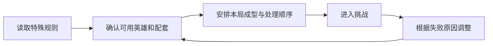
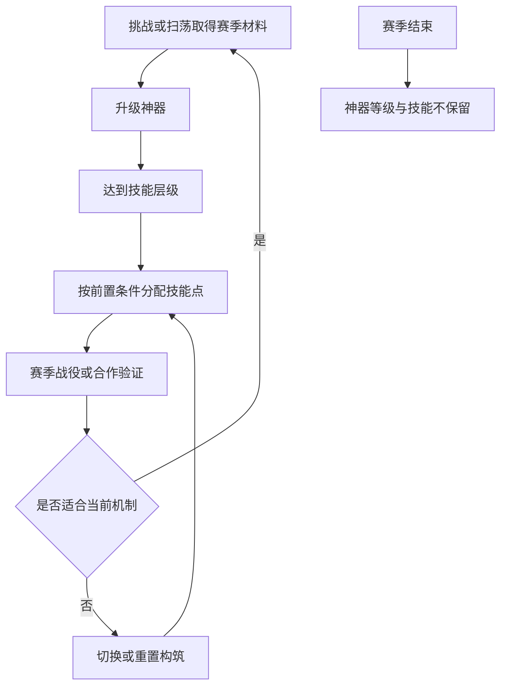

# 关卡、赛季与机制教学

永远的蔚蓝星球 · 手机 App · 内容框架 / 能力检验

**关卡的职责是提出一个值得解决的问题。** 若只增加敌人生命，玩家通常只需增加同一类输出；若改变击杀、召唤或控制条件，玩家才有理由重新理解自己的配置。

## 设计目的与功能

主线负责连续目标和基础能力检验，赛季内容可以重新组合规则与挑战。本文把关卡视为战斗系统的使用场景；具体开服阶段、开启条件与继承范围需要单独核对，不能从赛季名称猜测。

| 功能 | 玩家任务 | 设计作用 |
|---|---|---|
| 关卡选择 | 理解要面对的内容 | 将规则、奖励和进入条件一起呈现 |
| 威胁组合 | 应对不同敌人与机制 | 改变输出、控制和成型的相对价值 |
| 局内条件 | 在特殊限制或增益下决策 | 让熟悉的基础操作产生新问题 |
| 完成评价 | 理解通过与更高目标的差距 | 为复打提供具体方向 |
| 赛季组织 | 进入阶段性内容 | 创造重新配置的理由，避免把内容更新等同重置 |

## 三个关卡样本说明了什么

- S1 第 8—10 关玩家攻略分别讨论：石像鬼复活与召唤失败；怪物长期不受伤后的变化；法师击杀限制和一次召唤两个英雄。这些是攻略记录，不能直接作为所有 App 区服的当前配置表。[关卡资料](https://www.taptap.cn/moment/859430567714753123)

- **复活机制改变输出的时间要求。** 总伤害高未必够用，关键目标需要在条件发生前被处理。它把关注点从持续累计转向爆发窗口；如果没有清楚反馈复活来源，玩家却可能只理解为敌人“怎么都打不完”。

- **持续施加伤害的需求改变能力组合。** 当敌人长时间不受伤会变得更难处理时，覆盖与持续性就有价值。这提供了让不同伤害方式发挥作用的机会，而不只是比较同一目标上的伤害峰值。

- **击杀资格与双单位召唤同时考验准备和场面管理。** 前者要求战前配置有合适能力，后者让空位规划进入局内决策。这种组合能提高关卡差异，但也需要判断限制是否过硬：玩家如果尚未拥有可用工具，就不是“还没学会”，而是无法开始解决题目。



## S1：独立战役、赛季神器与重置边界

S1 App 公告把单人战役与普通主线分开：四个战区、40关，每关三档难度。每档首次通过给奖励，重打已通过难度不再给该奖励；扫荡则有独立产出。[S1 App 更新](https://www.taptap.cn/moment/843595257361730767?group_id=803344)

这两种收益承担不同职责：首通奖励鼓励尽早解决新问题，扫荡提供持续供给。若把重打无奖误写成整个赛季无重复收益，就解释不了玩家为何持续参与。

### 神器技能树：成长与选点分开

- 神器的属性和技能只在赛季单人战役、共战灭尊内生效，结束后不保留等级与技能。
- 等级达到节点后，还需要技能点激活；同层技能互斥，可切换；部分技能有前置要求。
- 预告明确提供免费重置。这里区分“当时披露的方案”和当前实际账号，不能据预告推断所有后续赛季规则。[官方神器说明，测试环境](https://www.wlxq.cn/article/417/)



这层成长的价值在于提供可逆试错。如果技能只增加伤害却要求大量不可回收材料，玩家就会更倾向等待唯一攻略；免费调整能把一部分成本从资源消耗转为理解与尝试。

### 关卡机制应改变哪一种决策

| 机制样本 | 原资料描述 | 玩家需要改变什么 | 教学应解释什么 |
|---|---|---|---|
| 空间宝石 | 拖动与英雄交换位置，有冷却 | 为相连能力或攻击距离调整位置 | 哪些格可换、何时可再次换 |
| 法老与木乃伊 | 法老彻底死亡后阻断木乃伊复活 | 优先处理复活源头 | 复活链的来源与终止条件 |
| 巨大英雄 | 击杀让英雄变大并增伤 | 让合适单位获得击杀机会 | 击杀归属与成长反馈 |

这些是[赛季战役预告样本](https://www.taptap.cn/moment/841069082835944939)，不作为现行逐关配置表。对设计的启发是把“敌人更强”拆成目标优先级、位置和成长分配三个可学习问题。

## 解锁、周期与玩家阶段

| 时钟 | 控制什么 | 容易出现的误读 |
|---|---|---|
| 账号进度 | 主线能力及部分玩法入口 | 高账号等级不等于服务器已开新内容 |
| 开服天数与跨服组 | 部分英雄、赛季的开放资格 | 同一天登录的两个服不一定有同样入口 |
| 赛季时间 | 战区开放、半程结算、结束与追赶 | 赛季剩余时间不等于从该玩家登录开始计算 |

S1 公告给出通常60天、上下半程各30天，并说明晚进入跨服组的加速开放与额外战役券追赶。分析后期节奏时应把追赶独立记录，不能用开服首批玩家的完整周期估算后来者成本。[赛季周期与追赶](https://www.taptap.cn/moment/843595257361730767?group_id=803344)

## UI 规则与教学

```ui-analysis
levels
```

这是补充的规则预览线框。完整原作关卡选择 UI 尚未核读，以下为设计建议。

| 信息 | 必须让玩家理解的内容 | 建议状态 |
|---|---|---|
| 特殊规则 | 哪条常规理解在本关发生变化 | 进入前可见，战斗中可再次查看 |
| 关键威胁 | 谁会复活、何时发生、如何应对 | 用敌人标记与反馈对应规则文字 |
| 进入条件 | 是否已解锁，资源是否够 | 未满足时明确具体原因 |
| 完成目标 | 通过与更高评价分别要求什么 | 结算时逐项对应，避免只有一个星数 |

教学应让规则第一次出现时有可观察的结果，再逐步叠加难点。如果特殊条件只放在长文本里，玩家很容易把机制失败误判为养成不足。

## 节奏与数值关系

机制变化和数值增长需要分开分析。前者改变解题方法，后者改变执行余量。若两者同时大幅提高，就很难判断玩家究竟缺哪一部分。对这类塔防，我更认可先让规则可理解，再收紧输出或资源条件的节奏。

## 我的评价与后续核查

- 这些样本提供了比单纯堆血量更丰富的配置检验，但不应把攻略里的反复重开直接视作理想体验。若最有效策略长期是重开直到随机有利，需要进一步检查随机性是否压过了可学习的决策。

- App 官方已发布 S1 开放与减负预告；其中未来项目不作为已上线功能。[官方说明](https://www.taptap.cn/moment/844263068358673457)。当前完整关卡配置和各服继承细则仍待核查；本轮已补S1神器重置的明确边界。

## 关联阅读

[战斗](../systems/召唤合成与战斗.md)、[英雄](../systems/英雄与永久成长.md)、[装备](../systems/装备图腾与洗炼.md)分别提供执行方式、能力与配套。
