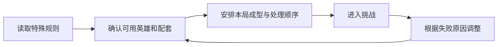

# 关卡、赛季与机制教学

永远的蔚蓝星球 · 手机 App · 内容框架 / 能力检验

**关卡的职责是提出一个值得解决的问题。** 若只增加敌人生命，玩家通常只需增加同一类输出；若改变击杀、召唤或控制条件，玩家才有理由重新理解自己的配置。

## 设计目的与功能

主线负责连续目标和基础能力检验，赛季内容可以重新组合规则与挑战。本文把关卡视为战斗系统的使用场景；具体开服阶段、开启条件与继承范围需要单独核对，不能从赛季名称猜测。

| 功能 | 玩家任务 | 设计作用 |
|---|---|---|
| 关卡选择 | 理解要面对的内容 | 将规则、奖励和进入条件一起呈现 |
| 威胁组合 | 应对不同敌人与机制 | 改变输出、控制和成型的相对价值 |
| 局内条件 | 在特殊限制或增益下决策 | 让熟悉的基础操作产生新问题 |
| 完成评价 | 理解通过与更高目标的差距 | 为复打提供具体方向 |
| 赛季组织 | 进入阶段性内容 | 创造重新配置的理由，避免把内容更新等同重置 |

## 三个关卡样本说明了什么

已核读的 S1 第 8—10 关玩家攻略分别讨论：石像鬼复活与召唤失败；怪物长期不受伤后的变化；法师击杀限制和一次召唤两个英雄。这些是攻略记录，不能直接作为所有 App 区服的当前配置表。[关卡资料](https://www.taptap.cn/moment/859430567714753123)

**复活机制改变输出的时间要求。** 总伤害高未必够用，关键目标需要在条件发生前被处理。它把关注点从持续累计转向爆发窗口；如果没有清楚反馈复活来源，玩家却可能只理解为敌人“怎么都打不完”。

**持续施加伤害的需求改变能力组合。** 当敌人长时间不受伤会变得更难处理时，覆盖与持续性就有价值。这提供了让不同伤害方式发挥作用的机会，而不只是比较同一目标上的伤害峰值。

**击杀资格与双单位召唤同时考验准备和场面管理。** 前者要求战前配置有合适能力，后者让空位规划进入局内决策。这种组合能提高关卡差异，但也需要判断限制是否过硬：玩家如果尚未拥有可用工具，就不是“还没学会”，而是无法开始解决题目。



## UI 规则与教学

```ui-analysis
levels
```

这是补充的规则预览线框。完整原作关卡选择 UI 尚未核读，以下为设计建议。

| 信息 | 必须让玩家理解的内容 | 建议状态 |
|---|---|---|
| 特殊规则 | 哪条常规理解在本关发生变化 | 进入前可见，战斗中可再次查看 |
| 关键威胁 | 谁会复活、何时发生、如何应对 | 用敌人标记与反馈对应规则文字 |
| 进入条件 | 是否已解锁，资源是否够 | 未满足时明确具体原因 |
| 完成目标 | 通过与更高评价分别要求什么 | 结算时逐项对应，避免只有一个星数 |

教学应让规则第一次出现时有可观察的结果，再逐步叠加难点。如果特殊条件只放在长文本里，玩家很容易把机制失败误判为养成不足。

## 节奏与数值关系

机制变化和数值增长需要分开分析。前者改变解题方法，后者改变执行余量。若两者同时大幅提高，就很难判断玩家究竟缺哪一部分。对这类塔防，我更认可先让规则可理解，再收紧输出或资源条件的节奏。

## 我的评价与后续核查

这些样本提供了比单纯堆血量更丰富的配置检验，但不应把攻略里的反复重开直接视作理想体验。若最有效策略长期是重开直到随机有利，需要进一步检查随机性是否压过了可学习的决策。

App 官方已发布 S1 开放与减负预告；其中未来项目不作为已上线功能。[官方说明](https://www.taptap.cn/moment/844263068358673457)。当前完整关卡表、评价条件及赛季继承规则仍待核查。

## 关联阅读

[战斗](../systems/召唤合成与战斗.md)、[英雄](../systems/英雄与永久成长.md)、[装备](../systems/装备图腾与洗炼.md)分别提供执行方式、能力与配套。
