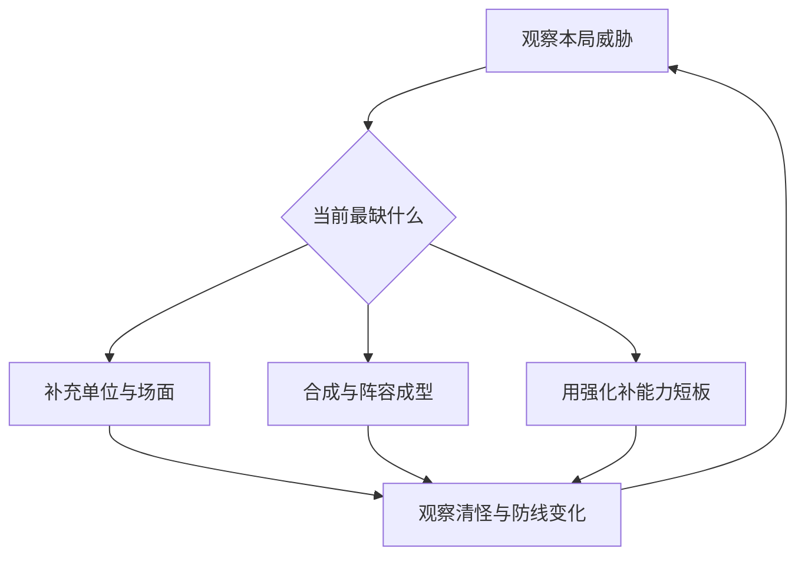

# 召唤、合成与局内强化

永远的蔚蓝星球 · 手机 App · 核心玩法 / 战斗

**这一系统要解决的问题：让玩家在不完全可控的条件下，持续组织一条能应对当前威胁的防线。** 我认为它的设计价值，在于把“获得单位”与“决定如何使用单位”安排在同一局里。随机结果提供问题，合成和强化提供调整手段。

## 设计目的与系统边界

战斗承担最直接的能力验证：英雄配置是否合适，养成是否足够，临场选择是否有效。局外英雄等级与装备属于进入战斗的条件；局内单位星级、场面和强化属于本局变化。阅读时需要分清这两种成长，否则容易把永久培养与合成升星混为一谈。

官方介绍明确列出随机召唤、技能搭配与合成进化。[玩法依据](https://www.taptap.cn/app/713683)。具体随机权重、完整合成限制与所有模式的资源规则，本次没有得到同一版本的完整规则面板。

## 系统功能：四件事形成一个决策过程

| 功能 | 玩家在做什么 | 我关注的设计问题 |
|---|---|---|
| 召唤 | 把可用的局内资源变成场上单位 | 新单位能否改善当前短板，玩家是否还能补救随机结果？ |
| 合成 | 调整场上单位，追求更高星级与新的能力组合 | 收益是否足以补偿当下场面的变化？ |
| 强化选择 | 在本局提供的选项中确定方向 | 选项是在改变打法，还是只有数值大小的差异？ |
| 威胁处理 | 观察敌人、防线与技能表现，再调整 | 玩家能否读出危险来自哪里，并及时行动？ |



这是决策示意，不是原作的代码执行顺序。三种行动并不保证随时可用，实际操作要受资源、场上条件与强化出现时机约束。

## 规则与策略：为什么“更高星”不应成为唯一答案

合成首先改变场面，再带来收益。我的分析方法是比较合成前后的整条防线，而不只比较一个单位的面板：是否失去正在承担清怪任务的单位？是否减少关键效果覆盖？高星单位的收益能否及时生效？这些问题能解释为什么相同操作在安全波次和危险波次可能有不同价值。

一个具体的历史样本来自竞技场玩家攻略：作者对闪电之子的场上数量、相邻关系与剑圣的星级提出了不同侧重。这说明至少在该攻略讨论的配置里，英雄并不共享同一种培养目标。[2025-07-16 玩家攻略](https://www.taptap.cn/moment/694655628546670613)。不能据此把推荐阵容定为当前最优，但可以据此建立分析视角：**有的能力依赖数量，有的依赖单体质量，有的依赖连接关系。**

对于随机性，我会分别记录随机发生的位置、玩家提前知道多少、出现不理想结果后能做什么。如果只有结果随机而没有补救动作，失败更容易被归因于运气；如果每种结果都能通过不同操作转化为可用条件，重复开局才有学习空间。

## UI 分析：把危险与可操作对象放在一起读

```ui-analysis
combat
```

上图是为分析整理的功能线框，**不是原作界面复刻**。目前已查看的原图不足以确认完整战斗 HUD，因此下面列的是补充设计建议，不能作为原作已有功能。

| 区域 | 应表达的信息 | 交互与状态建议 |
|---|---|---|
| ① 战况 | 当前波次、防线状态与主要危险 | 危险变化持续可见；不要只用瞬时飘字表达失败原因 |
| ② 战场 | 敌人类型、位置与技能作用范围 | 优先保证关键威胁可辨识，特效不能长期遮住危险对象 |
| ③ 阵列 | 单位身份、星级和可合成关系 | 选中时说明合法目标；无效操作告诉玩家缺少什么条件 |
| ④ 决策区 | 召唤成本、当前资源、强化选项 | 资源不足时保留成本；选项写出效果对象和条件 |

强化选项的文字应回答“改了谁、改了什么、何时生效”。例如“提高伤害”信息不足；若是限定某英雄、某星级或某种敌人，就需要在选择时看见。具体表现可以简洁，但关键条件不能藏在另一个页面里。

## 数值关系与阶段变化

前期重要的是建立能工作的场面；成型阶段重要的是让关键能力尽早进入循环；后期重要的是维持阵型和覆盖主要威胁。这是对单局过程的分析划分，不代表原作固定的波次分段。

评估收益时至少同时记录“能力多大”与“何时生效”。一次较晚到来的高收益，可能无法挽回前面已经失去的防线。还要区分总伤害与有效伤害：打在已经必死的小怪上的溢出，不等于处理了真正威胁。这些指标比单独累计合成次数更有解释力。

## 我的评价与迁移条件

值得借鉴的是让相同基础操作服务不同英雄目标。它能在较少操作类型下产生组合深度。但前提是英雄差异可读、合成后果可解释、危险来临前有决策窗口。若自己的项目只需轻度放置体验，过多阵型和条件规则反而可能增加负担。

下一轮实机应录下完整的一胜一败，逐次标注召唤、合成、强化、危险变化与失败原因。只有这样，才能判断这里描述的决策空间在真实操作中有多大。

## 关联阅读

[英雄成长](../systems/英雄与永久成长.md)决定带入能力；[装备与图腾](../systems/装备图腾与洗炼.md)改变条件收益；[竞技场](../systems/竞技场.md)与[合作](../systems/合作准备与挑战.md)改变战斗目标。
