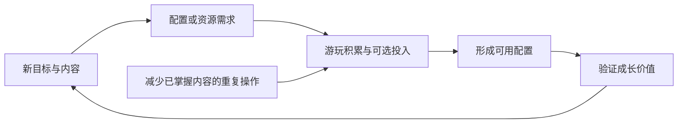

# 商业化与运营减负

永远的蔚蓝星球 · 手机 App · 持续运营 / 付费价值与时间分配

我会从三个问题分析商业化：**购买改变了什么，改变在哪些玩法中被感知，以及不购买时玩家需要经历怎样的过程。** 只列礼包、卡类和皮肤，无法回答这些问题。

## 设计目的与已知内容

这款产品持续更新英雄、活动与赛季，需要不断组织成长目标和参与节奏。本文只对有依据的商业化关系作分析，不以行业常见做法补齐当前商城。

| 内容 | 资料支持 | 对体验的影响分析 |
|---|---|---|
| 英雄皮肤 | 历史公告存在属性与技能效果 | 外观选择也可能影响配置条件 |
| 合作特权 | 历史周卡调整涉及次数和身份奖励 | 改变重复参与的资源效率 |
| 参与资源兑换 | App 公告提到竞技扫荡券不足时的购买入口 | 将重复挑战与资源消耗连接 |
| 活动与赛季 | 官方持续发布版本与内容说明 | 给旧账号提供新目标，同时增加维护负担 |

依据分别来自[2025-06-21 更新](https://www.taptap.cn/moment/685667018652778832)、[2026-03-05 App 更新](https://www.taptap.cn/moment/778714788971675862)。当前价格、购买上限、广告入口与礼包全量清单仍待 App 内核实。

## 功能性外观怎样改变设计评价

- 纯视觉外观的核心比较是偏好和表现质量；带有能力变化的外观，还会进入打法成本与强度比较。在这种情况下，角色攻略如果只写英雄名，会遗漏配置成立的必要条件。

- 资料库应在分析中明确“这个效果来自哪里”。英雄基础技能、成长节点、装备与皮肤的贡献不能混在一起，否则迁移设计时容易误以为基础英雄就拥有完整表现。

## 效率付费与重复劳动

- 效率类价值通常发生在多次参与后，一次战斗的比较不足以说明差异。分析需要使用同一目标：为了得到同样的资源或培养结果，不同路径各需要多少次数、时间和投入。本次没有完整采样，因此不计算付费效率倍数。

- 设计上的风险是把本来可以统一优化的重复操作，转化为持续的付费理由。是否存在这种情况需要实测，不能从“有特权”直接推断。更合理的评价方式，是区分仍有选择价值的重复与已经没有选择的机械操作。



## UI 与补充线框

```ui-analysis
liveops
```

线框是信息设计建议，未复刻原作商城。

| 区域 | 应说明什么 | 状态建议 |
|---|---|---|
| 权益说明 | 即时得到、周期领取、特殊能力分别是什么 | 避免用一个总价值数字掩盖条件 |
| 有效期 | 何时开始、何时结束、领取条件 | 到期与已领取状态分别显示 |
| 价格与限制 | 当前价格、限购、适用范围 | 确认前可见，不默认续购 |
| 结果与生效 | 已获得资源、已生效权益 | 失败或处理中不能伪装成成功 |

## 减负的作用与版本边界

- 官方 S1 说明讨论了合作、招募、竞技和公会等内容的减负，并明确区分已完成与计划项。[官方计划](https://www.taptap.cn/moment/844263068358673457)。这份资料可以证明运营关注重复耗时，不能证明所有预告功能已实际生效。

- 减负的价值是重新分配玩家时间：已掌握内容减少操作，新内容保留理解和尝试。若一次登录仍被领取、等待和维护占满，单局战斗再短，也不能形成轻量体验。

## 我的评价与迁移条件

- 持续运营产品可以从这里学习如何把不同成长目标连接起来，但不能把它直接当成单机游戏的商业模板。买断游戏更需要说明本体完成度、内容边界和扩展价值；这款 App 的分析重点则是长期效率与配置差异。

- 没有收入、留存和付费分布数据，本篇不宣称某项机制已被证明能提高商业成绩。可借鉴之处和代价应从具体玩家行为讨论，再用数据验证。

## 关联阅读

[招募](../systems/招募与重复转化.md)、[英雄](../systems/英雄与永久成长.md)与[合作](../systems/合作准备与挑战.md)分别说明获取、养成和权益兑现的位置。
