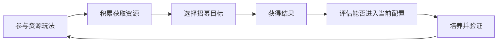

# 招募与角色获取

永远的蔚蓝星球 · 手机 App · 获取 / 长期目标

**招募把玩法所得转化为获得新能力的期待。** 对玩家而言，关键不是抽取动画有多长，而是这次获得能否接近一个可用的阵容目标，以及没有抽到目标时是否仍能理解自己的进度。

## 设计目的与证据范围

当前可确认的资源关系是：历史竞技场资料把招募券列为玩法收益之一；官方运营说明还提到星愿招募及减少动画等待的计划。[竞技场资源说明](https://www.taptap.cn/moment/694655628546670613)、[官方减负预告](https://www.taptap.cn/moment/844263068358673457)

这些资料支持“玩法参与连接角色获取”这一关系，但不足以还原全部卡池、概率、保底和重复转化。本页将其作为明确的研究边界，避免用常见抽卡规则填充原作。

## 功能框架

| 功能 | 玩家需要知道什么 | 当前分析边界 |
|---|---|---|
| 获取入口 | 当前有哪些招募目标与参与条件 | 星愿等入口有资料线索，完整入口列表待核 |
| 资源投入 | 消耗什么、资源从何而来 | 玩法奖励与招募券的关联有依据 |
| 结果表达 | 获得什么，对当前阵容有何用 | 具体结果布局待原图核读 |
| 重复获取 | 重复对象怎样处理 | 原作换算、上限与溢出未核实 |
| 目标进度 | 距离可用状态还差什么 | 不预设原作存在某种保底或里程碑 |



图中是设计关系，其中结果处理的具体规则仍待原作面板补证。

## 为什么要把“获得”与“可用”分开

英雄页的成长节点说明，角色价值可能取决于后续培养。因此招募不能只以新角色展示结束：如果玩家抽到目标后仍需投入才能使用关键功能，资料分析需要把这一段成本纳入。

另一个问题是资源使用时机。若获取资源同时参与阶段性活动，玩家可能需要在即时改善配置和等待更高综合收益之间取舍。本次没有确认各区服当前活动规则，所以这只是需要验证的关系，不能写成统一的囤券攻略。

## UI 与补充设计

```ui-analysis
recruitment
```

这是建议线框，不是原作复刻。

| 信息 | 设计建议 | 不应遗漏的情况 |
|---|---|---|
| 招募目标与时间 | 明确对象、范围和结束条件 | 不同入口不能共用含糊的概率说明 |
| 成本与结果范围 | 确认前展示消耗、规则入口 | 免费次数与付费消耗要能区分 |
| 结果页 | 分开标注新获得与已有对象 | 重复转化要展示实际去向 |
| 培养衔接 | 展示当前功能和下一目标 | 获得不等于已解锁完整能力 |

若需要实现一个可开发参考版本，概率、重复处理和异常重试必须有明确规格。原有参考附录保留了这样的补充方案，但不能用来回答原作到底如何抽取。

## 数值与设计评价

评价获取难度需要概率、保底、兑换和资源产出共同参与，单独知道某个稀有度概率并不足够。评价获取价值则需要考虑重复结果的用途与形成可用配置的总投入。

我认为这个系统应优先做到结果可解释和目标可规划。只有把完整成本讲清楚，玩家才能判断是否值得继续投入。当前证据尚不足以计算期望抽数或免费玩家毕业周期，本页因此不提供这些看似精确的结论。

## 关联阅读

[英雄成长](../systems/英雄与永久成长.md)解释获得之后的培养；[竞技场](../systems/竞技场.md)提供资源关联；[商业化](../systems/商业化与运营减负.md)讨论效率与付费。
