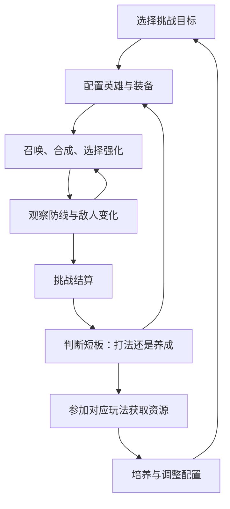
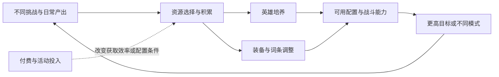

# 永远的蔚蓝星球

手机 App · 随机合成塔防 · 游戏分析样稿 · 2026 年 10 月 16 日

这款游戏的设计重点是：**用每局重新组建防线的变化，承接长期培养一支队伍的投入。** 玩家一方面期待这局能合出理想阵容，另一方面又知道，局外培养会改变下次开局的条件。这两种期待相互支持，也存在冲突：如果长期数值压过了局内选择，合成就容易退化成等待胜负揭晓的操作。

本文从公开的 App 资料分析这套关系。文中的体验判断是我的分析；有日期的规则例子保留其版本背景，尚未进行当前版本的完整实机流程测试。

## 01 产品与项目介绍

| 项目 | 内容 |
|---|---|
| 产品名 | 永远的蔚蓝星球 |
| 本次研究平台 | 手机 App；商店提供 Android、iOS 入口，微信小游戏不纳入本篇规则范围 |
| 上线与版本 | TapTap 登记上线日期 2025-05-28；Android 商店版本 3.0.7（66），2026-09-29 更新 |
| 厂商信息 | 创悦游戏；供应商为海南创悦网络科技有限公司 |
| 类型 | 竖屏塔防，以随机召唤、合成、局内强化和局外养成为主要组成 |
| 游玩与经营方式 | 单人推关、合作挑战、竞技；内购与持续版本运营 |

登记信息来自[官方商店](https://www.taptap.cn/app/713683)，不等同于各区服的热更新状态。

### 玩法描述

玩家按“准备—战斗—调整—再挑战”的顺序推进：

1. **战前准备：** 根据目标选择英雄和养成配置。

2. **组织防线：** 通过召唤、合成与强化建立场面，随机结果会不断改变可用条件。

3. **临场调整：** 判断当前缺输出、控制还是成型速度，再决定继续召唤、合成或保留单位。

4. **局外积累：** 将不同玩法的收益投入培养，为下一轮挑战做准备。

- 这意味着，评价它不能只看“合成是否爽快”。还要看玩家能否解释自己为何失败，以及失败后是否有两条可行路径：改打法，或带着清楚的目标补养成。若失败只能导向加数值，局内的策略空间就会被压缩。

### 美术风格与游戏元素

- **美术风格：** 合作准备界面中，角色比例夸张、轮廓圆润；饱和色块、描边与光效区分前后层级，使奇幻敌人显得更亲近。参考[合作公告原图](https://www.taptap.cn/moment/778714788971675862)。

- **画面层级：** 首领居中，参与者和操作按钮依次位于下方，形成“挑战谁—谁来打—怎么开始”的阅读顺序，适合竖屏快速识别。

- 游戏元素可以分为三组理解：英雄、怪物和防线组成战斗场景；合成、随机强化和职业搭配制造局内变化；装备、招募、领地与社交玩法提供长期目标。美术和特效承担反馈任务，但仅凭宣传素材，不能判断高密度战斗中的实际可读性。

### 核心亮点

- **随机合成：把成长做成一个即时选择。** 合成会同时改变单位数量与单位能力，因此“现在合不合”可以成为有代价的决定。我的关注点是这项代价是否能被读懂：玩家应能看到保留当前火力的价值，也能理解追求更高星级的收益。只有结果与选择之间能建立联系，随机性才更容易让人想再试一次。

- **轻度 Roguelike：用局内条件改变养成配置的用法。** 局外决定带着哪些能力进入战斗，局内强化决定本局放大哪一部分。它有机会让同一个英雄组合产生不同打法；但如果强化选项长期只有一个明显最优解，三选一的形式本身并不会创造策略。值得观察的是：面对不同敌人、不同场上阵型，玩家会不会改变优先级。

- **同一套战斗，承接不同的检验目标。** 主线可以检验配置能否处理指定威胁；竞技把清怪速度转化为对抗压力；合作让准备、沟通和双方配置进入决策。对内容制作而言，这能复用英雄与战斗资产；对玩家而言，关键是切换玩法后确实需要重新考虑阵容，而非重复同一种操作。

- **长期培养能改变局内过程。** 部分成长节点改变技能与成型方式，值得单独分析，而不能全部归入“攻击力提升”。例如角色是否更早获得功能、关键组合是否更容易启动，都会改变玩家对一局战斗的规划。具体样本见[英雄与永久成长](../systems/英雄与永久成长.md)。

### 市面参考数据

- 截至本次查看，TapTap 展示 **8.0 分、10,047 条评价、约 75 万下载、约 58 万关注**。这些是单个平台公开计数，下载与关注均为页面取整值；可以用来判断其在该社区已有一定讨论与触达规模，不能换算为总用户、活跃人数或收入。[数据来源](https://www.taptap.cn/app/713683)

- 目前没有在本次研究中取得可核验的 App 流水、买量成本或留存数据，因此不对商业成绩作数值推断。对于设计借鉴，我更看重规则能否形成有效选择，而不是先用“爆款”给所有设计背书。

## 02 核心循环：玩家为什么继续下一局



**小循环是局内修正，中循环是挑战与复盘，大循环是资源获取与长期培养。** 其中最重要的一步是“判断短板”：它把失败转化为下一次行动。如果游戏只展示战力差距，玩家就很难学会怎样调整。

### 前期：一次通关带来下一个明确目标

玩家首先学习召唤、合成与守住防线，反馈应尽量短：看见新单位、完成一次合成、通过一关。此时扩充内容的价值在于提供新能力和新目标。前期需要先让玩家理解自己的操作有作用，再逐步引入局外消耗；过早展示大量养成入口，会让失败原因变得难以判断。

### 中期：卡点把资源玩法连接起来

当一套阵容不足以处理所有挑战时，循环会从“继续下一关”变成“找出缺口—选择资源玩法—调整配置—回来验证”。这里的结构依据是矿场、竞技和合作分别连接不同资源需求，详见[领地与资源](../systems/领地资源与收集.md)。这时解锁玩法的意义应是新增一条解决问题的路径，而不只是增加每日任务数量。

### 后期：效率、适配和阶段目标替代连续解锁

我把后期理解为核心功能已熟悉、已有主力配置之后的阶段，而非固定开服天数。玩家会更关注同样投入怎样获得更高挑战效率、旧配置能否适应新规则，以及是否值得培养新的组合。赛季与活动能够提供重新规划的理由；但名称里有“赛季”不意味着养成全部重置。本篇不据此推断重置范围。

## 03 游戏节奏：每一阶段究竟在忙什么

| 阶段 | 玩家核心内容 | 主要决策 | 希望得到的反馈 | 主要风险 |
|---|---|---|---|---|
| 学习与解锁期 | 理解召唤、合成，建立首套可用配置 | 先补场面还是尝试合成；培养谁 | 一次操作能看见结果，新功能用途清楚 | 解锁过密，玩家照红点操作却不理解 |
| 配置成型期 | 针对卡点调整英雄、装备和词条 | 缺什么资源，去哪种玩法获取 | 调整后能解释改善在哪里 | 所有卡点最终都只能等资源或付费 |
| 深度优化期 | 模式专用配置、挑战目标与版本适配 | 即期收益与长期培养如何分配 | 有值得验证的新组合，旧投入仍有用途 | 日常重复挤压尝试新内容的时间 |

以上是按玩家能力与目标划分的分析阶段，不是原作的解锁日历。官方宣传中的“三分钟一局”也不等于日常总时长：组队、养成整理、领取和多模式挑战都占用时间。官方已经专门讨论重复玩法与等待的减负，说明分析节奏需要把这些操作一起纳入。[官方减负计划](https://www.taptap.cn/moment/844263068358673457)

## 04 商业化设计：付费改变了什么

- 这款 App 应按持续运营的内购产品分析。当前资料支持讨论的重点是**成长效率、功能性外观和重复挑战的便利性**；没有把“只卖本体／出售 DLC”的买断框架套在它身上。具体价格、当期礼包和广告入口尚未完成 App 内核验。

- **外观与强度存在联系。** 历史公告中的英雄皮肤包含属性和技能变化，因此研究皮肤时需要同时讨论收藏吸引力与战斗影响。若皮肤改变关键技能，玩家比较的就不只是外观喜好，还包括一个打法的完整成本。要评价这种设计，需要对比有无皮肤时的成型条件，而不能只看面板战力。

- **特权作用于资源获取过程。** 合作周卡的历史改动涉及奖励与次数。它让付费价值进入重复游玩的效率，而不仅是一次性赠送资源。我会追问：同样的养成目标，普通玩家需要多做哪些操作、花多久？这比罗列商城栏目更能说明商业化与体验的关系。[历史商业化依据](https://www.taptap.cn/moment/685667018652778832)

- **运营需要协调新内容与旧负担。** 新角色、活动和赛季持续提供目标，同时也容易堆积必做事项。减负设计的价值在于把时间还给有选择的内容。不过预告中的优化必须等后续公告或实机确认，不能直接记为已上线。详细讨论见[商业化与运营](../systems/商业化与运营减负.md)。

## 05 系统地图

下面按设计职责组织，而非照搬游戏菜单。每个模块都可点击，进入目的、功能、流程、UI 和设计评价；同一系统可能服务多个循环。重点展开战斗、装备、竞技与合作，其余模块保留独立分析。

```system-map
blue-planet-app
```

- **阅读关系：** 战斗是能力验证场；英雄、装备与招募决定可用配置；关卡与多人玩法提出不同题目；领地与社交组织资源和参与方式；商业化、活动与减负贯穿整个过程。

- 国王、披风、城墙机关已在相关资料中出现，本版纳入成长和装备模块说明；背包、完整教学、设置及遗迹的独立规则仍待补证。地图覆盖当前有依据的分析范围，不宣称已盘点所有服务器的全部菜单。

## 06 数值框架：成长怎样转化为过关能力

数值可以分为五层，每一层解决不同问题。

| 层次 | 主要内容 | 需要回答的问题 |
|---|---|---|
| 战斗基础 | 攻击、攻击频率、目标数量、控制与防线承受能力 | 面对这一类敌人，实际能清掉多少威胁？ |
| 局内成长 | 场上单位、星级、强化与阵型关系 | 什么时候成型，成型前如何过渡？ |
| 永久成长 | 英雄等级、技能节点、装备与条件词条 | 投入增加数值，还是改变可用行为？ |
| 资源经济 | 金币、招募券、装备材料、参与次数 | 哪项资源限制下一步，来源与消耗是否匹配？ |
| 内容检验 | 敌人机制、关卡条件、对手压力与合作要求 | 是能力不足、搭配不对，还是执行失误？ |

### 养成深度：纵向增长与横向适配叠加

- 纵向增长提高同一配置的能力，横向适配让玩家为不同挑战准备不同方案。装备词条的条件性、英雄功能节点和多人玩法规则，会让两者交织。较深的养成不应仅由等级上限证明，还要看玩家为了理解、完成和维护一套配置，需要掌握多少关联关系。

- 一个实际可用的分析顺序是：先确认本局的主要失败来源，再找相关能力，最后追溯它的养成入口。比如首领处理过慢，未必意味着所有攻击属性都同样有用；专属增益是否触发、关键英雄何时上场、控制能否争取输出时间，都可能改变结论。

### 资源框架：产出、消耗与回流



这是一张结构分析图，箭头不表示固定兑换率。资源数量、产出周期与成长成本必须在同一版本下采集，才能讨论每天推进多少、哪一步会形成瓶颈。

### 一个数值判断示例：条件增益不能直接相加

- 装备资料里出现了按目标状态、职业或防线状态生效的词条。分析时应先判断覆盖率，再比较面板幅度。**假设某个补充示例提供 20% 增伤，实际只覆盖 40% 的基础伤害，则在其他条件不变、无溢出且独立生效的简化条件下，总伤害提升约为 8%。** 这只是说明分析方法的自设例子，不是原作词条或伤害公式。

- 实战中，伤害时点还会影响击杀、资源到手和下一次召唤。即使总伤害相同，更早清掉危险单位也可能更有价值。因此本版不把一个统一系数套到所有英雄和模式上；具体词条讨论见[装备分析](../systems/装备图腾与洗炼.md)。

## 07 我的设计判断

- 这套结构最值得借鉴的地方，是让局外投入在局内以不同方式被验证。英雄培养提供可用工具，随机过程迫使玩家临场调整，不同模式再改变工具的价值。若要迁移到自己的项目，我会先做出“同一配置面对两种威胁，需要不同操作”的小样，再扩充养成层数。

- 我最担心的则是解释成本：随机结果、成长差距、条件词条和关卡限制同时作用时，玩家可能不知道输在哪里。继续添加系统容易，帮助玩家读懂失败更难。战前规则提示、成长节点说明与战后信息，需要和内容量一起增长。

- 第二个风险是时间负担。短局战斗只能说明一次入口轻，不能证明整个产品轻。扫荡和快捷功能如果能减少已经掌握的重复劳动，才会给新内容留出空间。判断减负是否有效，应记录完整一次登录的行为，而不是只测战斗计时。

## 08 来源与版本说明

资料核读日期：2026-10-16。主要依据为官方商店、明确面向 App 的公告和官方刊载的玩家攻略；玩家的推荐排序不作为官方结论。

- [产品信息与市场计数](https://www.taptap.cn/app/713683)
- [App 合作准备与竞技场调整，2026-03-05](https://www.taptap.cn/moment/778714788971675862)
- [战斗、社交与养成历史调整，2025-06-10](https://www.taptap.cn/moment/681511296339807133)
- [皮肤、合作特权与资源回收，2025-06-21](https://www.taptap.cn/moment/685667018652778832)
- [领地资源攻略，2025-05-28](https://www.taptap.cn/moment/676741667339897316)
- [竞技场玩家分析，2025-07-16](https://www.taptap.cn/moment/694655628546670613)
- [靴子图腾攻略，2025-12-29](https://www.taptap.cn/moment/754639971863759829)
- [洛姬档案，访问时页面显示相对更新时间](https://www.taptap.cn/moment/859896537528926567)
- [S1 关卡分析，访问时页面显示相对时间](https://www.taptap.cn/moment/859430567714753123)
- [App S1 与减负预告，页面标注 09/02](https://www.taptap.cn/moment/844263068358673457)

当前尚缺同一 App 构建下的完整新手流程、当前商城与概率说明、连续养成成本采样。它们影响节奏和付费效率的量化结论，不妨碍先讨论已知系统之间的关系。
