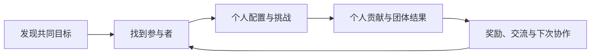

# 好友、公会与排行榜

永远的蔚蓝星球 · 手机 App · 社交 / 共同目标与比较

社交系统在这里承担两类不同职责：**帮助玩家找到合作对象，以及让个人成长在其他玩家面前有意义。** 前者重在降低协调成本，后者重在比较和共同成果，不能用一个“提高活跃”的目标代替具体设计。

## 系统目的与功能

历史官方更新记录了好友、聊天、公会首领与排行榜的改动；领地攻略也展示过按不同玩法进度划分的榜单。[公会与交流调整](https://www.taptap.cn/moment/681511296339807133)、[领地榜单资料](https://www.taptap.cn/moment/676741667339897316)

| 功能 | 解决的问题 | 设计分析 |
|---|---|---|
| 好友与交流 | 如何再次联系合适的参与者 | 稳定关系降低每次找人的成本 |
| 组队信息 | 如何判断是否能参加 | 邀请与玩法条件需要一致，避免无效打扰 |
| 公会首领 | 如何让个人参与连接共同目标 | 个人贡献、团体结果与奖励要能相互解释 |
| 排行榜 | 如何展示成长与比较 | 不同维度允许玩家看到不同类型的成就 |
| 消息和奖励提示 | 如何知道现在需要回应什么 | 有用信息与重复提醒需要分开 |

## 团体目标怎样影响个人行为

公会首领的历史公告把伤害贡献与宝箱收益联系起来，也调整过次数和奖励。[公告依据](https://www.taptap.cn/moment/681511296339807133)。这让一次战斗同时有个人发挥和团体产出的意义。但贡献比较也有代价：如果只展示最高伤害，较弱成员可能看不到自己的作用。

我的分析是，团体玩法应同时回答“我做了什么”和“大家因此得到什么”。这并不要求每个玩家贡献完全相同，而是要求贡献有可理解的路径。奖励差异若只在结算末尾出现，就容易让成员以为参与只是替强者完成目标。



## UI 与信息组织

```ui-analysis
social
```

完整原图不足，线框与下表是补充设计建议。

| 区域 | 信息 | 交互建议 |
|---|---|---|
| 目标区 | 当前共同目标、剩余时间、参与条件 | 明确“能参加”和“已完成”的区别 |
| 贡献区 | 我的贡献、团体进度、奖励规则 | 让个人位置始终容易找到 |
| 关系区 | 成员、好友与邀请 | 邀请前能理解目标与要求 |
| 比较区 | 榜单维度、统计范围、更新时间 | 切换榜单后保留清楚的比较口径 |

排行榜最重要的是“在比什么”。主线推进、挑战层数和竞技表现的含义不同，统一显示一个名次会丢失上下文。对于未上榜玩家，也应说明自己的成绩与下一目标，而不只展示头部名单。

## 节奏与评价

稳定的合作关系能降低反复找人的摩擦，团体目标能为个人培养增加用途。相应风险是固定时段和参与要求给玩家带来义务感。设计不能只观察参与人数，还应观察无效邀请、等待、错过后的损失和成员间的贡献差异。

本篇没有推断当前公会匹配、奖励分配完整公式或缺席惩罚。若迁移到小规模产品，我会先让好友邀请和共同目标形成闭环，再决定是否需要完整公会等级与多榜单体系。

## 关联阅读

[合作准备](../systems/合作准备与挑战.md)处理进入战斗前的协调；[竞技场](../systems/竞技场.md)提供另一种比较关系；[领地](../systems/领地资源与收集.md)关联资源与发现。
