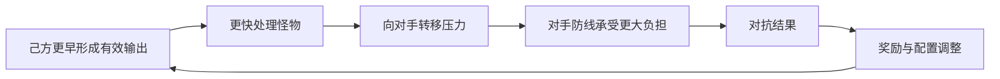
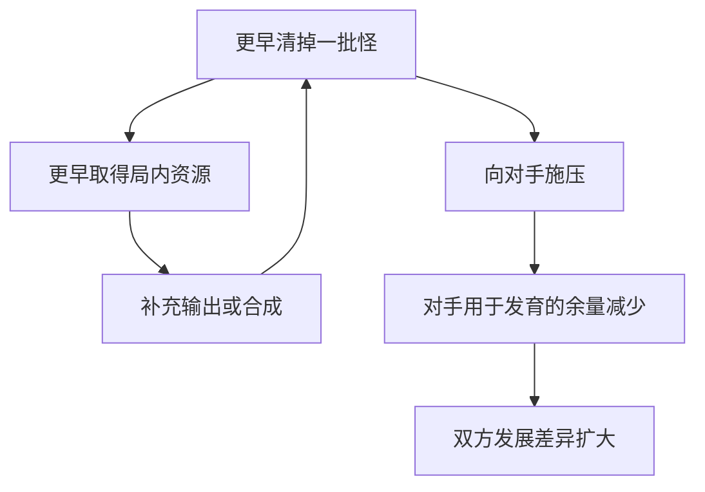

# 竞技场：清怪也是进攻

永远的蔚蓝星球 · 手机 App · 竞争玩法 / 节奏与资源回流

竞技场最有辨识度的关系，是**处理己方怪物的行为，会同时给对手增加压力**。于是清怪不再只是守住自己的防线，也参与决定对方需要应对多少威胁。这让早期发育速度与后续对抗产生联系。

## 设计目的与版本边界

- 从设计职责看，竞技场让已有的塔防配置获得一个相对比较目标：同样面对敌人，谁能更早组织有效输出。它还提供独立的参与与成长回流，使玩家有理由在主线之外验证配置。

- 必须区分历史版本：2025-06-10 公告已提到防守阵容和防守 AI；6 月 21 日更新描述击杀怪物向对手转移，并调整野猪施压机制。因此不能拿更早攻略里的“实时”字样，直接认定当前普通竞技场是双方同步真人操作。[6 月 10 日公告](https://www.taptap.cn/moment/681511296339807133)、[6 月 21 日公告](https://www.taptap.cn/moment/685667018652778832)

## 系统功能与关系

| 功能 | 在整体中的作用 | 分析要点 |
|---|---|---|
| 进攻配置 | 准备主动挑战使用的方案 | 是否针对前期清怪与成型安排能力 |
| 防守配置 | 提供被挑战时使用的防守条件 | 与进攻方案应有清楚区分，不混用当前编辑状态 |
| 对抗战斗 | 将双方清怪与压力相互连接 | 场面优势是否会滚大，落后方还有哪些调整空间 |
| 段位与奖励 | 让单次结果连接长期目标 | 比较维度与奖励用途应可解释 |
| 重复挑战减负 | 降低已掌握内容的操作负担 | 便捷操作不能让玩家误解消耗与重置时间 |



图中强调设计关系，没有假定匹配算法和实时联网形式。

## 规则怎样改变玩家选择

- 2025-07-16 的玩家攻略将早期清怪、银币获取和阵容发育连接起来，还讨论了数量型输出与高星输出的不同需求。[竞技场攻略](https://www.taptap.cn/moment/694655628546670613)。由此可以看出，阵容价值带有时间性：一套最终上限很高但启动很慢的配置，未必适合强调前期施压的环境。

- 这种设计把“贪发育”的成本外显化了。玩家暂时减少火力去追求未来收益时，对方的压力不会停止；早期优势也可能通过更好的发育条件继续放大。它的张力来自这一交换，风险则是优势过早锁定胜负。如果开局随机差异被不断放大而缺乏修正空间，后半局就可能只剩等待。

- 这里还需要区分对抗强度与资源收益。即使玩家没有赢，参与是否仍有明确价值，会影响弱势玩家是否愿意继续参与；但不能把某篇历史攻略的单场奖励数量直接作为当前计算参数。

## 历史数值不能混成一张现行奖励表

| 资料日期 | 当时记录 | 适用解释 |
|---|---|---|
| 2025-05-28 领地攻略 | 胜/败招募券为6/4 | 早期攻略记录 |
| 2025-07-16 竞技攻略 | 胜/败招募券为5/3 | 后续攻略记录，与上行存在差异 |
| 2026-03-05 App 公告 | 扫荡券改为周日24点清理 | 更改储存周期，不证明奖励数量仍为5/3 |

来源：[早期领地](https://www.taptap.cn/moment/676741667339897316)、[竞技攻略](https://www.taptap.cn/moment/694655628546670613)、[App 调整](https://www.taptap.cn/moment/778714788971675862)。本页不拿不同日期的票数、胜率、奖励拼出“每天稳定获得多少招募券”。

## 压力转移为什么放大早期清怪价值



这张图解释攻略中的节奏关系，不代表已取得真实对战统计。验证是否过度滚雪球，应固定养成配置，分别交换初始随机种子和操作策略：若胜负主要跟着种子走，问题偏向开局随机；若主要跟着账号强度走，则要看匹配与成长带入。

### 战报应能回答的四个问题

1. 哪个时间段开始出现无法处理的怪物积压？
2. 当时是有效输出不足，还是为了合成主动减少了火力？
3. 对方施压与本地自然波分别贡献了多少威胁？
4. 下一局换哪个配置或动作，能直接检验这个判断？

这些是参考战报要求。现有资料没有展示完整原作战报，不能宣称其已经提供上述指标。

## UI 规则与补充线框

```ui-analysis
arena
```

这是功能示意。当前只有攻略阵列局部，尚缺完整竞技场流程原图，以下为补充设计建议：

| 区域 | 需要表达的内容 | 关键状态 |
|---|---|---|
| ① 挑战对象 | 对手、比较维度、挑战方式 | 避免把镜像挑战包装成实时等待对手 |
| ② 我的配置 | 当前进攻与防守方案 | 保存成功与未保存要可区分 |
| ③ 资源与收益 | 所需参与资源、奖励说明 | 不足时先说明缺口与兑换代价 |
| ④ 结果与下一步 | 胜负、排名变化、所得资源 | 调整配置、继续挑战各有清楚入口 |

战斗表现还需要让压力转移可识别。只有看到清怪与对方场面变化的关系，玩家才能理解“我的输出也是进攻”，否则玩法容易被看成两块互不相关的塔防画面。

## 重复游玩的节奏

2026-03-05 的明确 App 公告调整扫荡券清理周期，并增加券不足时的购买入口。[App 调整](https://www.taptap.cn/moment/778714788971675862)。这种设计把首次理解玩法与重复获取收益部分分开。便利性需要与成本透明一起提供：玩家应先知道会花什么，再决定省下多少操作。

## 我的评价与适用条件

- 清怪转移压力适合已经具备明显发育曲线的塔防基础。它能够复用既有操作，改变其决策含义。但若双方强度差异远大于局内选择的作用，策略空间会被账号差距覆盖。验证时应控制养成与初始条件，比较不同策略，而不是直接用线上总体胜率评价某个英雄。

- 当前匹配规则、各类竞技入口的差异、现行奖励和完整战报仍待确认。开发附录中的匹配与结算规则属于另行补充的参考方案。

## 关联阅读

[战斗系统](../systems/召唤合成与战斗.md)解释发育动作；[装备](../systems/装备图腾与洗炼.md)解释时间性词条；[招募](../systems/招募与重复转化.md)解释部分奖励的长期用途。
