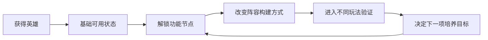

# 英雄与永久成长

永远的蔚蓝星球 · 手机 App · 养成 / 阵容能力

**英雄成长同时回答两个问题：这名英雄有多强，以及这名英雄现在能做什么。** 前者是连续数值，后者可能是功能节点。把它们放在一起看，才能解释为什么一次升级有时只是小幅增强，有时却改变整套配置的用法。

## 设计目的与功能

局外培养给反复挑战留下可积累的结果，也给玩家一个跨局的目标。它将角色获取、资源投入和局内表现连接起来；局内合成星级则负责单局变化，两者属于不同时间尺度。

| 功能 | 设计作用 | 阅读时需要区分的内容 |
|---|---|---|
| 英雄获取与选择 | 扩大可用工具集合 | 拥有英雄不等于已具备完整技能条件 |
| 等级成长 | 建立持续投入与阶段目标 | 基础增幅与功能解锁分开表达 |
| 技能和成长节点 | 改变可执行的行为 | 当前效果、下一节点与适用条件 |
| 阵容搭配 | 将不同能力组合成方案 | 输出、支援与成型手段是否互相支持 |
| 国王相关成长 | 为全局能力提供另一层配置 | 本版仅讨论有依据的关联，不补齐未知成长树 |

## 具体样本：洛姬的成长节点

- 官方刊载的玩家档案，将洛姬的成长描述为多个功能阶段：10 级获得幻影分身，20 级获得与屏障扩散相关的初始选项，25 级缩短分身变化时间。资料还描述复制、连接与增益之间的关系。它是攻略样本，服务器适用性和当前实机表现仍需核查；“最强”等评级没有作为本篇结论。[洛姬档案](https://www.taptap.cn/moment/859896537528926567)

- 这几个节点说明了三种不同的成长价值：获得新的操作可能、让功能更稳定地进入一局、缩短功能兑现的等待。对于需要尽早成型的配置，时间缩短可能比同幅度的面板提升更重要；对于尚未到功能节点的账号，直接照搬高成长攻略则可能无效。



## UI 与成长信息

```ui-analysis
heroes
```

线框为补充设计，并非原界面截图。页面重点应是让玩家理解本次投入的具体结果。

| 区域 | 展示内容 | 交互建议 |
|---|---|---|
| 当前能力 | 等级、技能、已生效节点 | 查看技能时保留触发条件，不能只显示描述名称 |
| 下一节点 | 差多少等级、将增加什么功能 | 将功能变化与普通属性增长分层 |
| 培养消耗 | 已有资源、所需资源与来源 | 不足时能返回有用的获取途径 |
| 方案关系 | 当前在哪些方案中使用 | 调整后提示影响范围，避免只更新一个模式 |

成长预览的价值在于帮助规划。若玩家只能在升级后才看到新能力，投入就缺少可判断的目标；若把所有远期节点同时堆在首页，又会让新玩家难以辨认眼前优先级。

## 数值与节奏分析

- 纵向增长让旧配置继续推进，功能节点让配置发生变化。两者交错能建立短期与中期目标，但节点间距需要合理：间距过长会让资源投入缺少可感知变化，节点过密又会削弱单次获得新能力的意义。

- 真正的养成深度还包含组合条件。一个英雄的功能可能需要图腾、其他英雄或局内强化才能体现，因此“抽到”和“可用”之间可能有距离。这段距离必须能被用户提前理解，否则资料库里的阵容展示就会给出错误预期。

## 我的评价与适用条件

- 值得迁移的是将成长节点与行为变化对应，而非简单扩展等级上限。对于小规模项目，可以先用少量节点验证：升级是否让玩家改变选择，还是只是更快处理同样的敌人。

- 完整英雄池、当前满级成本、国王成长树与重置返还规则尚未采齐。开发附录中的等级参数是补充参考，不进入原作成长表。

## 关联阅读

[招募](../systems/招募与重复转化.md)解决获取；[装备与图腾](../systems/装备图腾与洗炼.md)提供配套条件；[战斗](../systems/召唤合成与战斗.md)验证成长价值。
