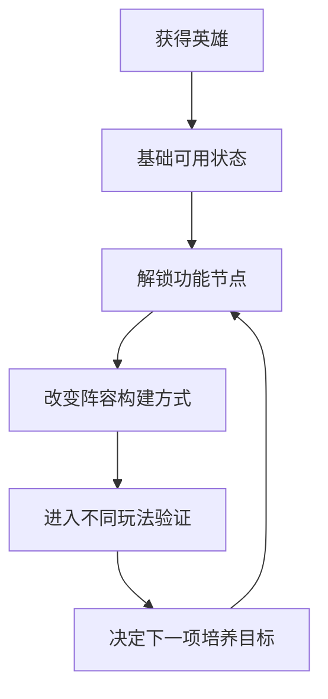
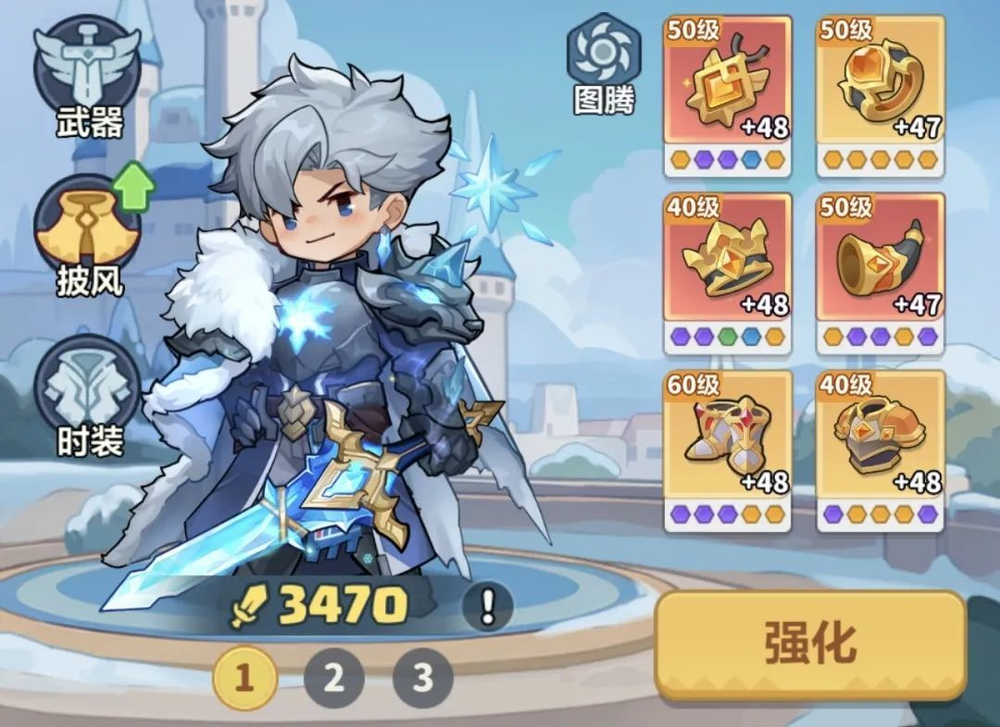
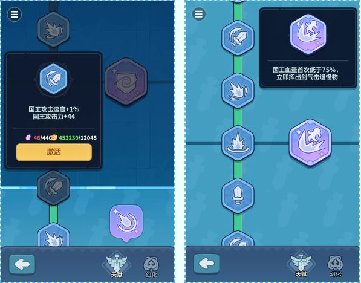
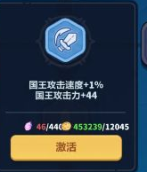
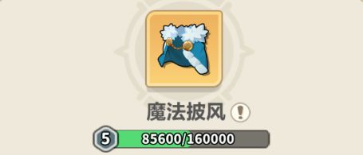
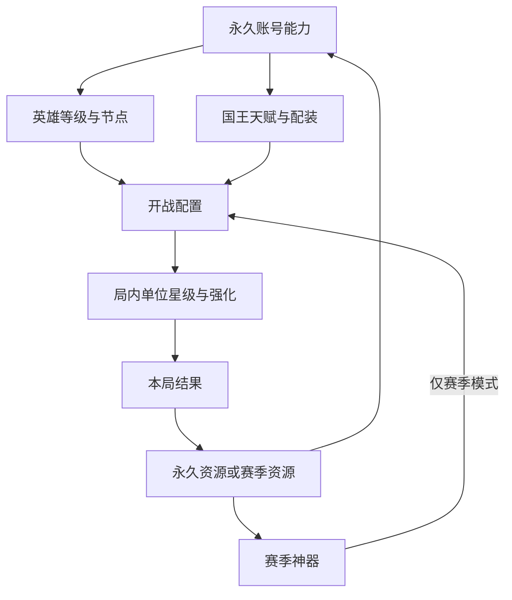

# 英雄与国王成长：能力、材料与配置

永远的蔚蓝星球 · 手机 App · 养成 / 阵容能力

**英雄成长同时回答两个问题：这名英雄有多强，以及这名英雄现在能做什么。** 前者是连续数值，后者可能是功能节点。把它们放在一起看，才能解释为什么一次升级有时只是小幅增强，有时却改变整套配置的用法。

## 设计目的与功能

局外培养给反复挑战留下可积累的结果，也给玩家一个跨局的目标。它将角色获取、资源投入和局内表现连接起来；局内合成星级则负责单局变化，两者属于不同时间尺度。

| 功能 | 设计作用 | 阅读时需要区分的内容 |
|---|---|---|
| 英雄获取与选择 | 扩大可用工具集合 | 拥有英雄不等于已具备完整技能条件 |
| 等级成长 | 建立持续投入与阶段目标 | 基础增幅与功能解锁分开表达 |
| 技能和成长节点 | 改变可执行的行为 | 当前效果、下一节点与适用条件 |
| 阵容搭配 | 将不同能力组合成方案 | 输出、支援与成型手段是否互相支持 |
| 国王天赋、披风与技能 | 建立独立的全局能力线 | 下文按界面、材料与技能条件逐项展开 |

## 具体样本：洛姬的成长节点

- 官方刊载的玩家档案，将洛姬的成长描述为多个功能阶段：10 级获得幻影分身，20 级获得与屏障扩散相关的初始选项，25 级缩短分身变化时间。资料还描述复制、连接与增益之间的关系。它是攻略样本，服务器适用性和当前实机表现仍需核查；“最强”等评级没有作为本篇结论。[洛姬档案](https://www.taptap.cn/moment/859896537528926567)

- 这几个节点说明了三种不同的成长价值：获得新的操作可能、让功能更稳定地进入一局、缩短功能兑现的等待。对于需要尽早成型的配置，时间缩短可能比同幅度的面板提升更重要；对于尚未到功能节点的账号，直接照搬高成长攻略则可能无效。



## 国王成长：武器、披风与技能配置



国王界面把武器、披风、时装与装备、图腾围绕角色摆放，底部还提供方案切换。这种组织让玩家以一个可见的角色承接多条培养线；代价是不同材料、效果范围与继承规则容易被一个战力数字遮住。

### 武器天赋：面板增长与行为节点



- 普通天赋消耗天赋石和金币；特殊天赋使用传说天赋石和金币。前者提供基础属性，后者还可能改变剑气等战斗行为。[2025-06-12 国王攻略](https://www.taptap.cn/moment/682325002019669229)

- 两条树应分别看投入回报：攻击提高影响持续输出，击退或额外攻击改变处理危险的时间窗口。即使面板增幅相近，对防线的意义也不同。



本图左侧节点显示材料 **46/440**、金币 **453239/12045**，并展示攻击速度 +1%、攻击力 +44。它能形成一条可核对的历史消耗样本：需要 440 个图示材料和 12,045 金币，材料尚缺 394。图片没有标明节点等级，因此不能拿它拟合整条升级曲线。

### 披风：一份资源承担多个培养目标



历史攻略将晶石与披风洗炼、成长和技能升级联系起来。图中是5级披风的 85,600/160,000 经验进度；这是进度条样本，不能把160,000当作一次洗炼费用。[披风资料](https://www.taptap.cn/moment/682325002019669229)

这里的选择是“先提高基础能力，还是继续追合适词条”。同一资源承担多个用途会形成取舍，但必须让玩家看到各自的收益和成本；只有一个醒目的升级箭头不足以指导投入。

### 时装、幻化与技能孔位

明确面向 App 的1月6日公告，把第4个时装技能孔位与开服满184天、祝福圣杯相联系；同时展示了时装与武器幻化的组合效果。[App 孔位公告](https://www.taptap.cn/moment/757642898178050495)

- **拥有不等于能装备：** 获得外观、开放孔位、激活技能是不同条件，应逐项核对。
- **外观可能改变构筑：** 该公告中的星光宝杖按场上英雄数量提供伤害收益。因此增加单位数量的价值，可能与追求高星的合成目标产生冲突。
- **国王不是英雄等级的另一种名称：** 国王的全局技能、英雄自身能力和局内星级应分别计算、展示，再汇总到开战方案。

## 养成材料与消耗证据表

| 培养对象 | 已确认的消耗或条件 | 数量掌握程度 | 不应混用 |
|---|---|---|---|
| 英雄永久成长 | 成长节点有攻略和更新支持 | 全等级费用未采齐 | 不用参考设计的碎片公式冒充原作 |
| 普通武器天赋 | 天赋石＋金币 | 上图仅一个未编号节点：440＋12,045 | 不以单节点推导其他节点 |
| 特殊武器天赋 | 传说天赋石＋金币 | 各节点费用待核 | 与普通天赋石分开 |
| 披风洗炼与技能 | 晶石 | 进度条不等于单次费用 | 与装备炼器石分开 |
| 时装第4孔位 | 祝福圣杯＋服务器开放条件 | 取得道具的完整成本待核 | 不等于账号等级184 |
| 装备强化 | 部位锻造书＋金币 | 逐级费用待核，见装备页 | 装备等级与强化次数分开 |

这张表区分“材料种类已知”和“每一级费用已知”。文末开发附录另外提供覆盖参考版本全等级的费用表、国王两条天赋线和计算顺序，所有自设数值均独立标明。

## 三种成长时间尺度



神器在赛季结束后不保留等级与技能，普通英雄、国王与装备不能因此被一并写成清空。神器的范围与技能树规则见[关卡与赛季](../systems/关卡与赛季规则.md)。

## UI 与成长信息

```ui-analysis
heroes
```

线框为补充设计，并非原界面截图。页面重点应是让玩家理解本次投入的具体结果。

| 区域 | 展示内容 | 交互建议 |
|---|---|---|
| 当前能力 | 等级、技能、已生效节点 | 查看技能时保留触发条件，不能只显示描述名称 |
| 下一节点 | 差多少等级、将增加什么功能 | 将功能变化与普通属性增长分层 |
| 培养消耗 | 已有资源、所需资源与来源 | 不足时能返回有用的获取途径 |
| 方案关系 | 当前在哪些方案中使用 | 调整后提示影响范围，避免只更新一个模式 |

成长预览的价值在于帮助规划。若玩家只能在升级后才看到新能力，投入就缺少可判断的目标；若把所有远期节点同时堆在首页，又会让新玩家难以辨认眼前优先级。

## 数值与节奏分析

- 纵向增长让旧配置继续推进，功能节点让配置发生变化。两者交错能建立短期与中期目标，但节点间距需要合理：间距过长会让资源投入缺少可感知变化，节点过密又会削弱单次获得新能力的意义。

- 真正的养成深度还包含组合条件。一个英雄的功能可能需要图腾、其他英雄或局内强化才能体现，因此“抽到”和“可用”之间可能有距离。这段距离必须能被用户提前理解，否则资料库里的阵容展示就会给出错误预期。

## 我的评价与适用条件

- 值得迁移的是将成长节点与行为变化对应，而非简单扩展等级上限。对于小规模项目，可以先用少量节点验证：升级是否让玩家改变选择，还是只是更快处理同样的敌人。

- 完整英雄池、原作逐级费用与重置返还规则仍待实机采证；已补国王双天赋、披风和技能孔位。参考附录的全等级费用只用于独立设计，不混入原作成本。

## 关联阅读

[招募](../systems/招募与重复转化.md)解决获取；[装备与图腾](../systems/装备图腾与洗炼.md)提供配套条件；[战斗](../systems/召唤合成与战斗.md)验证成长价值。
