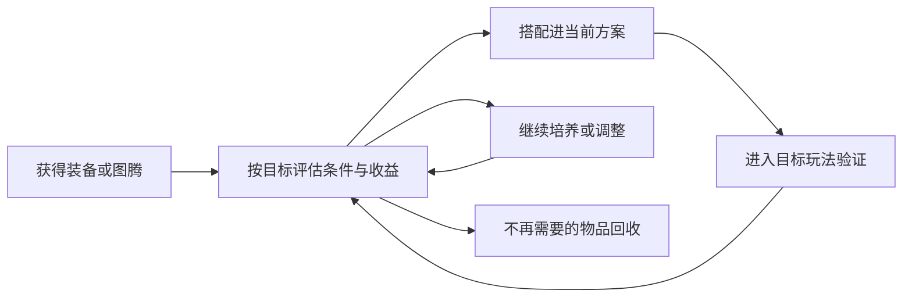

# 装备、图腾与洗炼

永远的蔚蓝星球 · 手机 App · 局外养成 / 条件构筑

**这套系统值得研究的部分，是把“更强”拆成了“对谁更强、什么时候更强、在什么配置下更强”。** 如果装备只提供一个持续增长的总分，选择就会很快收敛；条件词条让更换装备成为重新分配能力的过程。

## 设计目的与功能范围

装备承接挑战奖励，图腾与词条为配置增加差异，洗炼让玩家继续追求适配，分解则回收不再需要的物品。它们共同连接“获得物品—评估—投入或回收—再次挑战”，但具体槽位、品质和完整消耗表不能由少量攻略补齐。

历史官方公告涉及锁定特效后的洗炼成本调整与装备分解产出调整，说明保留目标属性的成本与回收资源都属于需要持续维护的经济关系。[洗炼调整](https://www.taptap.cn/moment/681511296339807133)、[回收调整](https://www.taptap.cn/moment/685667018652778832)

## 系统功能

| 功能 | 玩家目的 | 设计分析重点 |
|---|---|---|
| 获取与查看 | 知道新物品能做什么 | 基础属性、作用对象与条件是否分层表达 |
| 搭配 | 为当前阵容和模式选取能力 | 条件是否实际触发，是否与主力配置配合 |
| 洗炼与保留 | 调整不合适的部分 | 收益不确定时，代价与保留范围是否清楚 |
| 分解回收 | 处理替换下来的物品 | 是否减少无效存量，同时维持合理资源供给 |
| 模式适配 | 为不同挑战调整方案 | 避免一个总分掩盖关键能力差异 |



## 词条如何形成选择

已查看的靴子部位攻略包含英雄暴击、对特定对象增伤，以及随城墙状态变化的增益；其截图是历史品质样本，作者的梯度排名属于玩家意见。[词条来源](https://www.taptap.cn/moment/754639971863759829)

我不会直接照搬排名，而会把词条分成三个问题：

1. **收益对象是什么？** 全体英雄受益与某个主力受益，不能仅按百分比比较；主力承担的有效输出比例会改变价值。
2. **触发条件出现多久？** 对低生命防线才生效的增益，可能在危急时刻有价值，也可能整局不生效。不能把条件值当常驻值。
3. **收益到来是否及时？** 成型前的清怪能力，可能影响资源积累与随后召唤；只看结算总伤害会遗漏这个时间差。

一个自设的比较例子：词条甲常驻增加 8% 有效伤害，词条乙在部分时间增加 20%。若乙覆盖的基础伤害正好是全局的 40%，在无其他交互的简化条件下，两者总收益相近。但乙若恰好覆盖危险首领阶段，它可能更有用；若覆盖的是已经轻松处理的小怪，则可能更差。**这些数字仅是补充分析示例。**

## UI 分析与补充原型

```ui-analysis
equipment
```

已核读的原图只是一个词条局部，不能证明完整装备界面。线框因此明确作为补充设计，重点表达比较与确认，不冒充原游戏 UI。

| 区域 | 内容 | 操作规则建议 |
|---|---|---|
| ① 当前对象 | 装备名称、部位、适用方案 | 切换对象后更新全部对比信息 |
| ② 属性分层 | 基础属性、条件词条、作用对象 | 触发条件与数值同时可见 |
| ③ 调整对比 | 原结果、新结果、保留项目 | 提交前看清哪些内容会变化 |
| ④ 消耗确认 | 当前拥有、此次需要、操作结果 | 不足时显示缺口；重复点击不能重复消耗 |

对条件词条，我建议用完整句子表达“谁在什么情况下获得什么”，并提供统一的术语解释。对洗炼，应把保留项目和对应成本放在同一处；否则玩家很难判断多锁一项到底意味着什么。

## 数值框架与成长深度

装备的纵向成长提高能力上限，词条的横向变化提高匹配程度，两者共同决定优化空间。需要特别关注替换成本：如果每换一种模式都要高成本洗炼，表面上的多样性就可能被经济负担抵消。

回收系统也不能独立评价。过多物品产出配合过高回收收益，会改变材料供给；过低收益则可能让大量掉落失去意义。仅凭调整公告无法判断新平衡是否更好，必须同时观察获取量、消耗量、目标达成时间和不同进度玩家的差异。

## 我的评价与迁移条件

我更愿意借鉴条件词条与玩法目标的对应关系，而不是移植大量品质和洗炼层级。对小体量游戏，少量条件明确、用途不同的装备，就可能形成足够的构筑空间。只有当玩家已经能理解差异，继续增加随机层数才有意义。

当前完整词条池、概率、锁定费用和分解产出仍未统一采样。开发附录保留了明确标注的参考方案，它可以讨论实现，但不用于反推原作平衡。

## 关联阅读

[英雄成长](../systems/英雄与永久成长.md)提供能力基础；[竞技场](../systems/竞技场.md)改变词条时效价值；[领地资源](../systems/领地资源与收集.md)解释部分长期供给。
