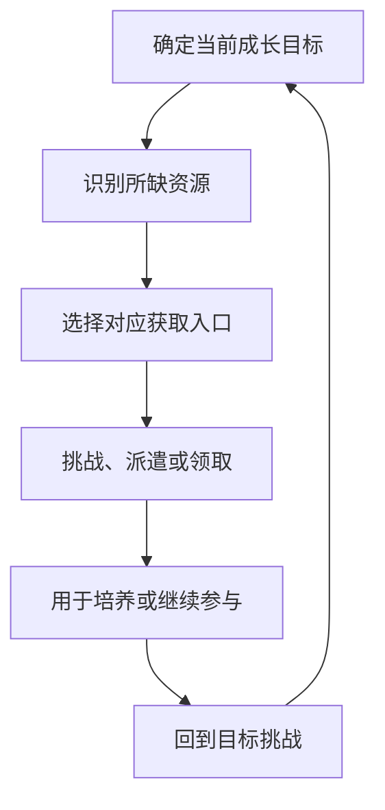
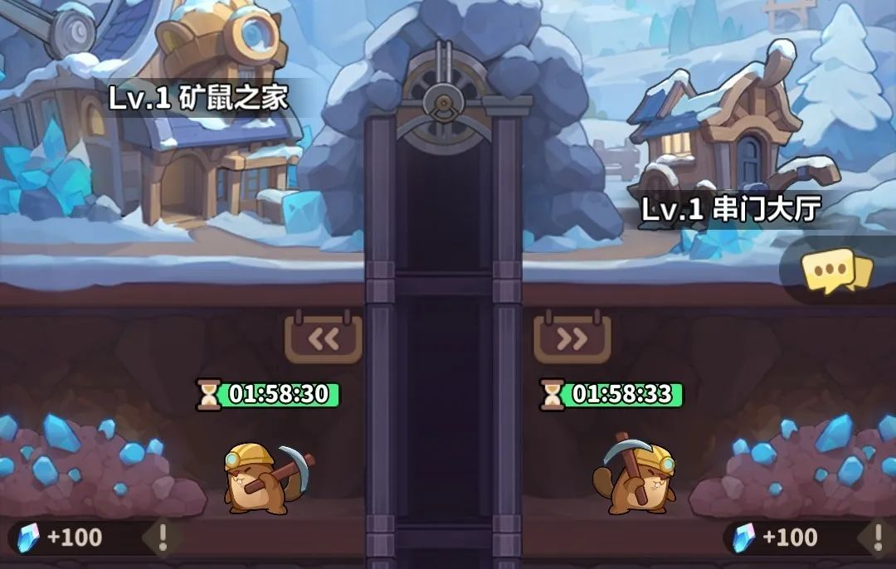

# 领地资源与收集

永远的蔚蓝星球 · 手机 App · 局外玩法 / 资源供给

**领地把“我缺什么”转化为“我接下来去哪里”。** 这些系统本身不一定提供复杂操作，但它们决定玩家两次战斗之间在做什么，以及一次登录包含多少领取、等待和整理。

## 设计目的与系统功能

2025-05-28 的官方刊载玩家攻略介绍了矿场、矿鼠之家、食堂和怪物图鉴：分别关联金币、披风洗炼材料、体力与探索奖励。该资料属于历史攻略，其解锁节点和产量不直接沿用为现行规则。[资料来源](https://www.taptap.cn/moment/676741667339897316)

| 子系统 | 功能关系 | 我的分析 |
|---|---|---|
| 星球矿场 | 挑战进度与金币获取联系 | 将战斗能力转化为另一条资源成长线 |
| 矿鼠之家 | 派遣与材料积累联系 | 让离开战斗后的时间也成为成长条件 |
| 食堂 | 提供继续参与所需的体力 | 影响登录安排与游玩机会 |
| 怪物图鉴 | 遭遇新内容与领取奖励联系 | 给探索进度增加可见记录 |



## 四个设施分别怎样工作

| 子系统 | 历史解锁与规则样本 | 产出用途 | 当前仍待核实 |
|---|---|---|---|
| 星球矿场 | 主线5关后；挑战不消耗体力；每日2次扫荡 | 金币用于长期培养 | 当前层数、每层奖励、扫荡基准 |
| 矿鼠之家 | 主线15关后；派矿鼠开采 | 晶石连接披风培养 | 罗盘品质、雇佣与建筑费用 |
| 食堂 | 6/12/18/21点提供领取机会，历史储量上限60 | 体力支持继续挑战 | 跨时段保留、当前产量与上限 |
| 怪物图鉴 | 随推进发现不同怪物 | 一次性钻石奖励 | 当前全图鉴与领取条件 |

这些是[2025-05-28 领地攻略](https://www.taptap.cn/moment/676741667339897316)的历史记录，不能作为2026年每日产量计算表。它们揭示四种节奏：突破层数、等待完成、定时领取和一次性发现。

### 矿鼠之家：生产设施与社交入口并排



- 矿鼠之家与串门大厅位于上方，开采位置、倒计时和资源提示位于下方。玩家能从建筑进入长期升级，从矿位处理当前任务。
- 两条矿位分别显示计时，说明阅读界面时要识别各任务，而不是只看一个“全部完成”红点。
- 图上的约两小时与 +100 是特定历史截图状态，不等于所有品质矿鼠都按相同速度产出。


**晶石**是披风相关资源。把小图放在首次解释处，读者更容易把材料、设施和培养入口对应起来；装备洗炼用的炼器石必须另列。

## 资源从哪里来，用到哪里去

| 资源 | 本页可确认的获取关系 | 消耗侧 | 分析重点 |
|---|---|---|---|
| 金币 | 星球矿场等玩法 | 英雄/国王/装备培养 | 多条成长争用时，瓶颈在哪里 |
| 晶石 | 矿鼠采集、相关互动 | 披风洗炼与技能 | 生产上限与洗炼目标是否匹配 |
| 体力 | 食堂等领取入口 | 有体力要求的挑战 | 登录次数与实际游玩机会 |
| 钻石 | 图鉴一次性发现等 | 具体消费入口各自核对 | 一次性产出不能计入长期稳定日产 |
| 炼器石 | 合作/装备回收关系见装备页 | 装备调整 | 不与矿鼠晶石合并统计 |

### 一次登录的分析路径

1. 先明确卡住的目标和缺少的资源，而不是默认清完全部红点。
2. 优先处理会满仓、会过期的供给，再决定是否进行挑战。
3. 将资源投入指定成长项，回到原目标验证。
4. 记录这次登录中真正有选择的时间与机械领取时间，分别评价。

这是建议的观察顺序。参考附录给出派遣、容量、跨日和重复领取的明确规则，避免实现时把“到点”误当作“已经到账”。

## 循环如何建立

- 资源入口之间的差异，会给玩家分配不同时间尺度的目标。挑战类入口强调“能力提升后回来试”，积累类入口强调“经过一段时间后回来收取”，图鉴则强调“推进新内容后查看结果”。它们为单一推关提供间隔，也可能让玩家在卡点时仍有行动路径。

- 问题在于，行动路径多不等于有意义的选择多。如果玩家每次只能按同样顺序清空领取按钮，系统增加的是维护工作。对这款游戏的分析应把资源收益和操作成本一起计入：一个入口是否值得保留，要看它让玩家作了什么决定，而非只看每天是否有人点击。

## UI 与状态设计

```ui-analysis
territory
```

这张图是补充的信息组织建议，不是原作领地界面还原。

| 模块 | 首层信息 | 状态建议 |
|---|---|---|
| 资源入口 | 产出什么、当前能做什么 | 区分可挑战、积累中、可领取 |
| 派遣任务 | 当前状态、预计结果、完成时间 | 完成后再提示领取，不用持续红点制造误解 |
| 容量提示 | 是否接近积累上限 | 明确停止积累或溢出的规则 |
| 图鉴奖励 | 新发现与已领奖分别计数 | 不把“未读”和“可领奖”混成同一状态 |

对于已完成重复领取的玩家，一键处理具有明确价值；但第一次看到资源时仍需要解释用途。快捷功能应减少重复动作，同时保留玩家理解资源关系的机会。

## 数值与节奏

- 经济分析需要同时记录每种资源的来源、产出频率、积累上限和主要消耗。仅有一张产出表无法说明养成速度，因为消耗可能随进度变化；仅有总产量也无法说明体验，因为相同产量可能要求完全不同的登录频率。

- 领地更适合承担可预期供给，让玩家知道等待能解决哪一部分问题。稀缺资源和随机结果都集中在这里时，玩家反而难以规划。

## 评价与边界

- 可借鉴的是按资源需求组织入口，以及让推进、积累、发现提供不同反馈。需要警惕的是把所有资源都做成独立倒计时：看似增加内容，实际可能只是增加需要记住的时间点。

- 当前 App 的产量、上限和领取时间尚未统一实测；本篇不以历史值计算每日成长速度。开发附录给出的是独立参考配置。

## 关联阅读

[英雄成长](../systems/英雄与永久成长.md)与[装备](../systems/装备图腾与洗炼.md)是资源消耗侧；[运营减负](../systems/商业化与运营减负.md)讨论重复操作。
