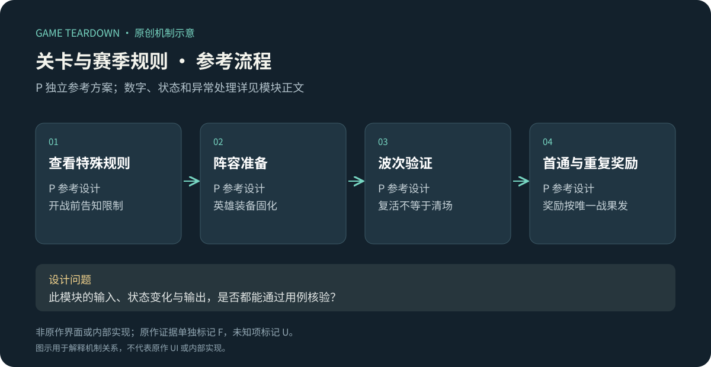
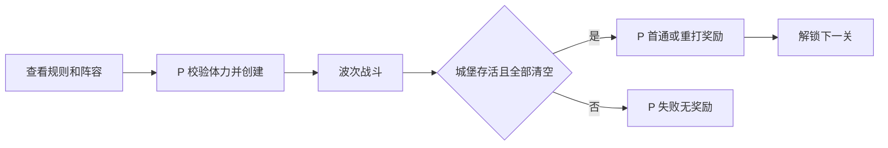

# 关卡、赛季与机制教学

> `blue-planet-levels` · 手机App · 2026-10-16 · 资料研究＋P参考关卡规格。

原创P参考流程概览；下文F证据与此图分开阅读，不能据图推定原作规则。

**BP-F10（F，攻略样本）**：S1第8–10关攻略涉及怪物复活、职业击杀限制、召唤异常和空格需求等关卡差异。[官方转载攻略](https://www.taptap.cn/moment/859430567714753123)。攻略中的推荐阵容是玩家策略，不保证唯一解。**BP-F11（F）**：官方减负说明区分已完成改动和未来更新计划；赛季开放与关卡重置范围不能由“S1”名称推断。[官方计划说明](https://www.taptap.cn/moment/844263068358673457)。

I：关卡规则能让同一套合成系统产生新问题，也可能把玩家卡在未拥有的角色上。因此需要提前展示限制、提供可获得的替代路线，并区分理解错误与账号资源不足。

## P范围、配置与对象

参考做3关单人战役和一个不重置英雄的赛季目录。使用[公共契约](../../_framework/参考实现公共契约.md)与TD战斗；所有机制与奖励为P。

`Stage{id,requiredClearId,waves[],modifiers[],firstReward,replayReward}`，`StageProgress{cleared,bestBaseHp,firstRewardClaimed}`。每关3波，每波开始后10秒进入下一波，最后一波须清怪才结束。每波3只40HP速度1m/s普通怪，道长10m；第三波另有120HP、0.6m/s首领，城堡10HP。固定奖励：首通100金币、重打20；每次门票1体力，体力不足不创建战斗。失败不退体力、不发奖励。

| 关卡P | 条件 | 特殊规则与教学 |
|---|---|---|
| s1 | 默认开放 | 无modifier，教学召唤与合并 |
| s2 | 通s1 | 第一波一只标记“复生”的怪死后1000ms在原地以50%最大HP复活1次；第二次死才发奖 |
| s3 | 通s2 | 召唤支付1份费用、生成2个相同英雄星1，至少2空格才允许；无空位不扣款 |

没有强制某职业杀怪的门槛，避免小英雄池里出现不可完成关。原作职业击杀机制留作F研究点，可另做后续扩展，不暗示此参考与原作完全相同。

## P规则与异常

| 规则 | 前置／动作 | 输出 P |
|---|---|---|
| STG-R01 | 请求进入未解锁关 | LOCKED且不扣体力；显示需通关ID |
| STG-R02 | 开战 | 体力扣除与battle激活一体提交；配置与方案固化 |
| STG-R03 | 复生怪第一次死 | 不发击杀币/经验，进reviving状态、计入未清敌人；复生后保留已用复生标记 |
| STG-R04 | 双召唤 | 两个空格同时占用，金币只扣一次；只有1空格时拒绝，无半次生成 |
| STG-R05 | 首通结算 | 首通标记、解锁、奖励同事务；重复结果不再首通奖励 |
| STG-R06 | 赛季结束 | 旧关改为只读历史，不再进入；正在进行的battle最多允许180秒结算；英雄装备与钱包不重置 |

赛季配置 `seasonId,startAt,endAt` 为UTC时间，参考测试用可控时钟；运行环境必须在部署配置显式填起止，不用系统当前时间随机生成赛季。到期正好开始请求拒绝；结算宽限期截止仍未完成判void返门票。仅stage进度按seasonId隔离，故新赛季不会意外清掉永久英雄。

接口 `GetStages(seasonId)`、`StartStage(stageId,presetId)`、`SettleStage(battleId)`；关卡读取资源域的体力并输出奖励给钱包，装备和英雄都只读。客户端计时只提示，权威时间判开放。

## UI／美术与验收 P

STG-UI01：开战前规则卡含“会复活一次／召唤需2格”的图文示例；STG-UI02：复生倒计时标识与尸体占位，不误以为已清场；STG-UI03：首通、重打、赛季历史三种奖励文案。需3关入口卡、复生标记、双召唤双格提示，不为规则重要性仅换背景色。

| 用例 | 给定→操作→预期 | 规则 |
|---|---|---|
| STG-T01 | 最后一只怪处于复生中→战斗不结算；再杀才结算 | R03 |
| STG-T02 | 仅1空格有10币→s3召唤→拒绝且币10 | R04 |
| STG-T03 | 首通结果重复→只100金币；下一次真正重打只20 | R05 |
| STG-T04 | endAt时请求进入→拒绝；此前已开始按180秒宽限处理 | R06 |

用例未运行。P指标：阅读规则卡后首次操作错误率、机制关失败原因、每关阵容更换比例。U：原作赛季继承、当前波次与概率、所有关卡清单，需App关卡规则面板采证。
