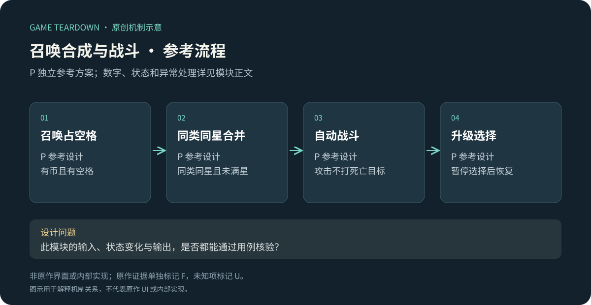
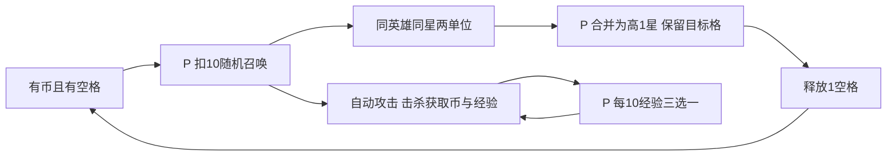

# 召唤、合成与局内强化

> 2026-10-19 参考规格：v2章节覆盖前文同名配置；未覆盖条款保留。原作规则见作者正文及对应日期来源。参考服务端尚未实现，网页原型只验证所注明的界面状态。

> `blue-planet-combat` · 手机App · 2026-10-16 · 公开资料研究。重点模块。F原作证据／I分析／P独立参考设计／U未知；参考验收尚未运行。

原创P参考流程概览；下文F证据与此图分开阅读，不能据图推定原作规则。

## 证据与设计目标

**BP-F03（F）**：官方App介绍把随机召唤、技能选择、合成进化作为局内变化来源，说明二合一升星。[官方商店](https://www.taptap.cn/app/713683)。宣传中的时长与决策数未实测。**BP-F04（F，攻略样本）**：洛姬档案描述复制、升星及不同成长节点对局内能力的改变。[官方转载玩家攻略](https://www.taptap.cn/moment/859896537528926567)。不把作者强度排名当客观评级。

I：空格既是召唤容量，也是继续合成的操作空间。升星会减少场上单位数，因此“星级更高”不必等于当下防线更强。需要比较即时火力损失、进化收益与随机变种，而非只统计合成次数。

## P参考范围与数据

本切片实现单人8格自动塔防、随机召唤、同类同星二合一与升级三选一。**不复刻原作格数、公式、职业相克或召唤权重**；采用[公共契约](../../_framework/参考实现公共契约.md)。局外英雄等级由[英雄成长](英雄与永久成长.md)提供快照，关卡域提供敌人波次。

| 对象／参数 | P样例 | 约束 |
|---|---|---|
| Board | slots[8]，每格null或unitId | 一实例一格；场上最大星级3 |
| HeroConfig | archer/fire/guard，召唤权重各1 | 三个演示职业名称不是原作英雄名 |
| Unit | heroId、star、attackCooldown、slotIndex | 合并后保留目标格，删除源实例 |
| 伤害 | archer=10、fire=8、guard=6 | 按1/2/3星倍率1/2.5/6，乘局外攻击系数后向下取整 |
| 攻速／目标 | 均每1000ms；距终点最近敌人 | 同距离按enemyId；每次单目标，射程覆盖整条10m道路 |
| 钱包 | summonCoin=30；召唤费用=10 | 击杀普通敌+2；局结束清零；无随次数涨价 |
| 城堡 | hp=10 | 普通漏怪扣1，boss扣3；hp≤0失败 |
| 经验 | 每击杀+1，累积每10点触发选择 | 同时多次升级排队；选择期间暂停本地战斗 |

## P规则与状态

全图P，F只支持随机召唤、合成与局内强化的机制方向，不能据图认定原作选项数和费用。

| 规则 | 输入／前置 | 结果 P |
|---|---|---|
| TD-R01 | 战斗进行且有空格、币≥10→召唤 | 按权重抽英雄，落最小空格索引，星1；扣币与生成同tick完成 |
| TD-R02 | 拖源到同英雄同星目标且星<3 | 删除源，目标变高1星并创建新unitId；攻击冷却重置1000ms；不用币；不随机变英雄 |
| TD-R03 | 满盘或目标不匹配 | 召唤/合成拒绝，不扣币、不修改阵列；解释满盘/星不同/满星原因 |
| TD-R04 | 每tick攻击计时到期 | 单位按slotIndex攻击，敌人死亡立即移出目标池；多个单位不向已死目标追加奖励 |
| TD-R05 | 累计经验跨10倍数 | 队列新增offer；当前tick结算完再暂停；选择后若队列未空继续选，否则恢复 |
| TD-R06 | 城堡损坏与最后怪死亡同tick | 先结算已抵达漏怪，hp≤0判失败；成功需波次已全部生成且敌人清空 |

三选一固定演示为：全体伤害+1000基点／城堡回复2（夹上限）／获得10召唤币；每次可重复，增伤加法累积。全满血时治疗仍展示但标“当前无收益”。无重抽。合成与召唤输入同tick按命令序号处理，失败不消耗序号对应资源；战斗结束后拒绝残留输入。

## 接口与异常 P

`StartDefense(stageSnapshot, rosterSnapshot, seed)`返回battleId；`Summon`、`Merge(source,target)`、`ChooseBuff(offerId,optionId)`由战斗域串行处理。输出`UnitChanged`、`EnemyKilled`、`BaseDamaged`、`DefenseEnded{outcome,stats}`。英雄域只能在开局前改变快照；战斗中不能通过局外升级刷新攻击。

单人退出在波次边界保存：存board、币、经验、buff、城堡、随机状态、下一波索引；未到边界的波次崩溃则从上一边界重开，不额外返还召唤币。联网竞技合作不沿用客户端暂停／回档，由对应模块的权威战斗调度接管。

## UI与美术 P

TD-UI01：召唤按钮显示价格／余额／满盘原因；TD-UI02：拖拽时只高亮合法合并格，满星使用数字3＋徽章；TD-UI03：城堡损伤、道路进度、剩余波次置顶；TD-UI04：三选一显示作用范围与本次增量。资产：8格底板、3英雄×3星级符号、召唤/合成/命中/漏怪反馈。合成动画200ms，规则即时提交；动画期间该格不可操作，其他格允许。颜色同时配形状，危险敌人优先于金币飞行动画。

## 验收与取舍

| ID | 给定→动作→预期 | 规则 |
|---|---|---|
| TD-T01 | 8格满、币30→召唤→仍30且无新单位 | R01/03 |
| TD-T02 | 2个同英雄星1→合并→1个星2，空格+1，伤害按2.5倍 | R02 |
| TD-T03 | 同tick两单位击杀同怪→只一份币与经验 | R04 |
| TD-T04 | 经验9同tick杀2怪→经验11、只出现一次升级 | R05 |
| TD-T05 | 城堡1HP最后怪到终点→失败，无成功奖 | R06 |
| TD-T06 | 波中崩溃→重开→恢复上次完整波边界，无跨档币复制 | 存档契约 |

P调参先测满盘停滞率、合并后短时漏怪、首次形成稳定阵容时间。U：原作格数、召唤费用曲线、合成变种、技能候选与暂停政策；需当前App教程完整录屏和规则面板。图文不代替这些证据。

## v2 联调补齐：结算顺序与国王加入

本节全为补充设计，扩充以上参考战斗，不修改原作事实。

| 顺序 | 同一50ms逻辑步的处理 | 冲突处理 |
|---|---|---|
| 1 | 接收合法命令，按服务端序号处理召唤、合成、选强化 | 旧revision拒绝；同ID重放不重新抽取 |
| 2 | 到期生成波次和复生敌人 | 新生敌本tick可被攻击 |
| 3 | 敌人移动，抵达终点则扣血并移除 | 城堡归零本tick仍完成记账，最后统一判终局 |
| 4 | 英雄按格索引攻击 | 死亡立即移出目标池，击杀奖励只一次 |
| 5 | 国王普通攻击、剑气 | 数值与冷却见成长v2；不可攻击已移除敌人 |
| 6 | 经验、效果计数、奖励及胜败 | 城堡归零优先失败；待复生或转移队列非空不判清场 |

伤害统一顺序：英雄基础攻击×星级倍率×永久等级系数×英雄增伤池×暴击倍率，最后向下取整且最低1。英雄增伤池包含局内强化与装备attack词条，相加后使用；国王伤害独立，不误吃英雄增伤池。装备crit只影响英雄直接攻击。所有模式按同一算法构建快照。

成长5/10级奖励分别以首次召唤、首次达到2星事件去重；合成后创建新unitId不能重置英雄级计数。20/30级攻击间隔覆盖默认1000ms；合成后的冷却设为该英雄当前间隔，替代旧固定1000ms。

终局后收到未处理输入统一END_STATE；只返回最终快照，不扣币。断线恢复携带lastAcceptedSequence，客户端只重发未确认命令。敌人转移由竞技模块单独标记来源，不能再次触发转移链。

新增验收：同tick最后怪抵达与国王击杀并存，按移动优先造成失败；L30英雄合成后冷却为800ms；重复连接不再获得首次召唤币；同tick怪物被英雄击杀后国王改选存活目标。以上用例未运行。
