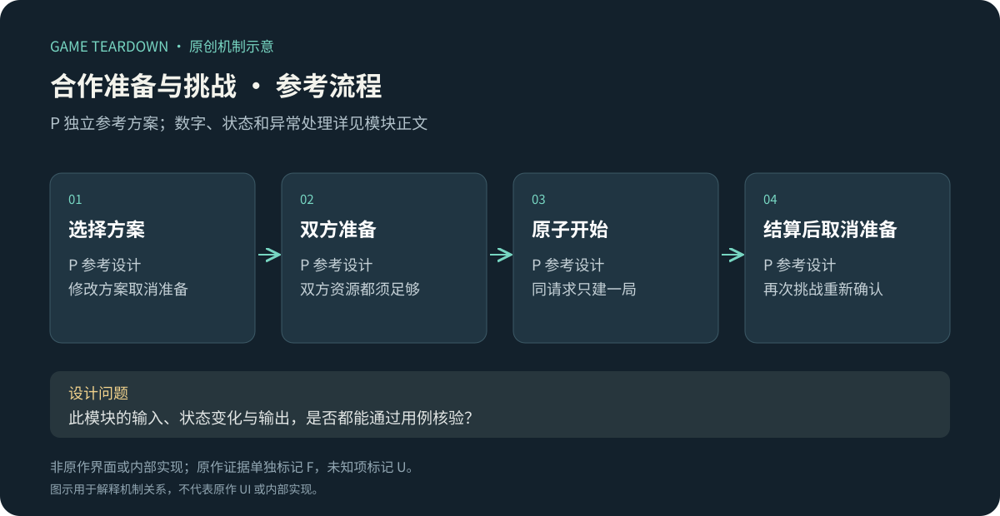
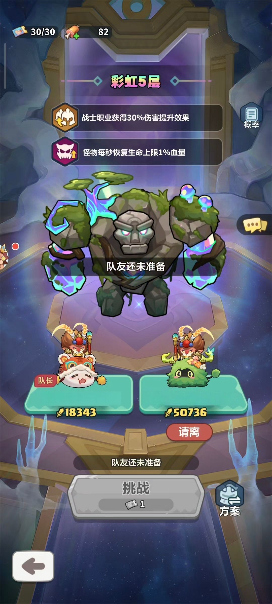
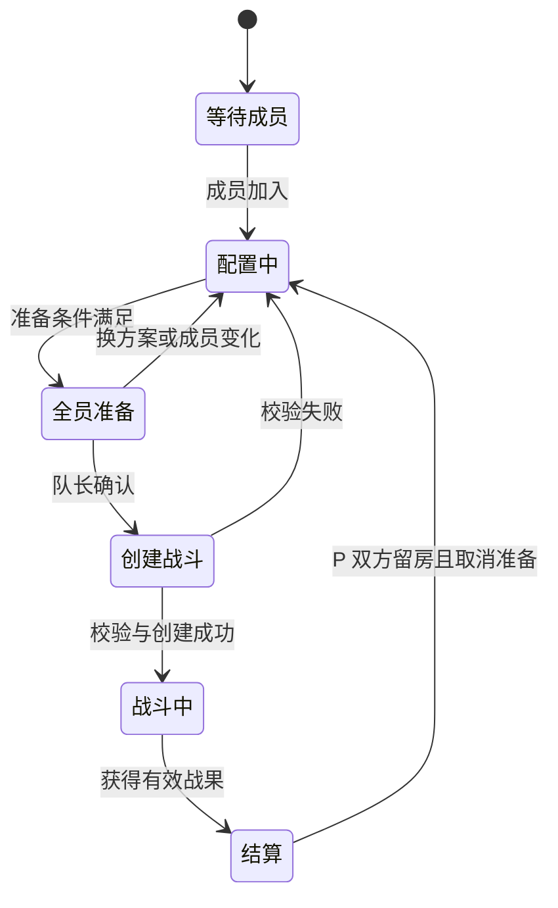

# 合作准备与挑战 · 模块设计拆解

> 2026-10-19 参考规格：v2章节覆盖前文同名配置；未覆盖条款保留。原作规则见作者正文及对应日期来源。参考服务端尚未实现，网页原型只验证所注明的界面状态。

> 案例 `blue-planet-coop` · 手机 App 正式服 · 资料截止 2026-10-16 · 研究状态 researched；参考规格可评审、未实测实现。F=来源事实，P=参考设计，U=未知。

原创P参考流程概览；下文F证据与此图分开阅读，不能据图推定原作规则。

## 1. 目标与范围

合作准备系统解决“队长开始战斗时，队员是否已经配好方案”的协调问题。本模块覆盖组队准备、开始挑战、结果与再次组队的关系；战斗本身、具体奖励数量和好友关系由其他模块负责。

**BP-F01（F）**：2026-03-05 官方公告明确面向 App 端包正式服：彩虹副本增加准备功能，队员切换战斗方案并准备后，队长发起挑战。[官方公告](https://www.taptap.cn/moment/778714788971675862)

**BP-F02（F，历史）**：2025-06-10 公告记录合作聊天、奖励预览／队长额外奖励说明，以及过长战斗中的怪物狂暴调整。[历史更新](https://www.taptap.cn/moment/681511296339807133)。不据此确定当前奖励数值或狂暴阈值。

## 2. 原图与关键观察

来源为 BP-F01 公告配图，2026-10-16 核读；研究引用，非自行实机截图。**看哪里**：底部“挑战”呈灰色，上方说明“队友还未准备”；右侧有“方案”入口，队员下方有“请离”。**说明什么**：开始条件、阵容配置和队长权限在一个界面内表达。**不能说明什么**：一张队长未准备图不能证明断线处理、准备后再换方案是否自动取消，也不能把图中资源数量当作默认容量。

## 3. 对象与规则

| 对象 | 设计含义 | 性质 |
|---|---|---|
| 队长／队员 | 发起挑战者与准备参与者 | F：公告与截图 |
| 战斗方案 | 开战前可调整的配置入口 | F；方案内部字段 U |
| 房间与成员快照 | 当前成员、准备状态、所选方案版本 | P：复现参考 |
| 战斗票据 | 唯一 battleId，关联开始时的快照 | P：结算一致性 |

| R-ID | 性质 | 条件与动作 | 状态／结果 | 反馈 |
|---|---|---|---|---|
| COOP-R01 | F | 队员未准备，队长查看开始入口 | 该配图中不能直接发起挑战 | 灰色按钮与未准备说明 |
| COOP-R02 | F | 队员完成方案并准备 | 队长可发起挑战 | 完整准备后画面待补 |
| COOP-R03 | P | 队员更改方案或成员变更 | 清除受影响准备状态，更新 roomRevision | 告知需要重新准备 |
| COOP-R04 | P | 队长点击开始 | 校验全部准备、成员在线与资源，再原子创建战斗 | 显示进入中，禁止重复提交 |
| COOP-R05 | P | 请求重复／网络重试 | 同 requestId 返回同 battleId | 不重复消耗门票 |
| COOP-R06 | P | 校验失败或战斗创建失败 | 不扣资源；保持可解释房间状态 | 指明成员变化／资源不足／网络错误 |
| COOP-R07 | U | 中途掉线、队长退出、票据退回、战后留房 | 当前 App 行为未核实 | 不按一般联机惯例填成事实 |

## 4. 状态图（P）

此状态图表达复现方案；战后留房不能直接采用“计划优化”的公告当已上线事实。

## 5. 配置与接口（P）

| 字段 | 类型／约束 | 原作值与参考处理 |
|---|---|---|
| roomId / leaderId / memberIds | 稳定 ID | 参考字段；人数上限不能由截图推广所有模式 |
| roomRevision | 非负整数 | 每次成员／方案变化递增 |
| loadoutRevisionByMember | 成员 ID→版本 | 准备绑定该版本，变更即取消 |
| readiness | 成员 ID→布尔值 | 新成员参考默认未准备 |
| costDefinition | 资源 ID＋数量＋扣除角色 | 原作按玩法／身份细则 U；配置不可隐式继承 |
| battleId / requestId | 唯一 ID | 防止重复开始和结算 |
| timeoutPolicy | 可配置策略 | 原作阈值 U，不任意填秒数 |

| 接口 | 输入 | 输出／失败 | 所有者 |
|---|---|---|---|
| setReady | roomId, expectedRevision, loadoutRevision | newRevision / staleRoom | 房间模块 |
| requestStart | requestId, roomId, expectedRevision | battleId / notReady, insufficientResource, memberChanged | 开战协调模块 |
| settleBattle | battleId, verifiedResult | 已发奖励记录 / alreadySettled | 结算模块 |

建议服务器对共享房间和奖励作权威判定；这是网络玩法的参考方案，未证明原作服务端架构。

## 6. UI／美术／音频

| UI-ID | 元素与状态 | 表达要求 | 来源性质 |
|---|---|---|---|
| COOP-UI01 | 成员槽／队长标签 | 区分权限与参与者 | F：原图 |
| COOP-UI02 | 未准备说明／禁用开始 | 同时告诉用户原因和下一步 | F：原图 |
| COOP-UI03 | 配置变化后的准备失效 | 不用短暂 Toast 作为唯一提示 | P |
| COOP-UI04 | 进入中／失败／重试 | 不与已开战状态混淆 | P |
| COOP-UI05 | 奖励预览／队长额外奖励 | 区分基础与身份加成，防止误解 | F：历史公告；现图 U |

制作建议：成员卡、身份角标、准备状态、按钮状态、网络等待反馈；准备音效是可选辅助，不能替代视觉状态。原图配色、字号和资源规模不直接照搬到目标项目。

## 7. 设计收益与代价

准备阶段让双方对开战有明确承诺，降低“还没配完就被拉进战斗”的摩擦；代价是多一次操作及可能的等待。若奖励要求重复刷同一内容，准备确认也可能变成机械点击，因此需要研究哪些变化必须重新确认，哪些可以保留。这是设计推断，未测得等待时间减少比例。

长线商业化附加分析：门票、身份奖励、特权次数会影响组队意愿与资源效率。当前证据不足以量化免费／付费差异，不能用旧周卡公告拼出当前收费规则。

## 8. 验收与缺口

用例是参考方案的测试设计，尚未运行，不代表原作通过。

| T-ID | 规则/UI | 条件→动作 | 预期结果 |
|---|---|---|---|
| COOP-T01 | R01/UI02 | 队员未准备→队长看开始入口 | 原图匹配；实际点击行为需录屏补证 |
| COOP-T02 | R03 | 已准备→修改方案 | 状态取消，开始按钮重新禁用 |
| COOP-T03 | R04 | 开始前成员退出 | 原子校验失败，不消耗门票 |
| COOP-T04 | R05 | 同请求重复提交 | 仅一个 battleId，门票只扣一次 |
| COOP-T05 | R06 | 创建战斗失败 | 资产不变，可返回配置阶段 |
| COOP-T06 | 接口 | 重复结算同 battleId | 奖励仅发一次 |

缺口：队员准备后的原图、改方案回退、完整开战与结算录屏、当前门票与身份奖励、断线恢复、战后房间保留行为。每个缺口对应具体规则，不阻止先理解协调设计，但阻止宣称完整还原当前实现。

## 9. 可直接实施的参考决策 P · COOP v1

用户选择补成参考设计后，下列P明确填补参考方案中的待定项；**不改变R07的原作U状态**。遵循[公共契约](../../_framework/参考实现公共契约.md)，战斗基础见[召唤合成](召唤合成与战斗.md)。

### 配置、费用与战斗 P

房间恰好2人、一队长一队员；双方都确认准备，队长点击开始同时表示确认自己的方案。队长1合作券、队员1合作券，创建battle成功且双方扣券事务提交后才激活；任一不足两方都不扣。免费合作券每日UTC+8零点补至3，上限3；本切片不售券、不配置周卡特权。

参考为左右两条10m道路、各自8格棋盘、**共享20HP城堡**。两人分别用自己的召唤币，不能转赠或跨棋盘合成。每10秒每条路生成3只40HP、速度1m/s普通怪，共6波；第6波每路加一只120HP、速度0.6m/s首领。普通漏怪扣共享HP1、首领扣3；任一路单位只攻击本路。第60秒完成生成后清空所有怪且城堡存活即胜；120秒未结束怪物速度翻倍、免疫控制且所受最终伤害×1.5，再取整；180秒未结束判失败。狂暴阈值与倍率为P，不来自旧公告。

三选一不暂停共享战斗，5秒未选默认伤害。胜利队长得20合作币、队员16；失败双方各4；这是为验证身份奖励展示的P差异，不代表原作公平性。每battle每人仅发一次，背包奖励不在此切片。

### 房间与断线决策 P

| 规则 | 触发 | 明确决策 |
|---|---|---|
| COOP-R08 | 成员改方案 | 只取消该成员准备；队长换关卡取消双方准备；roomRevision递增 |
| COOP-R09 | 非战斗队长离开 | 解散房间，队员回大厅；队员离开则房间保留等待新成员 |
| COOP-R10 | 房间掉线 | 立即取消掉线者准备；30秒等待重连，超时按离开处理 |
| COOP-R11 | 战斗掉线 | 战斗继续；单位继续自动攻击，无新手动输入；30秒内可重连，超时AI接管，原成员回归后下一个tick收回AI权限 |
| COOP-R12 | AI操作 | 每500ms先合并合法最低星且格索引最小一对，否则能召唤则召唤；升级默认伤害；双方全掉线也模拟到180秒结果 |
| COOP-R13 | 胜败结算 | 有效结果发奖、不退门票；房间存在则双方留房且取消准备；队长已离开则返回大厅 |
| COOP-R14 | 服务故障无有效结果 | 标void，双方各退原消耗1券，超上限转待领取；无胜败奖，幂等处理 |
| COOP-R15 | 准备房间闲置 | 5分钟没有任何成员操作解散；战斗中不计该闲置时间；聊天不延长闲置，方案或准备操作延长 |

R03“成员变化清受影响准备”的精确定义：队员加入或离开时全员准备清除；仅换个人方案时按R08处理。请求开战依据roomRevision和两份loadoutRevision校验；最后一刻改方案必使旧开始请求失败，不静默用新方案。

### P数据补齐与交接

`Room{capacity:2,stageId,leaderId,memberIds,readiness,loadoutRevisionByMember,roomRevision,lastActiveAt,state}`；`Battle{battleId,roomId,memberSnapshots,costReceipts,controlOwnerByMember,result}`。`controlOwner`枚举player/ai，只有权威服务能更改；恢复时下发最近快照和最后接受输入序号，客户端不重放已处理扣币命令。

资源域拥有门票和合作币；房间域拥有准备与权限；战斗域拥有棋盘、共享城堡与结果；结算域用battleId+memberId作为发奖键。广播`MemberReadyChanged`、`BattleStarted`、`ControlOwnerChanged`、`BattleSettled`；房间Revision与战斗tick不可混用。

COOP-UI06：队员断线／AI接管／已回来三态，配文字与控制者图标；COOP-UI07：倒计时120秒狂暴提示及180秒上限；COOP-UI08：结果分别显示本人身份、基础结果与本次实际收益；COOP-UI09：再次挑战前展示双方准备与两张门票。原图未观察到的UI均为P。

### P追加验收（未运行）

| ID | 给定→动作→预期 | 规则 |
|---|---|---|
| COOP-T07 | 队员票0队长票1→开始→双方票不变，不激活battle | R04、费用约定 |
| COOP-T08 | 已准备→队长换关→双方取消；只队员换方案→仅其取消 | R08 |
| COOP-T09 | 战斗掉线31秒→AI接管；回来→下一tick玩家接管且无重复指令 | R11/12 |
| COOP-T10 | 同battle结算两次→队长20、队员16仅一次，双方未准备 | R13 |
| COOP-T11 | void重试→各退1券一次，不发合作币 | R14 |
| COOP-T12 | 共享城堡1HP，两路同tick漏怪→一次失败，城堡夹为0 | 战斗约定 |

这些决策可实现一个双人合作切片；原作完整关卡、角色与网络质量尚未验证。重点体验实验为准备等待时长、被动开战次数和断线后的伙伴负担。

## 10. v2 两类合作的配置覆盖

以下补充设计将同一房间用于通关型和计分型参考玩法；页面可点击原型仍只演示普通准备，不声称运行了赛季战斗。

| 字段 | normalCoop | seasonCoop |
|---|---|---|
| 成本 | 双方各1合作券 | 双方各1赛季合作券，每日补至3 |
| 战斗 | 前文双路六波，共享20HP | 双人各8格，共享20HP，每10秒每路3只普通怪＋一个不可击杀靶 |
| 靶目标 | 普通首领可击杀 | 靶固定在距终点5m、无碰撞，不阻挡普通怪，属于boss目标 |
| 时长/结算 | 清场胜利、180秒失败 | 120秒或城堡归零结束，伤害总量/100向下取整为分数 |
| 奖励 | 原20/16合作币；失败各4 | 每人min(20,分数)神器经验；队长另得5经验，分数0则均0 |
| 神器 | 不生效 | 使用赛季技能快照 |

计分型靶攻击目标优先级：距终点最近普通怪优先，无普通怪才攻击靶；国王同规则；靶不产击杀币、不触发击杀经验，只累计有效伤害。两人各初始30召唤币、每10秒补10币；其他普通怪仍按TD奖励。参考不复刻原作跨服组伤害折算公式、全部环境技能与商业奖励。

开始时校验mode＋seasonId＋双方方案版本；切换mode取消双方准备。普通合作权益assist_bonus仅增加normalCoop胜利合作币，不给赛季经验加4。战后结果界面按模式切换“胜/败”与“本次成绩”，不能对不可击杀首领显示“未击败所以失败”。

新增结算接口字段mode,outcome,score,totalDamage,seasonId；score仅计分型必填。公会收到赛季队长成绩事件用于参考赛季榜，不使用普通合作胜利事件代替。

验收：mode变更取消准备；seasonCoop即使靶不死亡也在120秒正常结算；分数0不发队长奖励；神器只影响赛季；同battle重复上报不重复发经验；normalCoop互动原型的两张演示券仍只属于前端状态。待实现。
