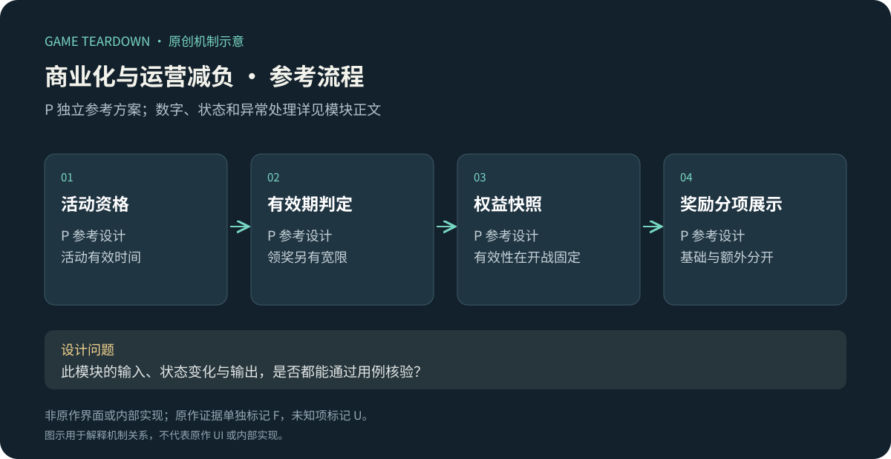
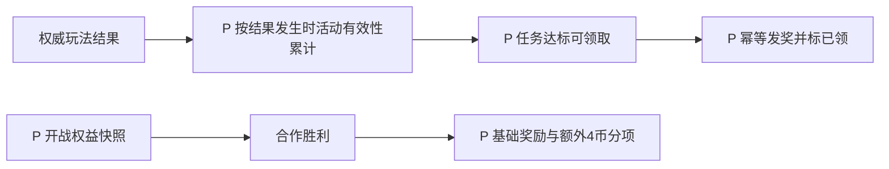

# 商业化、数值性外观与运营减负

> `blue-planet-liveops` · 手机App · 2026-10-16 · 历史商业化机制研究＋P运营模块参考。金额、收益或留存未测量。

原创P参考流程概览；下文F证据与此图分开阅读，不能据图推定原作规则。

**BP-F16（F，历史公告）**：6月21日公告介绍皮肤属性及部分行为变化，也提及合作周卡增益；外观不能统称纯装饰。[官方公告](https://www.taptap.cn/moment/685667018652778832)。**BP-F17（F）**：减负说明将已做调整与后续扫荡、快速战斗等计划分开描述。[官方减负计划](https://www.taptap.cn/moment/844263068358673457)。未核实计划最终上线情况。

I：研究长线商业化时应把购买内容、效率变化、重复劳动和公平性影响连接起来。没有收入/留存数据，不能推断某项设计“已证明提升付费”。分析单机买断时则更关注完整体验和扩展内容边界，不能强行套每日商业循环。

## P切片范围

参考只实现**7日运营任务＋非支付权益模拟器**：用于验证权益生效、到期、奖励提示和岗位交接，不接真实支付/订单渠道。商业支付的渠道验签、退款和地区规则未设计，不得据本切片直接开卖。采用[公共契约](../../_framework/参考实现公共契约.md)。

`Event{id,startAt,endAt,missions[]}`；`MissionProgress{eventId,missionId,count,claimed}`；`Entitlement{id,startsAt,endsAt,source:'test-grant',status}`。示例任务：每日完成1次主线→20金币，每日完成1次合作→1招募券；每日独立桶，上限各1。活动持续7×24小时，UTC起止由测试配置显式指定，不随用户登录滚动创建。

参考权益 `assist_bonus`：有效期内合作胜利额外+4合作币；无战力加成，不重复叠加多个同ID权益。权益资格固定在battle开始时，若战中到期仍按开战资格结算；失败无额外收益。用于测试的领取成本为0且入口标“测试权益”，不伪造原作周卡价格或效果。

## P规则与流程

| 规则 | 条件／动作 | 结果 P |
|---|---|---|
| OPS-R01 | 活动start≤结果时间<end | 按eventId/day/missionId递增，上限1；使用服务端事件ID去重 |
| OPS-R02 | 日切 | 新日任务0，旧日不可继续累计；已达标未领的旧日奖励保留至活动end后24小时 |
| OPS-R03 | 任务领取 | 校验达标、未领、未过宽限；发奖励与claimed同事务 |
| OPS-R04 | 权益重复授予 | 同grantId返回原结果；不同grantId同权益延长有效期7天，起算max(now,oldEnd) |
| OPS-R05 | 权益到期 | 新battle不再带额外奖励标志；已有battle照开战快照处理 |
| OPS-R06 | 发奖展示 | 基础16或20币与额外4币分项列出，合计明确；不能把测试权益描述为原作特权 |

接口`GetEvents`、`ClaimMission`、`GrantTestEntitlement`、`SnapshotEntitlements`；测试授予接口只允许开发环境，不放生产客户端公开调用。奖励域不从客户端“我看完了动画”推断任务完成。活动配置引用的资源和任务事件必须存在，否则整活动禁用并报配置错误。

## UI／美术 P

OPS-UI01：任务进行／可领／已领／过期四态，明确活动与领奖两个截止；OPS-UI02：权益卡展示生效与到期时间、具体+4币；OPS-UI03：合作结果基础/额外/合计；OPS-UI04：活动结束后只读记录。需日历图标、任务图标、权益角标与过期遮罩；倒计时不能不断滚动延长，限时文案由实际时间驱动。

## 验收与研究缺口

| 用例 | 给定→动作→预期 | 规则 |
|---|---|---|
| OPS-T01 | 同合作成功事件重放→任务仅累计1 | R01 |
| OPS-T02 | 当日完成未领→日切→旧任务仍可领，新任务0 | R02/03 |
| OPS-T03 | 权益开战有效、结算前到期→胜利仍加4；下一场不加 | R05 |
| OPS-T04 | end+24h正好领取→EXPIRED，不发奖 | R03 |
| OPS-T05 | 队员基础16且权益有效→结果显示16+4=20，重试不重复 | R06 |

用例未运行。U：当前真实商品、价格、订阅方式、广告、退款、皮肤叠加与付费影响。完整商业发布需要另立支付模块；本文件交付的是可开发运营切片和原作商业机制研究，不冒充完整支付方案。
