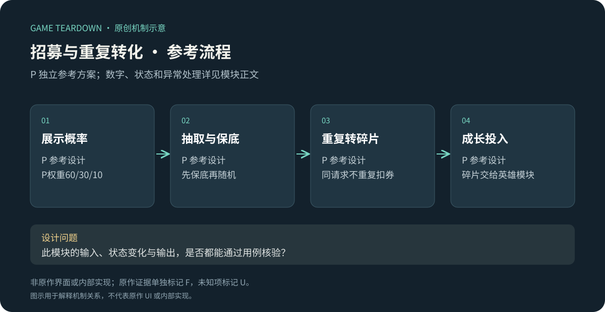
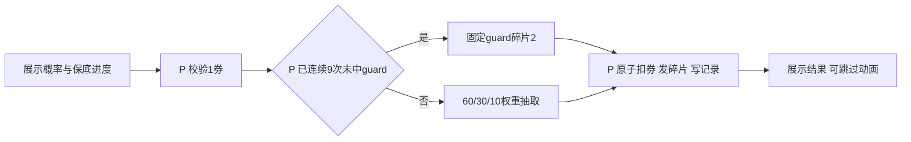

# 招募与重复获取转化

> `blue-planet-recruitment` · 手机App · 2026-10-16 · 资料级研究；P参考演示概率不代表原作。

原创P参考流程概览；下文F证据与此图分开阅读，不能据图推定原作规则。

**BP-F15（F，历史攻略）**：竞技场攻略把招募券作为玩法奖励之一，说明竞技参与与角色获取资源存在联系。[官方转载竞技攻略](https://www.taptap.cn/moment/694655628546670613)。这不能证明当前招募池、概率、保底或十连规则；这些全部为U。

I：招募需要同时解释“得到什么”“重复后如何处理”“离目标还有多远”。仅有抽取动画而没有概率和重复转化说明，不能形成可理解的成长路径。

## P参考范围与配置

实现一个永久免费券池，不接真实支付、不做限时UP。使用[公共契约](../../_framework/参考实现公共契约.md)、HERO英雄碎片模型。池含archer/fire/guard三种碎片包，权重60/30/10，每包2片；单抽1招募券，只做单抽入口，但连续提交必须逐次串行。演示初始账户3券。

`RecruitPool{id,version,entries[{heroId,weight,shards:2}],pityAfter:10}`；`RecruitRecord{id,accountId,poolVersion,sequence,result,pityBefore,pityAfter}`。连续9次未获得guard，第10次必给guard2片；出guard即重置计数0，其他+1。权重和保底优先级固定，保底触发不再随机。所有结果是碎片，所以不存在重复英雄实例；达到解锁条件由英雄模块显式解锁，不自动消耗碎片。

## P规则和状态

| 规则 | 条件／操作 | 结果 P |
|---|---|---|
| REC-R01 | 发起抽取 | 固定池版本，券不足拒绝；一次命令只抽一次 |
| REC-R02 | 判定结果 | 先保底后随机；写入计数与结果，同事务扣券和发碎片 |
| REC-R03 | 请求重复 | 返回原record，不再次消耗券和保底计数 |
| REC-R04 | 已发结果但动画中退出 | 下次进入展示未确认结果；已到账碎片不重复发放 |
| REC-R05 | 池版本下线 | 新抽取拒绝；已生成记录可查询；本参考保底计数跨同poolId版本继承 |

接口`GetPool`返回权重、保底规则、当前计数及费用；`Recruit(poolId,version)`返回记录与钱包；`ListRecords(cursor)`可查看最近100次，后端完整账本不因前端分页截断。新版本若删guard必须先做明确迁移配置，不允许自动把保底指向另一角色。

## UI／美术 P

REC-UI01：抽取按钮上显示1券和拥有数；REC-UI02：结果概率面板列60%/30%/10%及“最多10次获得guard，提前获得重置”；REC-UI03：结果直接显示碎片+2和当前总量；REC-UI04：保底计数9时显示“本次必得guard”。需要3头像碎片图、结果框、可跳过抽取动效；动画颜色不能暗示不存在的品质分层。

## 验收与取舍 P（未运行）

| 用例 | 给定→操作→预期 | 规则 |
|---|---|---|
| REC-T01 | count=9且1券→抽取→guard+2、count0、券0 | R02 |
| REC-T02 | count=3，固定随机落guard→结果后count0 | R02 |
| REC-T03 | 断网重试同requestId→只有一条record | R03 |
| REC-T04 | 结果已提交但未播放→重进→能看结果，碎片不再增加 | R04 |

P测试池是概率与重复获取链路的实现样例，不能当商业投放建议。评价时同时记录目标获取分布和每次操作负担；U需要原作概率公示、当前券来源、池继承和重复转化录屏。
