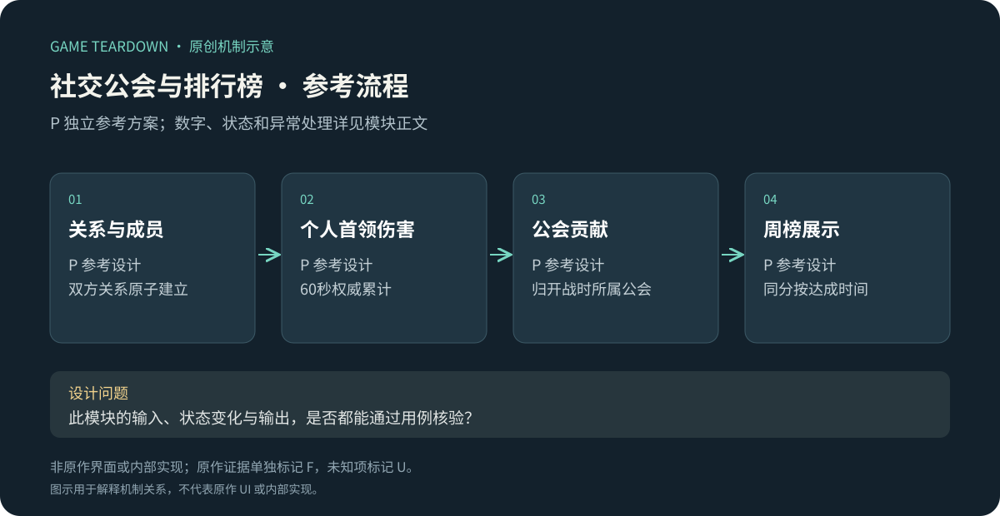
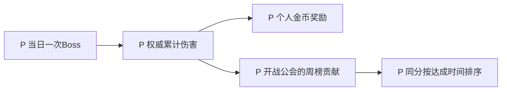

# 好友、公会、团体首领与排行榜

> 2026-10-19 参考规格：v2章节覆盖前文同名配置；未覆盖条款保留。原作规则见作者正文及对应日期来源。参考服务端尚未实现，网页原型只验证所注明的界面状态。

> `blue-planet-social` · 手机App · 2026-10-16 · 来源研究＋P参考设计。

原创P参考流程概览；下文F证据与此图分开阅读，不能据图推定原作规则。

**BP-F13（F，历史公告）**：2025-06-10公会Boss调整每日挑战次数和奖励，按伤害发奖；6月21日公告包含好友上限、聊天提示与组队筛选改动。[公会Boss公告](https://www.taptap.cn/moment/681511296339807133)、[社交优化公告](https://www.taptap.cn/moment/685667018652778832)。**BP-F14（F，历史攻略）**：领地资料列出主线、竞技、合作、矿场等不同榜单。[领地攻略](https://www.taptap.cn/moment/676741667339897316)。

I：排行榜需要解释比较的维度；公会Boss需要解释个人贡献和团体结果的关系。“更活跃”不是唯一目标，也应研究错过一天是否影响全公会、弱成员是否有合理贡献路径。

## P范围与实体

参考实现双向好友、公会成员、每日个人伤害Boss与周伤害榜。文字聊天与内容审核不在可实施切片内，使用4种预置短语；不引入无设计的开放UGC。遵循[公共契约](../../_framework/参考实现公共契约.md)。

`FriendRequest{id,from,to,state,expiresAt}`有效7天，双向好友上限50；`Guild{id,leaderId,members,maxMembers:20}`；`BossAttempt{attemptId,guildId,playerId,day,damage,result}`；`RankEntry{playerId,score,reachedAt}`。一人最多一公会。申请时满员不自动排队，重复申请复用原pending；退会立即生效，当日不能再参加另一公会Boss。

## P规则与配置

Boss是60秒不可击杀训练靶，使用单人TD棋盘、3演示英雄，无漏怪与死亡；每次英雄攻击仅累加伤害，不能重复击杀产币。初始30召唤币，每10秒补10币，无经验升级；每日1次。奖励金币=`min(200,floor(totalDamage/100)×10)`；不足100伤害得0，提交时显示门槛。

| 规则 | 事件／条件 | 结果 P |
|---|---|---|
| SOC-R01 | 发送好友申请 | 自己／已好友拒绝；未决申请不重复生成；双方未满才可接受 |
| SOC-R02 | 接受好友 | 一次写入双方关系并结束申请；一方满则不建立任何一边 |
| SOC-R03 | 入退公会 | 入会需空位和无其他公会；会长退会先转让给加入最早成员，无成员则解散 |
| SOC-R04 | 开始Boss | 服务端校验当天未挑战、入会记录和阵容；成功激活battle才占次数 |
| SOC-R05 | Boss结果 | 权威累计伤害、按公式发金币、累加该周分数；退会后结果归开战时公会，不给新公会贡献 |
| SOC-R06 | 排行 | 分数降序，同分达到该分时间早者先，再playerId；展示前100及本人行 |
| SOC-R07 | 周切换 | UTC+8周一00:00开启新榜，旧榜只读；跨界battle按开始时weekId记入旧榜，最多60秒宽限 |

接口 `RequestFriend/AcceptFriend/RemoveFriend`、`JoinGuild/LeaveGuild/TransferLeader`、`StartGuildBoss/SettleGuildBoss`、`GetRank(weekId)`；用户搜索只返回公开昵称头像和公开ID，不暴露账号私密字段。好友删除同步双方关系，但不删除已完成战报。预置短语不带资源与指令效果。

## UI／美术 P

SOC-UI01：好友待申请／已好友／满员说明；SOC-UI02：公会会长标识和退会影响确认；SOC-UI03：Boss伤害、60秒倒计时、预计金币；SOC-UI04：榜单维度、周区间、同分排序说明及本人置底行。需要关系图标、会长徽标、伤害榜图标和空列表页；角色头像来自项目自有资产，不假造真实玩家。

## 验收与风险 P

| 用例 | 给定→动作→预期 | 规则 |
|---|---|---|
| SOC-T01 | 接受时对方好友刚满→双方都不新增关系 | R02 |
| SOC-T02 | 会长退会→最早成员继任；最后1人退会→解散 | R03 |
| SOC-T03 | 伤害1250→结算→金币120；同结果重试不再加榜分 | R05 |
| SOC-T04 | 开战后退会加入另一公会→本次分数仍归旧会，当日不能再打 | R04/05 |
| SOC-T05 | 同分两人→早达成者在前；翻页与本人行排序一致 | R06 |

用例未运行。调参看公会内贡献集中度与低养成成员参与率，不以强制每日上线作为默认成功标准。U：原作当前好友上限、公会管理权限、跨服范围、所有榜结算奖励与隐私设置。

## v2 赛季公会分与转会归属

参考另建SeasonGuildScore{seasonId,guildId,playerId,score}；仅seasonCoop队长结算分数累加，不实现捐献和冰岛补给。开战固化guildId；期间退出仍归原公会，进入另一公会不能追溯转移。跨日后允许新公会参加，但已有battle不能再次提交贡献。

赛季榜按公会总分降序，同分用最早达到时间，再guildId。参考赛季结束时冻结榜；发奖对象取结束时已连续入会满24小时且至少贡献一次的成员，奖励统一100金币，不随排名变化。该门槛与奖励纯属参考，不是原作团体奖励。

结束前开战按关卡模块的180秒宽限接受结果，榜单在宽限结束后冻结；奖励任务使用seasonId＋guildId＋playerId去重。不能在正式截止一刻先发奖再接收改变排名的结果。

UI需并列个人贡献、公会总分和结算口径；未满24小时或未贡献的成员明确显示领取条件。好友预置短语、普通周伤害榜保持原规格，不能将赛季分数累加到常驻周榜。

验收：转会后旧场仍记原会；同场重试贡献只一次；剩23小时入会不满足24小时条件；最后有效场在宽限内改变排名，发奖等待冻结；普通周榜与赛季榜互不污染。待实现。
