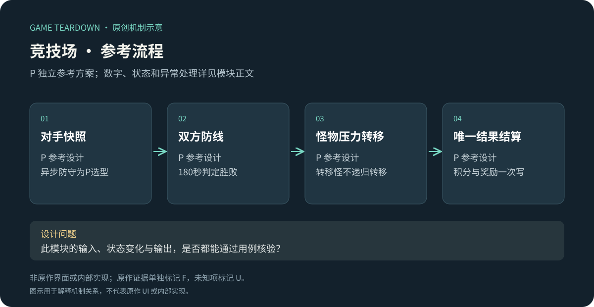
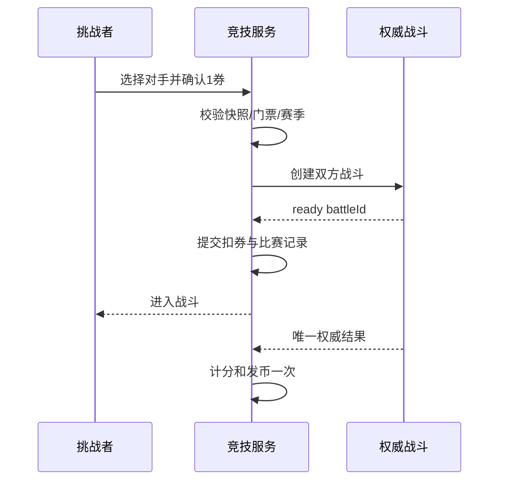

# 竞技场：压力转移、攻防阵容与重复挑战

> 2026-10-19 参考规格：v2章节覆盖前文同名配置；未覆盖条款保留。原作规则见作者正文及对应日期来源。参考服务端尚未实现，网页原型只验证所注明的界面状态。

> `blue-planet-arena` · 手机App · 2026-10-16 · 重点模块；F按来源日期，P为可开发参考方案。

原创P参考流程概览；下文F证据与此图分开阅读，不能据图推定原作规则。

## 原作证据与版本差异

**BP-F08（F）**：2025-06-10公告提到防守阵容与AI；6月21日公告说明击杀向对方发送怪物压力。[6月10日](https://www.taptap.cn/moment/681511296339807133)、[6月21日](https://www.taptap.cn/moment/685667018652778832)。早期领地攻略使用“实时”字样，不能与之后AI防守说明无日期拼接。

**BP-F09（F）**：2026-03-05明确App公告把扫荡券从每日清理改为每周周日24点清理，并提供券不足时的购买入口；公告中的快速战斗仍是后续计划。[App公告](https://www.taptap.cn/moment/778714788971675862)。这里只确认公告时点，未核实当前热更。

I：杀怪既解除己方压力，又对对手施压，形成进攻节奏与生存节奏的耦合。扫荡属于减少重复操作的另一层设计，不能替代首次挑战中对构筑的理解。

## P参考玩法范围

实现**异步防守快照挑战**，明确是选定的参考方案。挑战者操作自己的棋盘，对手快照由AI操作；双方共用权威模拟，无实时真人匹配。使用[公共契约](../../_framework/参考实现公共契约.md)和[召唤合成](召唤合成与战斗.md)，联网模式不允许暂停。局外成长与装备全量带入，显示对手快照等级，不宣称公平归一。

### 数据和数值 P

`ArenaProfile{rating=1000,tickets=3,defenseSnapshotId,seasonId}`；`Match{matchId,attackerId,defenderSnapshot,seed,state,result}`。每日00:00（UTC+8）免费补3券至上限3，不累积超过上限；一挑战1券，胜+20分、败−10分、平0分，积分下限0。胜得10竞技币、败5、平7；无扫荡、无购买券作为本切片范围，原作相关事实仍保留于上文。

匹配池按当前积分±200、同服、排除自己筛选，按积分差升序和profileId取3名；不足3名就展示实际人数，0名时进入明确标注的训练对手且不扣券、不计分、不发竞技币。不偷偷用机器人冒充真人。

## P流程与规则

P图解释事务；战斗创建完成但扣券提交失败时取消未激活battle，不让免费未登记比赛继续。

| 规则 | 前置／动作 | 结果 P |
|---|---|---|
| ARENA-R01 | 挑战开始 | 固化双方英雄/装备/防守方案，之后局外更改不影响本场；对方无需在线 |
| ARENA-R02 | 己方击杀普通怪 | 在对手路口排队生成1普通怪，出生延迟1000ms；每累计8杀额外发1精英，精英HP=普通2倍、漏怪扣2 |
| ARENA-R03 | 怪物转移再次被杀 | 带origin=transfer，不再次转移、不计8杀额外怪；防止无限互送循环 |
| ARENA-R04 | AI每500ms决策 | 先合并合法对中星级最低、格索引最小一对；否则能召唤则召唤一次；升级选择固定优先伤害、回血、币 |
| ARENA-R05 | 一方城堡先归零 | 对方胜；同tick双零平；180秒仍未结束按剩余城堡HP高者胜，相同平 |
| ARENA-R06 | 结果结算 | 只改挑战者积分/竞技币，防守者收战报不变分；同matchId只结一次 |
| ARENA-R07 | 挑战者掉线 | 权威战斗继续，玩家单位自动攻击但无手动召唤合成；30秒可重连；超时仍模拟到结果，不退款 |
| ARENA-R08 | 服务端故障无可信结果 | match标void，原券返1且不超过正常持有上限，多出券进待领取；不计分、不发胜败币 |

双方起始波次为每10秒3只普通怪，HP40、速度1m/s、路长10m；每30秒一只HP120的boss漏3血，不可转移。3分钟最多18组普通波和6只boss。三选一弹层不暂停，5秒未选默认伤害项，客户端无法靠断网冻结。

## P接口、UI和验收

`ListOpponents`返回快照摘要与有效期60秒；`StartMatch(opponentSnapshotId)`过期返回STALE不扣券；`GetMatch(matchId)`用于重连和结算查询。`SetDefense(presetId)`保存不可变快照；战报只展示已结算数据，不以客户端上报伤害决定奖励。

ARENA-UI01：对手积分/快照等级/“异步防守”标签；ARENA-UI02：双方城堡、转移队列和剩余秒数；ARENA-UI03：结果列积分、币与扣券，void单独显示；ARENA-UI04：已保存防守方案版本。资产用双路缩略图、压力箭头、精英标记与胜败平图标，避免只靠颜色辨敌我。

| 用例 | 给定→动作→预期 | 规则 |
|---|---|---|
| ARENA-T01 | 同请求开始两次→仅1比赛和1扣券 | R01 |
| ARENA-T02 | 杀8普通怪→发送8普通＋1精英；再杀转移怪→不再发送 | R02/03 |
| ARENA-T03 | 双方同tick归零→平，挑战者+7币、分不变 | R05/06 |
| ARENA-T04 | 180秒同血→平；不同血→高者胜 | R05 |
| ARENA-T05 | 开战后升级防守英雄→本场仍旧快照，下场新快照 | R01 |
| ARENA-T06 | 服务端无可信结果→void一次返券；重试不重复返 | R08 |

用例未运行。调参观察先手领先是否滚雪球、初期失误能否回稳、不同成长档匹配跨度。U：原作当前同步方式、匹配细则、奖励、赛季重置；不能用以上参考数字填充原作竞技场筛选。

## v2 对抗与资源接入

保留v1异步快照、180秒上限、胜败平奖励与AI规则。新增英雄与国王能力按成长v2，装备按六槽v2；防守快照包含国王天赋、披风与图腾，不能只记录三个英雄等级。

竞技币另设兑换：2竞技币换1招募券，每日最多5份；不与招募币共用。按UTC+8日切，ExchangeArenaToken(quantity)仅接受1..5且总数未超限；每次需显式确认整笔价格。胜10币最多完成当天5份兑换，失败5币可换2份余1币。这是参考经济桥梁，不是原作5/3券奖励。

券不足、快照失效、候选消失、结算处理中分别使用INSUFFICIENT/STALE/NOT_FOUND/RETRYABLE。对手列表只读摘要；确认挑战时锁定快照hash。异步防守AI不消费防守者真实券或钱包；对方战斗内货币完全隔离。

UI战报将自然怪击杀、转移怪击杀、精英发送量、城堡损失分栏。转移怪击杀可按TD奖励币和经验，但不计入新转移及8杀门槛；此项与v1 R03一致。参考不模拟扫荡，不能将页面原作扫荡说明错误接到同一API。

验收：胜一场10币兑换5券后日限归零；第6份拒绝；防守战结算不改防守者钱包；开战前变更国王天赋使旧客户端revision失效；战中变更不影响双方旧快照。待实现。
