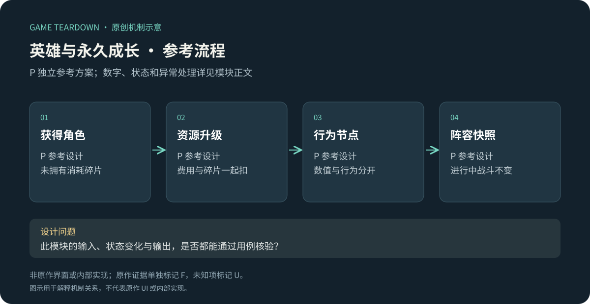
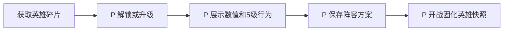

# 英雄与永久成长

> `blue-planet-heroes` · 手机App · 公开资料研究，2026-10-16。下列参考配置可供切片开发，未测试玩法平衡。

原创P参考流程概览；下文F证据与此图分开阅读，不能据图推定原作规则。

**BP-F05（F，玩家档案）**：洛姬资料按成长节点说明复制、护盾与复制时间变化；这说明至少该样本的成长不只增加攻击值。[官方转载的英雄档案](https://www.taptap.cn/moment/859896537528926567)。攻略时点、服务器开放和皮肤条件需单独核对。

I：设计者应把“数值升一级”和“学到一种新行为”分别呈现。跨模式带入永久养成时，竞技差距不再仅由局内决策产生；不能用胜率单独评价角色机制。

## P参考对象与边界

实现3个演示英雄的获得、升级、功能节点与4方案管理。国王成长、原作完整升阶表和角色数量均为U，不强行放进事实。使用[公共契约](../../_framework/参考实现公共契约.md)。

`HeroAccount{heroId,owned,level,shards}`，`RosterPreset{id,heroIds[],revision}`。初始拥有archer/fire/guard各1级，原型最高10级。从L升到L+1消耗金币`100×L`、该英雄碎片`2×L`，一次升一级；达到上限拒绝。解锁新英雄消耗10对应碎片。攻击系数=`10000+500×(L−1)`基点；5级功能为“战斗第一次召唤此英雄时立即额外获得5召唤币”，每英雄每battle只一次，未召唤不触发。该参考能力与洛姬原作无关。

## P规则和流程

| 规则 | 条件／动作 | 结果 P |
|---|---|---|
| HERO-R01 | 未拥有且碎片≥10→解锁 | 扣10，owned=true、level=1；不自动加入已保存阵容 |
| HERO-R02 | 已拥有、未满级、资源足够→升级 | 扣金币和碎片，level+1；同时更新显示；不改变进行中battle |
| HERO-R03 | 保存方案 | 正好3个已拥有且互不重复英雄；非法不覆盖旧方案；原型预置4个方案槽 |
| HERO-R04 | 开战 | 校验所选方案revision，生成不可变等级和效果快照 |
| HERO-R05 | 首次召唤5级以上英雄 | 以battleId+heroId去重给5币；合成、复制、重新召唤都不重复给 |

例：3→4级需要300金币＋6碎片；原有300金币、6碎片时升后均0；基础伤害10在4级系数1.15下取整11。升级差额、解锁与满级状态由客户端展示，资源所有权仍在服务端。

## P数据与接口

配置字段 `heroId,levelCap,unlockShardCost,costByLevel,attackBpsByLevel,milestones[]`；数组必须覆盖1..cap，所有费用非负整数、升级费用不可零以防错误配置。`UpgradeHero`返回hero/wallet；`SavePreset`返回preset；`BuildBattleRoster`返回hash及完整effectIds。`HeroUpgraded`用于大厅红点和展示，不让战斗监听后动态加属性。

异常：碎片被另一交易消耗→STALE/INSUFFICIENT、整笔不扣金币；配置升级导致等级上限缩减→既有档保留当前等级但禁止继续升，战斗快照用明确迁移表，不静默降级；迁移表缺失则停用新配置。

## UI／资产 P

HERO-UI01：等级卡显示攻击当前→下一等级、两种费用与不足数量；HERO-UI02：功能节点时间线区分未解锁、可达、已解锁；HERO-UI03：方案选择显示版本、缺角色原因。制作3头像、1碎片底、等级数字、5级能力图标、升级成功一次音；不要让“战力+N”替代具体效果。

## 验收 P（未运行）

| ID | 给定→动作→预期 | 规则 |
|---|---|---|
| HERO-T01 | L3且300币6碎片→升级→L4且余额0/0 | R02 |
| HERO-T02 | L3且币足碎片5→升级→两资源均不变 | R02 |
| HERO-T03 | battle用L4开始→大厅升L5→该battle无5级奖励，新battle有 | R04/05 |
| HERO-T04 | 5级英雄召唤、合成、再召唤→仅首次+5币 | R05 |
| HERO-T05 | 方案重复填同英雄→拒绝，旧方案保持 | R03 |

调参指标为目标等级等待时间与功能节点使用率。补证需求：当前App等级成本、国王成长、升阶、重置继承和模式带入限制。参考数值不得进入“原作成长成本”筛选。
