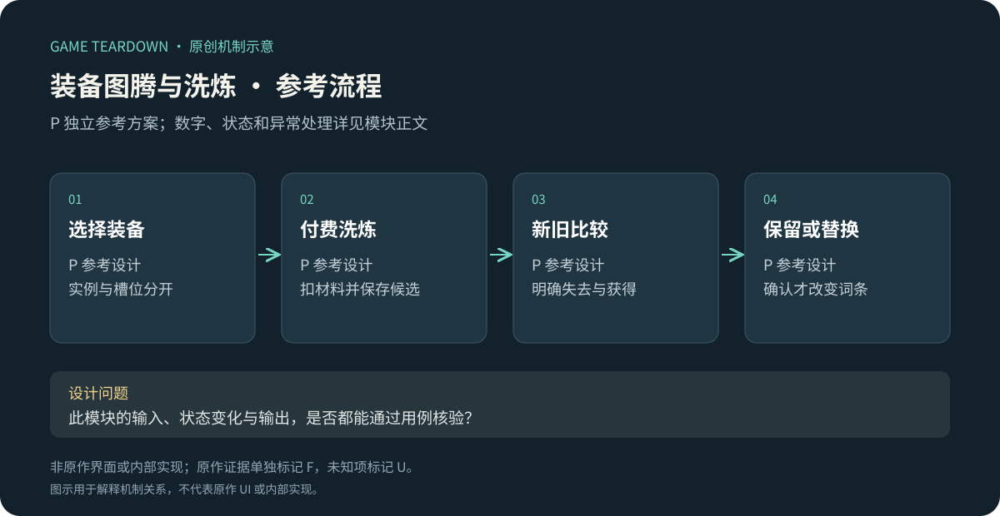
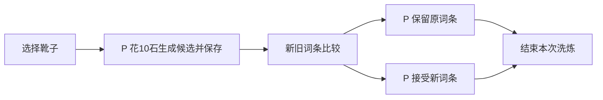

# 装备、图腾与洗炼

> 2026-10-19 参考规格：v2章节覆盖前文同名配置；未覆盖条款保留。原作规则见作者正文及对应日期来源。参考服务端尚未实现，网页原型只验证所注明的界面状态。

> `blue-planet-equipment` · 手机App · 2026-10-16 · F历史资料／P参考规格；用例未运行。

原创P参考流程概览；下文F证据与此图分开阅读，不能据图推定原作规则。

**BP-F06（F，攻略）**：靴子图腾资料按条件与玩法讨论词条搭配，排名属于作者判断。[官方转载玩家攻略](https://www.taptap.cn/moment/754639971863759829)。**BP-F07（F，历史公告）**：官方曾因资源投放情况调整装备分解的精炼石产出，表明回收与养成消耗需要联动管理。[2025-06-21更新](https://www.taptap.cn/moment/685667018652778832)。不把旧产出当现价。

这是BP-F06中的词条局部图：能读到英雄暴击率+6%；它只证明这张历史截图的一个词条，不能证明完整装备面板、所有品质或当前概率。图片仅研究引用。

I：装备对模式的适配可能高于简单品质排序。洗炼改变条件收益时，需要让玩家知道“换到了什么、失去了什么、为何此模式有用”；分解则承担物品回收和资源供给，不能单独优化按钮点击数。

## P切片与配置

只实现靴子一槽、两条词条、预览保留型洗炼与批量分解；不复刻原作图腾格数或词库。采用[公共契约](../../_framework/参考实现公共契约.md)。

`Equipment{id,slot:'boots',quality:1|2,affixes[],locked}`；`PendingRoll{rollId,equipmentId,oldRevision,candidate}`。初始背包一件品质1靴，词条为attack、baseHp。词条池 attack（英雄攻击+500基点）、crit（暴击率+300基点）、baseHp（城堡最大HP+1），等权重不放回抽2条。暴击伤害倍率15000基点，每次直接攻击独立抽取；攻击增益先加法汇总，暴击乘算后向下取整。城堡上限在开战初始化时加，不改变进行中战斗。

洗炼每次花10精炼石，品质1/2分解返3/8石；均为演示值。容量100实例按公共契约。锁定仅防分解，不阻止穿戴；洗炼锁定装备允许但需明确确认。原型不做锁词条、随机品质和付费扩容。

## P规则、状态与接口

| 规则 | 前置／动作 | 变化／反馈 P |
|---|---|---|
| EQ-R01 | 非战斗→穿戴靴子 | 更新槽位引用，旧件留包；下局快照使用新词条 |
| EQ-R02 | 有10石、无未决roll→洗炼 | 扣10、抽2条并持久化candidate；原词条暂不变；抽到相同组合也收费 |
| EQ-R03 | 接受或保留 | 接受时一次替换；保留丢候选；两者均不退10石；关闭页面保留未决roll |
| EQ-R04 | 未决roll存在 | 禁止再次洗炼、分解该件或转移该件；允许重新打开比较 |
| EQ-R05 | 批量分解 | 预校验每件未锁、未装备、无roll、存在；任一非法整批拒绝；成功整批删除并发石 |
| EQ-R06 | 新配置与已生成候选 | 候选保存具体数值和配置版本，接受时不重新抽取 |

接口 `EquipBoots(id)`、`BeginReroll(id)`、`ResolveRoll(rollId,accept)`、`Dismantle(ids[])`，返回完整wallet与装备diff；事件 `EquipmentChanged`、`RefineCurrencyChanged`。每请求走公共原子和幂等契约。装备在roll期间被非法删除视为状态损坏，拒绝接受并保留诊断，不把候选应用给另一件。

## UI／美术 P

EQ-UI01：新旧两列逐词条对比，不用总战力遮盖触发条件；EQ-UI02：装备／锁定／未决状态同时可见；EQ-UI03：批量分解确认展示数量、品质与预期返石，默认不选已锁和已装。资源为靴子占位图、3词条符号、锁/装备角标、两种品质边框。生成候选动效可跳过，结果由持久化状态驱动；洗炼失败不播放成功光效。

## 验收与风险

| ID | 给定→操作→预期 | 对应 |
|---|---|---|
| EQ-T01 | 石10→洗炼→石0且候选保存；关页重开→同候选 | R02/03 |
| EQ-T02 | 选择保留→旧词条不变、石不退、未决清空 | R03 |
| EQ-T03 | 未决时再次洗炼→拒绝且不收费 | R04 |
| EQ-T04 | 批量含1件锁定→全批无删除、无返石 | R05 |
| EQ-T05 | 品质1＋品质2两件合法→分解→返11石且实例均移除 | R05 |

P调参关注洗炼后接受率、连续无提升次数、材料净流量。U：当前原作槽位、图腾生成与装备是否同实例、完整词条概率、锁定/保留交互。不能把本参考“可保留”作为原作检索标签。

## v2 配置拓展：六部位、强化与条件效果

以下替代v1“仅靴子”的内容范围；新旧候选事务、批量分解与容量保护沿用。本节全部自设，不把六部位事实扩充成原作配置。

| 项目 | 参考配置 | 默认与边界 |
|---|---|---|
| 槽位 | head/body/hand/leg/feet/accessory | 每槽最多1件；初始仅feet一件；同实例不可占两槽 |
| 品质 | 1或2 | 分解3/8炼器石；不提供升品 |
| 强化 | 每部位等级0—20 | 每次金币100×目标级＋该部位书目标级；更换装备保留部位等级 |
| 强化效果 | 每级英雄攻击增伤+50基点 | 六槽加法汇总；只有该槽已装备时生效 |
| 洗炼 | 每件2条，不重复；attack/crit/baseHp等权 | 无锁10炼器石，锁1条20炼器石；最多锁1条 |
| 词条数值 | attack +500基点；crit +300基点；baseHp +1 | 同类加法；暴击率上限5000基点；暴击倍率15000 |
| 图腾 | 每方案最多1枚early或boss | 通s2送early，通s3送boss；不可同时装两枚 |

金币与部位书费用完整定义域为目标1..20；每部位满强化累计21,000金币、210本书，六部位合计126,000金币、各部位书各210本。炼器石与晶石是两个独立钱包资源，接口不接受旧泛称refineStone。

锁词条只影响重抽：锁1条时保留其ID与值，另一条从其余两种等权生成。保护锁只阻止销毁，与词条锁是两个字段；UI分别标注。候选生成时扣费，拒绝候选不退款；未处理候选时禁止再次洗炼、转移与分解该件。

early图腾在waveIndex≤3时英雄伤害增伤池+1000基点；boss图腾仅攻击boss目标时+1500基点。攻击结算时判断条件，不能在战斗开局永久烘焙进全体伤害。公会伤害靶为boss；竞技普通/转移精英不算boss；合作首领算boss。

强化接口UpgradeSlot(slot,targetLevel)，锁词条接口SetAffixLock(equipmentId,affixIdOrNull)，洗炼BeginReroll需带锁定字段revision；穿戴改为Equip(slot,id)，不再只接受靴子。仓库中受任一方案引用的装备不可分解，报出引用方案名称；批量中有任一非法项则全批失败。

UI增加六槽强化等级、单次费用、替换后保留项；新旧词条对比注明本次锁定与费用，未决候选可重新进入。新增资产六部位图标、两种图腾符号、保护锁与词条锁不同图标、方案引用标记。无需六套重复的洗炼界面。

验收：锁attack洗炼只能在crit/baseHp之间生成另一条；只有19石时锁1条洗炼整笔拒绝；强化19→20消耗2000金币20书；更换物品等级不变；引用于未选中方案的装备也不能分解；early在第4波不生效。均为待实现用例。
