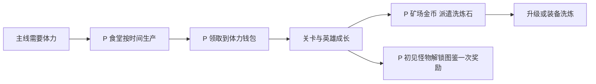

# 领地资源、派遣、食堂与图鉴

> `blue-planet-territory` · 手机App · 2026-10-16 · 历史资料分析＋P参考经济模块。

原创P参考流程概览；下文F证据与此图分开阅读，不能据图推定原作规则。

**BP-F12（F，2025攻略）**：领地攻略分别介绍矿场金币、矿鼠派遣产出、食堂体力、怪物图鉴及多个榜单入口。[官方转载财子攻略](https://www.taptap.cn/moment/676741667339897316)。原解锁关卡与产量属于当时记录，不能默认为现在有效。

I：这些子系统把不同时间尺度的资源需求集中到大厅。优点是玩家知道“缺什么去哪里”；代价是大量领取动作、红点和倒计时。将“有事可做”与“必须频繁上线”分开评价。

## P边界与配置

本篇分四个子模块交付，每个都有独立状态；排行榜由[社交](社交公会与排行榜.md)负责。采用[公共契约](../../_framework/参考实现公共契约.md)。

| 子模块 | 状态对象 | 演示配置 P |
|---|---|---|
| 矿场 | MineAccount{remainingDaily:2,claimedRunIds} | 每日2次，单次战斗用普通s1配置；胜100金币、败0；开始扣次数，失败不退 |
| 派遣 | Dispatch{id,startedAt,endsAt,memberIds,state} | 2个槽、每次1名已拥有英雄、时长2小时、产10洗炼石；同英雄不能两槽同派 |
| 食堂 | FoodStore{stored,lastAccruedAt,remainderSec} | 每10分钟产1体力，储存上限30；体力钱包上限100；不要求持续在线 |
| 图鉴 | Bestiary{discoveredEnemyIds,rewardClaimedIds} | 初次击杀normal/boss各解锁条目；每条一次20金币 |

派遣英雄仍可上阵，避免抢占战斗阵容；取消派遣无产出、无成本返还，因为出发不收费。食堂满仓期间溢出时间丢弃，不在领取后瞬间补满。矿场与派遣样例解锁条件为通s1，食堂和图鉴开局开启，均非原作解锁规则。

## P流程与规则

| 规则 | 输入／条件 | 结果 P |
|---|---|---|
| LAND-R01 | 进矿场 | 校验今日剩余次数和解锁；创建battle成功才扣1，日切不撤销正在打的battle |
| LAND-R02 | 开派遣 | 校验空槽、英雄存在且未派遣；保存服务端起止时间；未到endsAt不能领取 |
| LAND-R03 | 到时领取 | 派遣奖励只发一次，槽清空、英雄解除占用；客户端改时无效 |
| LAND-R04 | 查询食堂 | `newUnits=floor((elapsed+remainder)/600)`，stored夹到30；满仓后remainder=0，lastAccruedAt更新到当前 |
| LAND-R05 | 领取食堂 | 先结算产量，再转移min(stored,100−stamina)；余量留食堂，未领取部分不消失 |
| LAND-R06 | 首次有效击杀 | 解锁图鉴但不自动发金币；点领取一次20币，重复击杀不重复解锁奖励 |

例：食堂20、余时0、过120分钟→本可产12，实际stored30、余2丢弃；此时体力95→领取5，体力100、食堂25。若体力100则按钮显示容量已满，不改变stored。离线结算至今只使用服务端时间。

接口 `StartMine`、`StartDispatch(heroId,slot)`、`ClaimDispatch`、`QueryFood`、`ClaimFood`、`DiscoverEnemy`、`ClaimBestiary`。资源域处理钱包，活动计数域按日期分桶，旧日矿场结果不扣新日次数。后台恢复不能通过重复计时重复生成资源。

## UI／美术 P

LAND-UI01：四设施卡显示当前可执行动作和收益；LAND-UI02：派遣可用／进行／可领状态，禁止把倒计时结束当已到账；LAND-UI03：食堂显示25/30及“体力钱包已满”；LAND-UI04：图鉴未见／已见未领／已领。资产为4设施图、英雄头像复用、资源图标、完成标记；红点只在可领取且能产生实际到账时出现，满钱包另用说明图标。

## 验收 P（未运行）

| 用例 | 给定→操作→预期 | 规则 |
|---|---|---|
| LAND-T01 | 食堂20、过120分、体力95→领取→体力100、食堂25 | R04/05 |
| LAND-T02 | 派遣未到点，客户端时间改快→仍不可领 | R02/03 |
| LAND-T03 | 派遣领取请求重复→只得10石、只清一个槽 | R03 |
| LAND-T04 | 矿场跨零点结算→旧日消耗不扣新日2次 | R01 |
| LAND-T05 | normal击杀10次→图鉴只一个未领奖；重复领取只20币 | R06 |

P经济审计：每日免费满领矿场最多200金币、派遣每槽理论最多120石但不要求玩家如此上线、食堂受30仓储和100钱包双上限约束。此为参考配置推导，不是原作产能。U：当前矿鼠资源名、食堂数值、自动领取和完整图鉴。
