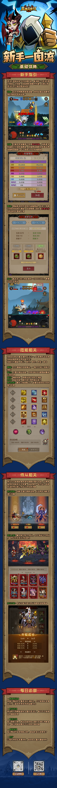

# 美术阅读入口 · 英雄没有闪 · 微信小游戏

先核对原图范围，再按每模块UI-ID和资产状态表制作。P流程图不代表原作界面；原图为研究引用，不自动纳入公开素材包。

[参考公共契约](../../_framework/参考实现公共契约.md)

| 模块 | 本岗阅读重点 |
|---|---|
| [刷宝战斗与混沌石](../systems/刷宝战斗与混沌石.md) | 危险、掉落和状态反馈的层次 |
| [装备处理与背包](../systems/装备处理与背包.md) | 容量、筛选、批量确认、新旧比较 |
| [祝福等级与头衔](../systems/祝福等级与头衔.md) | 概率前后、可领升级、条件缺口 |
| [技能符文与构筑](../systems/技能符文与构筑.md) | 冷却单位、兼容提示、效果归因 |
| [侍从招募与主协战](../systems/侍从招募与主协战.md) | 主副槽、盾血分离、招募结果 |
| [暗能与套装](../systems/暗能与套装.md) | 件数、生效条件、独立回收资源 |
| [主线日常与挖矿](../systems/主线日常与挖矿.md) | 模式成本、挖掘状态、作废反馈 |
| [离线收益与回流](../systems/离线收益与回流.md) | 有效时长、产量、满仓解释 |
| [运营活动与社交边界](../systems/运营活动与社交边界.md) | 截止时间、权益分项和取消反馈 |

## 已核读官方长图

来源[2025-02-12官网图解](https://www.37.com/yxmys/article.html?cate=gonglue&id=37)。从上向下看混沌石/战斗、祝福、头衔、技能、侍从、日常区域；它支持当时的共用介绍，不能证明当前微信布局或概率。长图保留完整上下文，各模块的SVG负责简明解释参考流程。

[另一张已核读的新手图](../assets/official-beginner-20250212.png)仅作阶段指引线索，不作为必走路线。

## 交付与验收边界

每个模块至少有一张本地SVG和详细规则图/流程文字。所有T用例目前是设计，未冒充执行通过。原作当前平台与数值缺口见各正文末尾；新增证据必须带来源、日期、平台和账号阶段。
