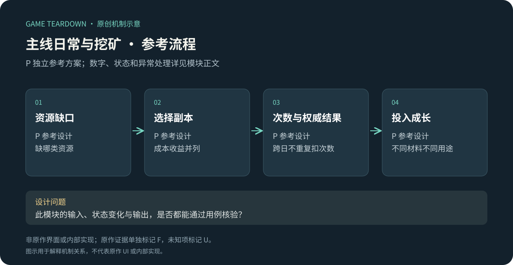

# 主线、日常副本与挖矿

> `hero-no-dodge-challenges` · 目标微信小游戏 · 2026-10-16 · F共用历史图稿，P可开发资源玩法。

原创P参考流程概览；下文F证据与此图分开阅读，不能据图推定原作规则。

**HN-F08（F，共用官方资料）**：一图流将主线、混沌石来源副本、首领讨伐、秘境和挖矿列为不同资源路径。[官方一图流](https://www.37.com/yxmys/article.html?cate=gonglue&id=37)。新手攻略提供分阶段推进建议，但建议不等于强制解锁条件。[官方新手攻略](https://www.37.com/yxmys/article.html?cate=gonglue&id=36)。微信模式范围和现行门票U。

I：副本分工能把资源缺口变成明确行动目标；过多日常则会挤压构筑实验时间。专业拆解要把“资源产出、参与成本、重复操作、失败损失”放在同一张表。

## P参考配置与边界

采用[公共契约](../../_framework/参考实现公共契约.md)。主线只做stage1/2各3只小怪＋手动Boss；小怪按IDLE，Boss HP100/160、每2秒伤害8/10，60秒未胜判失败；Boss攻击仍每次耗1石。首通各给100结晶，不重复领取；过stage1开日常，过stage2满足头衔条件。

| 日常P | 次数和操作成本 | 遭遇／收益 |
|---|---|---|
| stone_farm | 每日2次；不耗混沌石；30秒限时 | 6只30HP小怪依次出现；每杀1得10石，最多60；中途退出保留已核实击杀产出 |
| lord | 每日1次；不耗混沌石 | 100HP首领、每2秒伤8、60秒；胜10灵魂石，败0 |
| dark_rift | 每日1次；不耗混沌石 | 120HP首领、每2秒伤10、60秒；胜1个暗能，slot两种及set两种分别等权，rank1；败0 |
| mine | 每日5铲，不付费购买 | 4×4矿格，点一格耗1铲；产20石/20结晶/1加速券，权重5/3/2 |

日常使用同一技能/侍从快照，但将IDLE扣石覆盖为0，必须在开战界面显示“本模式不耗石”；未明确覆盖的规则继承IDLE。每日零点重置次数与铲子至上限，不累计。日常失败已消耗次数不退，服务器故障无可信结果返次数。

## P状态、流程与规则

| 规则 | 条件／输入 | 结果 P |
|---|---|---|
| CHAL-R01 | 主线3小怪已处理掉落 | Boss按钮开放；不自动强制开打，允许回营改构筑 |
| CHAL-R02 | 日常开始 | 检查解锁和本日剩余，创建battle后原子扣1；不同模式独立次数 |
| CHAL-R03 | 日常结算 | 以attemptId去重；牧场按击杀数，其他按胜败表发奖；同tick双方死判失败 |
| CHAL-R04 | 生成矿盘 | 每日首次进入按服务端seed预先抽16格奖励并保存；客户端只看已挖内容 |
| CHAL-R05 | 点击矿格 | 未挖且铲>0，扣1、标挖、发固定奖励同事务；重复点同格无额外消耗 |
| CHAL-R06 | 日切与重试 | 请求带dayId；旧日未提交请求EXPIRED不扣新日铲，已提交请求返回旧结果 |

矿盘不含连锁炸弹与隐藏连通规则，避免把纯资源点击包装成未定义策略玩法；正式新增工具时需补作用范围、连锁和资源结算。例：5铲第一次挖得到20石→铲4；同requestId重试仍铲4、石只20。

接口`GetChallenges`、`StartChallenge(mode,stage)`、`SettleChallenge`、`GetMine(dayId)`、`DigCell(dayId,index)`；奖励服务接收唯一rewardId。暗能掉落满包转待领取，不能因此吞掉挑战奖励。过期矿盘归档，不以刷新页面重新随机。

## UI／美术 P

CHAL-UI01：模式卡并列次数、时间上限、主要奖励和是否耗石；CHAL-UI02：Boss挑战前展示当前构筑快捷入口；CHAL-UI03：矿格未挖／处理中／已挖状态、铲数；CHAL-UI04：失败区分普通失败与服务器作废。资产为4模式图标、3资源图、16格可复用底板、Boss预警，不需要为每格单独画资源背景。

## 验收 P（未运行）

| 用例 | 给定→动作→预期 | 规则 |
|---|---|---|
| CHAL-T01 | 0混沌石但日常次数1→进入lord→允许且无扣石 | 模式覆盖 |
| CHAL-T02 | 牧场杀4退出→40石、次数已消耗1，重试不重复 | R03 |
| CHAL-T03 | 矿格重复点击→只耗1铲、只有一份奖励 | R05 |
| CHAL-T04 | 旧日格请求零点后才提交→EXPIRED，新日仍5铲 | R06 |
| CHAL-T05 | 暗能胜利但包满→奖励待领取、次数不回退 | R03 |

P指标：每日必做耗时、资源来源集中度、无效重复点击。U：微信当前副本解锁、挖矿工具、扫荡、暗能秘境完整规则和首领排行榜。
