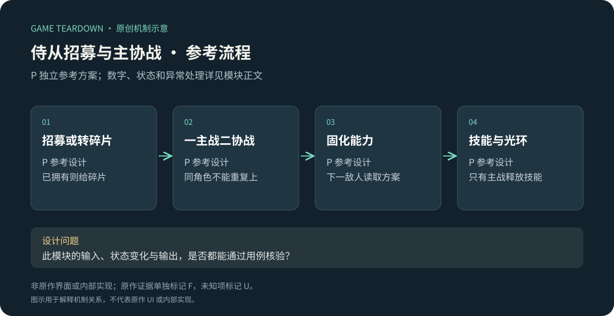
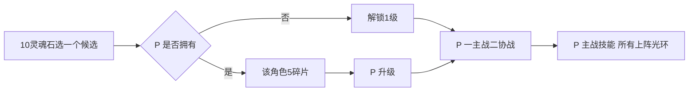

# 侍从招募、主战与协战

> `hero-no-dodge-companions` · 微信目标平台 · 2026-10-16 · 共用历史机制证据，微信适用性U。

原创P参考流程概览；下文F证据与此图分开阅读，不能据图推定原作规则。

**HN-F06（F，共用官方图稿）**：官网图解展示灵魂石招募与三名侍从阵容，其中主战参与战斗，其余提供辅助属性/光环。[官方一图流](https://www.37.com/yxmys/article.html?cate=gonglue&id=37)。不将图中的刷新、购买或培养费用当当前微信规则。

I：主战与协战让“拥有角色”与“角色在场上做什么”分离。收藏增益、光环和主动攻击若没有清楚层次，玩家很难判断升级究竟提高哪个部分。

## P范围与数据

参考实现一主战二协战、固定三候选招募、等级1–5；无星级、羁绊、收集全局属性。采用[公共契约](../../_framework/参考实现公共契约.md)。`Companion{id,owned,level}`，`Party{mainId,supportIds[2],revision}`。

| 侍从P | 主战每3次角色行动触发 | 光环（任意上阵位置） |
|---|---|---|
| guardian | 给主角护盾 `5×level`，持续直到吸收完或敌人结束 | 最大HP+10 |
| hunter | 对存活敌人造成 `4×level`直接伤害 | 攻击+1000基点 |
| healer | 治疗 `3×level`，不超过maxHp | 受到最终伤害减少500基点 |

初始只有guardian1级，允许空协战；所有上阵ID必须不同且已拥有。招募候选固定显示三者，每购买一次消耗10灵魂石：未拥有则解锁1级，已拥有则获得该角色5训练碎片。升级L→L+1消耗`5×L`对应碎片，最多5级；升级不立即恢复生命。角色与样例能力均为P自创。

## P规则与流程

| 规则 | 条件／输入 | 结果 P |
|---|---|---|
| PET-R01 | 确认购买候选 | 校验10石，解锁或发碎片与扣费同事务，重复请求不多买 |
| PET-R02 | 保存阵容 | 主战必填、协战0–2；重复ID或未拥有拒绝；一次更新全部位置 |
| PET-R03 | 开始敌人 | 固化等级与光环，同类百分比加法汇总；只有main有主动技能 |
| PET-R04 | actionSeq是3的倍数 | 角色伤害和DOT后、敌人还活着时执行主战技能；敌人已死不治疗/补盾刷收益 |
| PET-R05 | 护盾/治疗 | 护盾新值替换旧值不叠；敌人伤害先按减伤向下取整，再扣盾、再扣HP；换敌人护盾清零 |

例：主guardian L2、第3次行动后盾10；敌人伤害5且healer协战→floor(5×0.95)=4，盾剩6，HP不变。技能不额外耗混沌石，经验与掉落仍归冒险模块。阵容修改下一只敌人生效，不在当前伤害中途变更。

接口`RecruitCompanion(id)`、`UpgradeCompanion(id)`、`SaveParty`、`BuildPartySnapshot`；战斗消费`ResolveCompanionAction(actionSeq)`，返回效果事件，不能由侍从模块独立发第二份击杀奖励。

## UI／美术与验收 P

PET-UI01：主战大槽与协战小槽、明示“主战技能”和“上阵光环”；PET-UI02：招募卡写“解锁”或“已拥有→5碎片”；PET-UI03：培养详情等级变化前后数据；PET-UI04：盾与HP分别显示。需3占位角色、头像、主战/协战角标、盾/治疗/射击反馈；协战不生成假在场模型。

| 用例 | 给定→动作→预期 | 规则 |
|---|---|---|
| PET-T01 | guardian已拥有→购同角色→5碎片，不多1个实例 | R01 |
| PET-T02 | main与support同ID→保存失败，旧阵容保持 | R02 |
| PET-T03 | healer仅协战→有减伤，无每3行动治疗 | R03/04 |
| PET-T04 | 盾10、5伤、healer光环→盾6且HP不减 | R05 |
| PET-T05 | 第3次角色伤害已击杀→侍从不额外触发，不重复掉落 | R04 |

用例未运行。U：微信侍从当前数量、刷新/广告、主协战继承比例、升星和图鉴全局加成。P调参观察主战替换是否改变打法，而非只看拥有总数。
