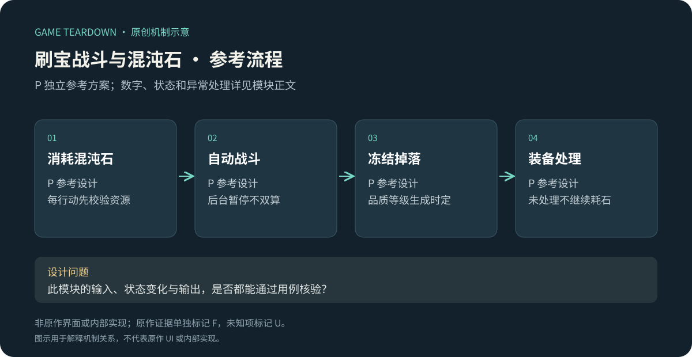
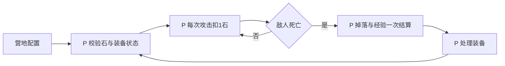

# 刷宝战斗与混沌石循环

> `hero-no-dodge-combat` · 目标平台：微信小游戏 · 2026-10-16 · 历史媒体证据与多端共用攻略分栏；P参考设计不代表微信现行规则。

原创P参考流程概览；下文F证据与此图分开阅读，不能据图推定原作规则。

## 原作证据与图解

**HN-F01（F，微信首发报道）**：2025-04-10媒体在讨论微信上线时描述了放置刷宝与技能构筑的结合。[GameLook原文新浪刊载](https://finance.sina.com.cn/stock/relnews/cn/2025-04-10/doc-inesrwyy3327215.shtml)。报道不是当前实机测量。

**HN-F02（F，共用历史图稿；微信适用性U）**：官网一图流把混沌石消耗、战斗刷装、装备分解和祝福提升连接起来。[2025-02-12官方图解](https://www.37.com/yxmys/article.html?cate=gonglue&id=37)。发布时间早于微信上线，不能把每次消耗细则自动移植到微信。

[查看已核读的官方长图](../assets/official-overview-20250212.png)：上半段的混沌石、战斗和祝福区域说明资源循环；不支持当前掉率、攻击帧数或微信离线结算。图文证据统一见[美术阅读入口](../roles/美术阅读.md)。

I：玩家的主要决策可能从操作躲避转向选择构筑、处理掉落和分配资源。分析重点是每次消耗能否得到可理解的进展，而非将“自动战斗”理解为完全无决策。

## P可开发切片

实现营地→自动战斗→掉落待处理→回营的循环。下列时序、消耗和数值全部P。遵循[公共契约](../../_framework/参考实现公共契约.md)，服务器权威结算；不猜原作技术架构。

`Adventure{id,stageId,state,enemyHp,attackSeq,loadoutSnapshot,pendingLootId}`；角色基础HP100、attack10，敌人HP30，每击杀1只给经验10并生成1装备；每3只开启手动Boss挑战入口。普通攻击每1000ms一次，**每次攻击消耗1混沌石**；初始20石。敌人每2000ms攻击一次，伤害5，普通伤害公式为max(1,攻击−防御)，双方演示防御0。技能修正见[技能](技能符文与构筑.md)。

## P规则与流程

| 规则 | 条件／动作 | 状态与反馈 P |
|---|---|---|
| IDLE-R01 | 开始冒险 | 无待处理掉落且混沌石>0；固化英雄/技能/侍从快照；进入Running |
| IDLE-R02 | 到攻击tick | 先校验并扣1石，再应用技能和伤害；石不足→暂停回营，不产生免费攻击 |
| IDLE-R03 | 怪死亡 | 同attackSeq只结算一次；原子给经验与掉落队列，停战进入LootPending，不继续扣石 |
| IDLE-R04 | 主角死亡 | 本敌未掉落不生成奖励；已扣石不返；回营满血，保留已到账经验和装备 |
| IDLE-R05 | 玩家退出或后台 | 当前战斗保存后暂停，不继续逐次扣石；离线收益按独立模块，不重复模拟同一敌人 |
| IDLE-R06 | 最后一击双方死亡 | 先按actorId固定顺序收集本tick伤害，双方结果一起提交；玩家死亡优先，未发本敌奖励 |

处理完掉落后可继续当前关；石恰好在击杀时用尽仍发该次合法奖励，再回营。战斗中换装备不即时改变快照，下一只敌人开始前读取新方案。多端同时登录只允许一个活动session持有战斗租约，第二端只读并提示；不双开刷同一资源。

## 数据、接口与UI P

配置 `attackIntervalMs=1000,enemyAttackIntervalMs=2000,stonePerAttack=1,normalHp=30,normalAttack=5,killXp=10`；时间都是50ms倍数。`StartAdventure`、`PauseAdventure`、`ResolveAttack`为权威接口，客户端只能发开始/暂停，不能提交任意击杀数。输出`LootReady`、`ExperienceGranted`、`AdventurePaused{reason}`；掉落归装备模块，经验归成长模块。

IDLE-UI01：当前混沌石与每次攻击费用；IDLE-UI02：自动战斗中／待处理／石不足／死亡原因；IDLE-UI03：Boss可挑战但不强制自动进入。资产：角色攻击、受击、倒地；敌人对应状态；掉落光柱与伤害数字分层，掉落处理按钮不能被动效遮挡。

## 验收 P（未运行）

| ID | 条件→操作→预期 | 规则 |
|---|---|---|
| IDLE-T01 | 3石、10攻、30HP敌→3次攻击→石0、经验10、1待处理掉落 | R02/03 |
| IDLE-T02 | 2石同敌→2次后暂停、敌10HP，不生成第三次攻击 | R02 |
| IDLE-T03 | 掉落未处理等待30秒→不继续耗石、不再发装 | R03 |
| IDLE-T04 | 同attackSeq重试→只扣1石和结算一次 | R02/03 |
| IDLE-T05 | 进入后台→恢复→从已保存状态继续，不再扣已完成那次石 | R05 |

P指标：每装备所耗石、待处理停顿、构筑差异对消耗效率的影响。U：微信当前扣石事件、倍率、自动继续、死亡和后台规则，需同账号录制资源变化确认。
