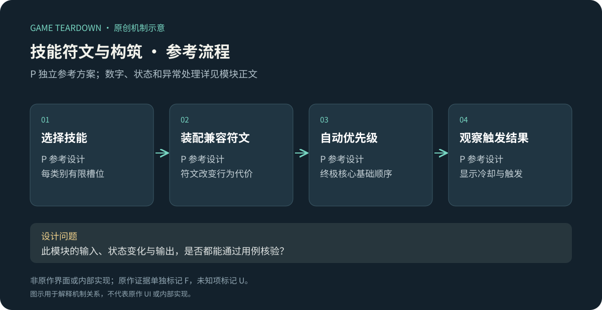
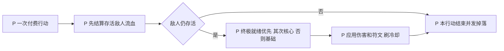

# 技能、符文与自动战斗构筑

> `hero-no-dodge-build` · 微信小游戏首发时期证据 · 2026-10-16 · F与P分离，未实测当前版本。

原创P参考流程概览；下文F证据与此图分开阅读，不能据图推定原作规则。

**HN-F05（F，媒体）**：微信上线报道介绍技能与符文组合、主动选择的被动技能及后续成长体系。[GameLook／新浪](https://finance.sina.com.cn/stock/relnews/cn/2025-04-10/doc-inesrwyy3327215.shtml)。官方早期图稿也展示技能分类，但截图部分字样不清，不以模糊标签确定当前分类数。[共用图解](https://www.37.com/yxmys/article.html?cate=gonglue&id=37)。

I：自动战斗将“何时按技能”转为“带什么、按什么顺序自动执行”。符文若改变目标、触发或资源关系，会比单纯伤害增加更能支持流派；代价是联动解释和异常测试数量增长。

## P可实施对象与配置

仅做1基础技能、1核心技能、1终极技能和1被动槽，两个方案；并非原作槽位复刻。使用[公共契约](../../_framework/参考实现公共契约.md)，基础攻击由IDLE每1000ms提供一次行动、每行动扣1混沌石。

| 槽／选项 P | 配置与效果 |
|---|---|
| 基础 slash | 攻击×1.0，默认可用 |
| 核心 heavy | 攻击×2.0，行动冷却3次；首次第1次可用 |
| 核心 spin | 攻击×1.6，冷却2次；与heavy二选一 |
| 终极 burst | 攻击×4.0，冷却8次；首次第1次可用 |
| 被动 fortify | 最大HP+20，开始敌人时取快照，不即刻治疗 |
| 符文 bleed | 只能装heavy：命中后每后续行动前流血伤害2，共3次 |
| 符文 swift | 只能装spin：冷却从2变1，倍率从1.6降到1.2 |

每技能最多1符文。技能与符文在此样例开局全部解锁，不做概率获取；初始heavy/bleed、burst、fortify。对象 `SkillPreset{basicId,coreId,ultimateId,passiveId,runeBySkill,revision}`，`Runtime{nextReadyActionBySkill,dots[]}`。

## P规则与流程

| 规则 | 条件／动作 | 结果 P |
|---|---|---|
| SKL-R01 | 保存方案 | 每槽一合法技能；符文兼容；任一非法整份拒绝，不清旧方案 |
| SKL-R02 | 付费行动开始 | actionSeq+1，先结算DOT；本次已扣石，若DOT击杀仍不退款，也不对空目标放技能 |
| SKL-R03 | 选择主动技能 | 按终极→核心→基础，第一个ready执行；施放后nextReady=actionSeq+cooldown |
| SKL-R04 | bleed刷新 | 同目标只保留一条自身流血，重施刷新为3次、不叠数量；DOT不触发bleed或暴击 |
| SKL-R05 | 进入新敌人／换方案 | 重读方案，主动冷却沿冒险session保留；新技能首次nextReady=当前seq+冷却，防换装刷新大招；新session从全部ready开始 |
| SKL-R06 | 技能附加效果 | 每行动触发链最多4层，同effectId同root只触发一次；所有收益效果不得递归创建额外付费行动 |

伤害公式 `max(1,floor(attack×skillBps/10000×(10000+bonusBps)/10000−defense))`，攻击和加成来自装备/暗能/侍从快照。例attack10、heavy倍率20000、bonus1000、防御0→22。一次行动只花1石，不按命中段数重复扣费；这是一项明确P取舍。

## 接口、UI与验收 P

`SaveSkillPreset`返回revision和效果清单；`BuildSkillRuntime(snapshot)`、`ResolveAction(actionSeq,target)`供战斗域调用，不能由客户端指定伤害。输出`SkillUsed{id,damage}`、`StatusApplied{id,durationActions}`用于表现和诊断。

SKL-UI01：配置面板含技能类型、符文兼容、取舍；SKL-UI02：战斗中技能冷却用“还需N次行动”，不伪显示秒；SKL-UI03：伤害日志可开关，显示直接/DOT/侍从来源。需要4主动图标、1被动、2符文图和3类动效；流血图标标剩余行动数。

| 用例 | 给定→动作→预期 | 规则 |
|---|---|---|
| SKL-T01 | 全部ready第1行动→使用burst，第2行动→heavy | R03 |
| SKL-T02 | heavy第2行动施放，冷却3→第5行动重新ready | R03 |
| SKL-T03 | spin安装bleed→保存失败，旧方案不变 | R01 |
| SKL-T04 | 流血击杀敌人→本行动只扣1石、只一份掉落、不放空大招 | R02 |
| SKL-T05 | 新敌人切换终极→不能立即借换装重置已有冷却 | R05 |

用例未运行。P指标：构筑是否改变资源效率、玩家能否说明符文代价。U：当前微信技能分类、符文获取/升级/套装、优先级和所有冷却，应补战斗录像与技能详情。
