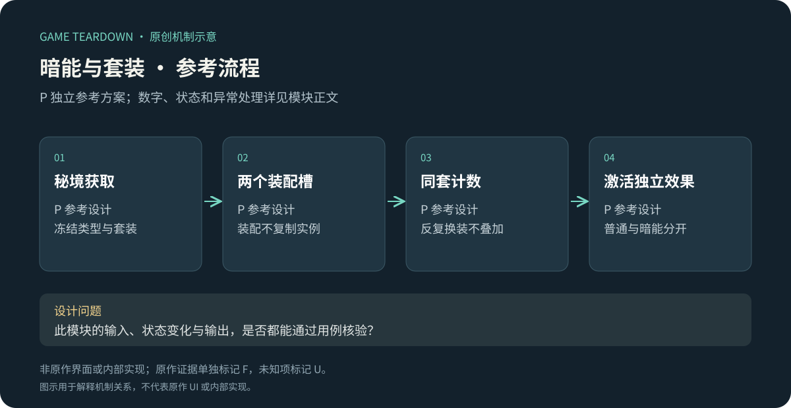
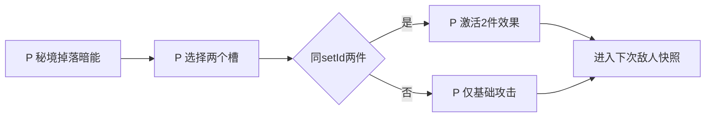

# 暗能与套装：第二套构筑成长

> `hero-no-dodge-dark-energy` · 微信首发报道提供存在性线索 · 2026-10-16。详细规则U，P为独立参考模块。

原创P参考流程概览；下文F证据与此图分开阅读，不能据图推定原作规则。

**HN-F07（F，媒体描述）**：微信上线报道将后期开启的暗能列为另一条关键养成体系。[GameLook／新浪](https://finance.sina.com.cn/stock/relnews/cn/2025-04-10/doc-inesrwyy3327215.shtml)。早期官网图稿有“威能秘境”等字样，不能仅因读音相近就断言与后来的暗能系统完全相同。当前槽位、层级、套装、掉率都需微信采证。

I：增加第二套装备可能扩展组合空间，也可能重复第一套的线性属性。模块分析应先找它独有的决策，再讨论养成深度；不能因为名称不同就判定机制创新。

## P参考范围与配置

只做2个暗能槽（sigil/core）与两种2件套效果，作为独立方案验证，不宣称原作采用此结构。采用[公共契约](../../_framework/参考实现公共契约.md)。`DarkItem{id,slot,setId,rank:1|2}`与`DarkLoadout{sigilId,coreId,revision}`。每件基础属性：rank1攻击+1，rank2攻击+2；两槽合计。材料升级1→2固定消耗20暗能粉尘，原型上限2。

| P套装 | 2件同套生效 | 限制 |
|---|---|---|
| blood | 角色直接攻击命中后回复本次实际伤害的10%，向下取整 | 不含DOT和侍从伤害；不超maxHP，击杀可回血 |
| focus | 核心技能伤害增加2000基点 | 与其他核心增伤相加，不减少冷却 |

初始不拥有；秘境[日常挑战](主线日常与挖矿.md)提供掉落。已装占通用背包容量，默认锁定为true；分解未锁未装备暗能rank1/2返5/10粉尘，不沿用普通装备结晶配方。

## P规则、接口和状态

| 规则 | 输入／条件 | 状态和结果 P |
|---|---|---|
| DARK-R01 | 装配到兼容槽 | 原件留包，新件引用替换；不允许同实例占两槽 |
| DARK-R02 | 求套装 | 按不同实例计数，2件同set激活一次；反复穿脱从零重算 |
| DARK-R03 | 升级 | 非战斗、rank1且粉尘≥20→扣20升2，保留instanceId和套装 |
| DARK-R04 | 分解 | 未装未锁无方案引用才允许，删除与返粉同事务 |
| DARK-R05 | 血套回复 | `heal=floor(actualDirectDamage×1000/10000)`；先结直接伤害再回血，角色已死亡不复活 |

接口`EquipDarkItem`、`UpgradeDarkItem`、`DismantleDarkItems`、`BuildDarkSnapshot`；输出`SetBonusChanged{setId,count,active}`给界面。战斗伤害事件须携带sourceKind，不能把DOT冒充直接伤害吸血。

## UI／美术 P

DARK-UI01：两槽图，显示0/2、1/2、2/2；DARK-UI02：套装效果完整描述与生效条件，不只点亮名称；DARK-UI03：升级保留套装的前后对比、粉尘费用；DARK-UI04：分解返粉而非结晶。制作两套×两槽4个占位图、套装连线、激活标记和独立资源图标，避免普通装备与暗能回收资源混淆。

## 验收与边界 P（未运行）

| ID | 给定→操作→预期 | 规则 |
|---|---|---|
| DARK-T01 | 同套两件→激活一次；卸一件→失效，基础属性同步变化 | R01/02 |
| DARK-T02 | 血套直接伤害27→回复2；DOT27→不回复 | R05 |
| DARK-T03 | rank1且20粉→升级→rank2、粉0、set不变 | R03 |
| DARK-T04 | 已装备或锁定→分解→失败、粉尘与物品不变 | R04 |

P指标：不同套装的选择情境、换装后策略变化、与普通装备属性重复度。原作完整暗能地图与套装采证优先级高；当前文档中P数量和词条均不得进入原作标签。
