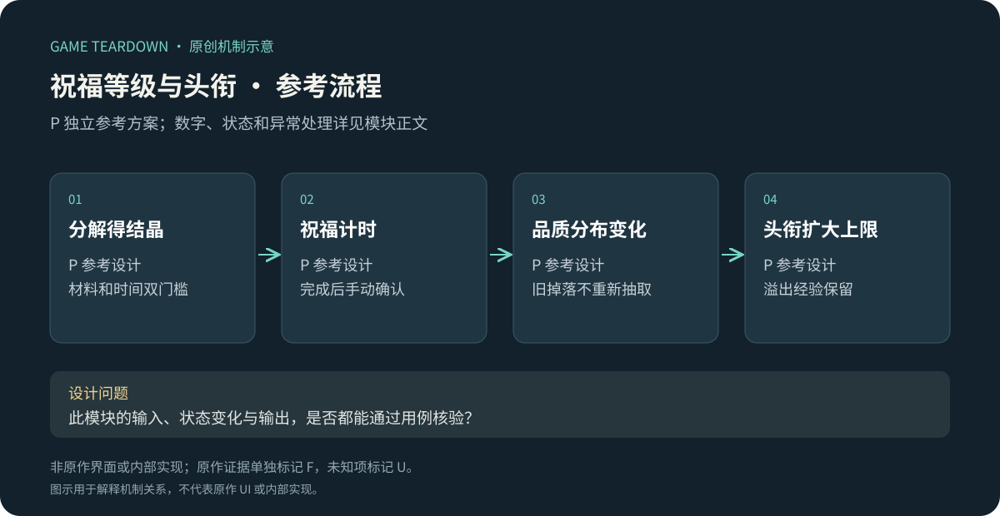
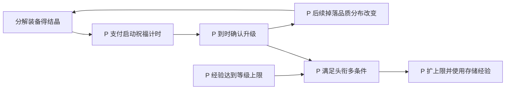

# 祝福、角色等级与荣誉头衔

> `hero-no-dodge-progression` · 微信目标平台 · 2026-10-16 · 重点模块；共用历史证据，微信细则待核实。

原创P参考流程概览；下文F证据与此图分开阅读，不能据图推定原作规则。

**HN-F04（F，共用图稿）**：官方一图流把分解产出的结晶用于提升祝福，并将祝福与更高品质装备机会联系；另展示荣誉头衔对等级上限的影响与多条件升级。[官方图解](https://www.37.com/yxmys/article.html?cate=gonglue&id=37)。图中概率及计时只属于该旧账号截图。

I：这不是同一根经验条，而是“刷装备→回收材料→提高掉落分布→获得更好装备”的反馈环，角色等级和头衔另提供进度门槛。应检查三条线是否互相促进，还是形成多重等待。

## P对象与演示配置

依赖[公共契约](../../_framework/参考实现公共契约.md)、BAG回收、IDLE经验。`Progress{level=1,xp=0,title=0,blessing=1,upgradeJob|null}`。角色每升一级需100XP，经验溢出保留；头衔0上限5，头衔1上限10。祝福最高3级，只有一升级队列。

| 升级 P | 成本／计时 | 结果 |
|---|---|---|
| 祝福1→2 | 100结晶，60秒 | 品质1/2/3权重80/18/2变60/35/5 |
| 祝福2→3 | 300结晶，180秒 | 权重变40/45/15 |
| 头衔0→1 | 角色≥5、祝福≥2、首通stage2；免费 | 等级上限10，立刻消费已存XP连续升级到上限 |

加速道具一张减少30秒，可批量但最多使用ceil(remaining/30)张，多余选择不消耗；不做广告加速或付费加速接入。待完成计时到达后需要点击领取升级结果；在领取前掉落仍按旧祝福。所有权重是P演示，不对应图中原作概率。

## P规则、流程与公式

| 规则 | 输入／条件 | 结果 P |
|---|---|---|
| GROW-R01 | 获得XP | xp累加，若level<cap则循环每100升1级；达上限剩余XP保留 |
| GROW-R02 | 开始祝福升级 | 未满级、无job、结晶足够→扣费和job原子创建；不支持取消退款 |
| GROW-R03 | 领取升级 | now≥endsAt才允许；level+1、job清空，重复领取无效 |
| GROW-R04 | 使用加速 | 对指定job减少时间，至多到now；到时不自动升祝福，仍需领取 |
| GROW-R05 | 升头衔 | 三条件同时满足；无消耗；cap更新后执行R01消费已有XP |
| GROW-R06 | 装备生成 | 固化当时祝福版本与角色等级；领取旧掉落不按新概率重抽 |

例：level5/cap5/xp250→升头衔→level7/xp50，不能把250经验全部清零。概率抽取使用[公共契约](../../_framework/参考实现公共契约.md)权重区间，权重总和100；不是浮点概率比较。

## P接口与UI

`GrantXp`只接权威战斗奖励；`StartBlessing/AccelerateBlessing/ClaimBlessing`返回job与钱包；`UpgradeTitle`返回逐项条件和新等级；`GetDropProfile`仅装备生成域调用。多端共享同job，客户端计时到0只是提示，不能自行提升品质。

GROW-UI01：当前与下级三品质概率并列，总和100%；GROW-UI02：升级中、可领取、满级状态；GROW-UI03：头衔三个条件逐项√或差值；GROW-UI04：经验封顶时显示“已储存250XP”。需祝福图标、品质概率条、3条件图标、计时条；到时提示与实际领取成功用不同反馈。

## 验收 P（未运行）

| ID | 条件→操作→预期 | 规则 |
|---|---|---|
| GROW-T01 | 100结晶祝福1→启动→0结晶、60秒job、祝福仍1 | R02 |
| GROW-T02 | 剩余40秒选3加速券→只用2，时间到now、仍待领取 | R04 |
| GROW-T03 | 头衔条件缺stage2→升级失败，其他条件不“消费” | R05 |
| GROW-T04 | lv5/xp250→合法升头衔→lv7/xp50 | R01/05 |
| GROW-T05 | 祝福1生成掉落、祝福2领取→保留原品质结果 | R06 |

P调参看材料等待与计时等待是否重叠、头衔门槛是否提供清晰下一步。U：微信当前成本曲线、速度倍率、广告、实际上限与经验溢出规则。
