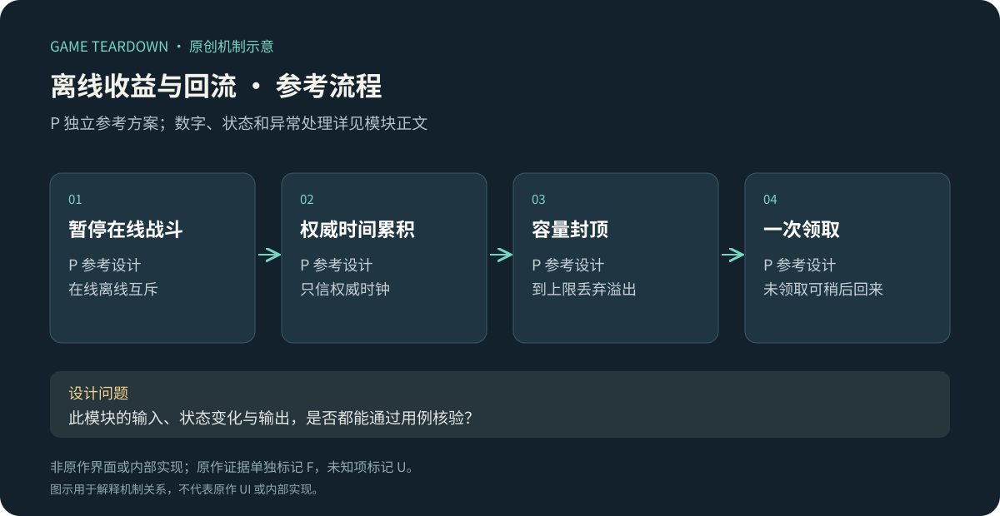
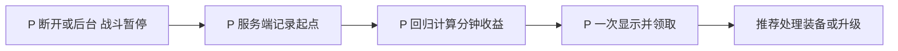

# 离线收益与回流提示

> `hero-no-dodge-offline` · 目标微信小游戏 · 2026-10-16 · 共用产品承诺／P独立离线模块。

原创P参考流程概览；下文F证据与此图分开阅读，不能据图推定原作规则。

**HN-F09（F，共用开发商介绍）**：产品介绍包含放置与离线收益方向。[开发商页面](https://www.iplay11g.com/gamecon-meiyoushan.html)。此承诺不证明微信的收益上限、是否耗混沌石、广告翻倍或物品类型。

I：离线进展应让玩家回归后有清楚下一步，也要与在线消耗区分。不能同时计算后台实战和离线模拟而重复产出；回归弹窗若层层领取，会增加回来的成本。

## P范围与配置

参考离线只产结晶，不刷装备、不扣石、不推进主线。采用[公共契约](../../_framework/参考实现公共契约.md)。`OfflineLedger{lastAccruedAt,pendingCrystal,remainderSec,revision}`，固定每60秒1结晶，未领取累计上限480（8小时产量），最少整分钟才有产出。离线资格为主线stage1首通，后台暂停战斗后才能进入离线计时。

## P规则和计算

| 规则 | 条件／动作 | 结果 P |
|---|---|---|
| OFF-R01 | session转离线 | 保存战斗暂停状态与lastAccruedAt；多设备仍有活跃session时不算离线 |
| OFF-R02 | 回归计算 | elapsed=max(0,now−lastAccruedAt)，units=floor((elapsed+remainder)/60)，pending=min(480,pending+units) |
| OFF-R03 | 到上限 | 丢弃溢出和余秒；若未到上限保留模60余秒；lastAccruedAt更新，防重复计算 |
| OFF-R04 | 点击领取 | pending全部发到结晶钱包，pending清0；重复requestId不再发；此切片无广告翻倍 |
| OFF-R05 | 关闭弹窗未领取 | pending保留，大厅入口可继续领；在线期间停止新增，不能靠重复开关刷分钟 |

例：离线90秒→1结晶＋30余秒；本次不领，随后再次离线30秒→累计2结晶、余秒0。离线10小时最多480，不是600。微信客户端时钟只用于展示，计算依赖权威服务时间。

接口`OnSessionBackground`、`GetOfflineSummary`、`ClaimOffline`；状态 `Online→Accruing→Pending→Online`，Pending与Online可同时存在为未领取余额。断线时服务端以最后心跳加15秒确认离线；最后在线活动之后的15秒不产离线收益，避免与在线战斗重叠。

## UI／美术 P

OFF-UI01：离线有效时长、每分钟速率、上限、当前收益；OFF-UI02：到上限说明“已满，不再累积”；OFF-UI03：领取成功后只给一个与资源相关下一步入口，不层层嵌套奖励。资产为时钟、结晶图标、容量进度条、无收益空态；不要展示并未产生的装备图作为诱导。

## 验收 P（未运行）

| 用例 | 给定→动作→预期 | 规则 |
|---|---|---|
| OFF-T01 | 90秒后回归再离线30秒→累计2结晶 | R02/03 |
| OFF-T02 | 离线10小时→480；连续查询仍480 | R02/03 |
| OFF-T03 | 同领取请求2次→只发一笔，pending0 | R04 |
| OFF-T04 | 设备A离线而B在线→不启动离线收益 | R01 |
| OFF-T05 | 客户端时钟调快1天→权威收益不变 | 时间契约 |

U：微信真实离线入口、上限、耗石与翻倍。P指标：回归到首次有意义操作的时间、领取误解率；不能以更频繁回访一项指标评价所有设计。
