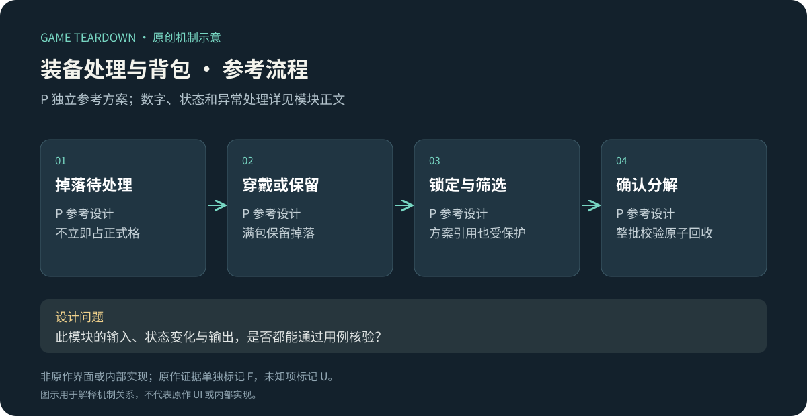
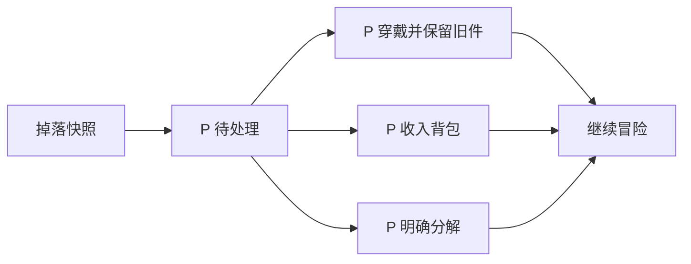

# 装备处理与背包保护

> `hero-no-dodge-inventory` · 目标微信小游戏 · 2026-10-16 · 重点模块。原作背包完整规则U；P提供可开发方案，不能用于宣称原作拥有这些功能。

原创P参考流程概览；下文F证据与此图分开阅读，不能据图推定原作规则。

**HN-F03（F，共用历史图稿）**：官方图解展示装备带来战力提升、淘汰装备分解为奥术结晶。[官网图解](https://www.37.com/yxmys/article.html?cate=gonglue&id=37)。微信当前容量、筛选、锁定、批处理、自动分解和扩容均未核验。

I：刷宝的物品吞吐量高，整理成本会不断累积。应分别研究新装备即时决策和长期保留管理；“战力更低”不能成为自动销毁套装或构筑核心的充分理由。

## P范围与对象

参考做3槽装备（武器/胸甲/饰品）、100实例背包、掉落待处理队列、锁定、筛选、批量分解。采用[公共契约](../../_framework/参考实现公共契约.md)。不实现物品交易、扩容付费、自动分解或真实原作套装表。

`Gear{id,slot,level,quality:1|2|3,affixId,locked,sourceRewardId}`；装备引用不复制实例。基础属性：武器攻击=`2×level×quality`，胸甲HP=`5×level×quality`，饰品攻击=`level×quality`；三类默认一个affix，演示池attack_pct(+500基点)或health_flat(+10)，等权重。品质概率由祝福模块提供，装备等级取发放时角色等级，不因稍后升级变更。

分解返结晶=`quality×10`，不随level变化。锁定或已装备不可分解；装备被收藏到方案仍视为受保护，即使当前没穿。前端筛选支持槽位、品质、等级范围、锁定和方案引用，排序quality降序、level降序、id升序，筛选不改变物品状态。

P掉落生成顺序固定：按武器/胸甲/饰品等权重各1抽槽位→按祝福快照抽品质→冻结当前角色等级→按两词条等权抽1个；四步使用同一奖励随机序列并保存结果。创建时未锁定，装备和方案引用保护独立计算。没有隐藏保底或随账号付费变化的权重。

## P规则和状态

| 规则 | 前置／动作 | 结果 P |
|---|---|---|
| BAG-R01 | 新掉落到达 | 先进入待处理队列，不自动入包；队列项不是可装实例，转入时才分配正式instanceId |
| BAG-R02 | 选择穿戴 | 背包有空位则入包＋换槽同事务，旧件仍占原格；包满拒绝并保留掉落，不挤掉旧装 |
| BAG-R03 | 选择保留 | 有空位则入包；无空位留队列，提供去整理入口 |
| BAG-R04 | 分解待处理 | 展示品质和返还量，确认后删除队列项并发结晶；品质3另需勾选确认，不默认选中 |
| BAG-R05 | 批量分解 | 仅显式选中且未保护的实例；服务端重新校验所有ID，任一非法整批失败，不部分销毁 |
| BAG-R06 | 穿脱重算 | 从角色基础与所有已装物品重新计算；生命上限减少夹当前HP，增加不自动回血 |

例：品质2武器level4给16攻击，分解给20结晶；锁定后不论筛选或品质都不可被批量分解。批量请求只接受实例ID数组不接受“把当前筛选全部删掉”，避免服务端筛选范围与用户看到的范围不同。

## P接口与异常

`InspectLoot(rewardId)`返回冻结等级/品质；`ResolveLoot(rewardId,equip|keep|dismantle)`，`SetLock(id,locked)`、`Dismantle(ids[])`、`Equip(id,slot)`。requestId重复不再次发结晶；包满不消耗待处理。删除和发结晶写同事务，断网重试先查询既有结果。装备来源链保存sourceRewardId用于追踪，不能用当前品质概率重新算旧掉落。

## UI／美术 P

BAG-UI01：新旧对比卡列属性和词条，品质、等级、锁定都可读；BAG-UI02：批量确认列实例数量、最高品质、返还合计，默认排除保护物；BAG-UI03：容量99/100、满包处理和待处理数量；BAG-UI04：筛选开关与已选数量分开显示，换筛选清空旧选择并提示。需3装备图、3品质框、锁/穿戴/方案角标，所有保护态有文字；危险分解不使用与普通领取完全相同的反馈。

## 验收与迁移

| ID | 给定→操作→预期 | 追踪 |
|---|---|---|
| BAG-T01 | 背包100件→掉落选穿戴→CAPACITY，旧槽与待处理均不变 | R01/02 |
| BAG-T02 | 批量选2件后其中1锁定→提交→整批不删、不返石 | R05 |
| BAG-T03 | 同掉落分解请求重发→结晶只发一次 | R04 |
| BAG-T04 | 一个未穿但在方案中的物品→批量分解→拒绝并说明被哪套引用 | R05 |
| BAG-T05 | quality2/level4武器→预览→攻击16、分解20，不能混淆 | 配置/ UI01 |

用例未运行。P指标为每100掉落操作次数、误分解率、保留物重新使用率。此案例允许检索“参考方案支持锁定／批处理”，但原作事实筛选对应字段必须null，直到补得微信界面与操作证据。
