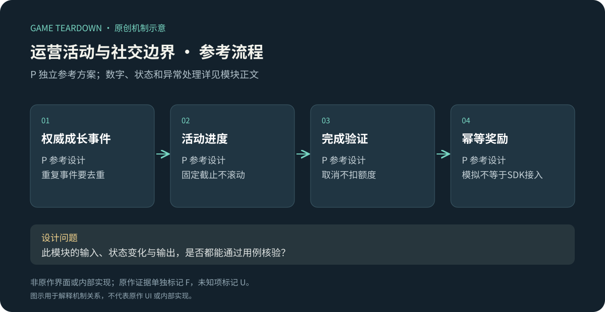
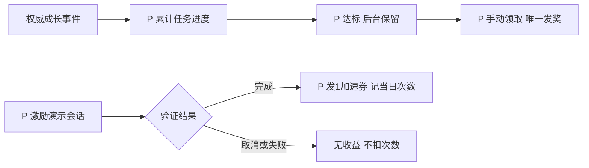

# 运营活动、加速入口与社交边界

> `hero-no-dodge-liveops` · 微信目标平台 · 2026-10-16 · 证据不足部分明确U，P可实施参考任务模块。

原创P参考流程概览；下文F证据与此图分开阅读，不能据图推定原作规则。

**HN-F10（F，共用历史攻略）**：官方新手图稿提及分阶段成长与公会活动，祝福图中可见加速相关入口。[新手攻略](https://www.37.com/yxmys/article.html?cate=gonglue&id=36)、[一图流](https://www.37.com/yxmys/article.html?cate=gonglue&id=37)。不能凭一个图标确定当前微信广告次数、支付价格或免广告权益。完整竞技、公会管理、付费商品与广告规则没有足够独立证据，本批列入采证地图，不编成已证实原作系统。

I：成长资源如果同时进入限时活动，会改变“立刻消费”与“囤积等待”的取舍。分析需区分基础收益、活动奖励与购买收益，避免把作者推荐的攒资源策略写成强制玩法。

## P范围与数据

只实现7日新手任务与模拟激励奖励，公会、支付、真实广告SDK不在参考切片中；接口预留但无假“已接入”声明。使用[公共契约](../../_framework/参考实现公共契约.md)。

`AccountEvent{openedAt,endsAt=openedAt+7d,missions[],claimed}`；任务：累计击杀10敌→10石，首次祝福2→50结晶，首次解锁3侍从→2加速券。新手任务无每日重置；截止后24小时仍可领已达标奖励。活动起点是账号创建，不是每次进入页面。

`RewardSession{id,placementId,createdAt,expiresAt,verified,state}`。开发环境可模拟完成/取消/失败三种回执；示例位置 blessing_speed，一次有效完成发1张加速券，每日上限3，UTC+8零点重置。真实平台实现时必须另行定义可验证完成凭证，不可由前端任意“completed=true”直接发奖。

## P规则与流程

| 规则 | 条件／动作 | 结果 P |
|---|---|---|
| HOPS-R01 | 事件发生在活动内 | eventId去重更新计数；活动结束后发生的新事件不追记 |
| HOPS-R02 | 领取任务 | 达标且未领且now<endsAt+24h才发奖；同mission一次 |
| HOPS-R03 | 发起激励演示 | 剩余次数>0，创建5分钟有效session；不预扣次数；每账号只1个pending |
| HOPS-R04 | 完成回执 | 验证session未过期、未兑付，原子发券和次数+1；取消/失败清session不扣次数 |
| HOPS-R05 | 跨日回执 | 按开始时dayId计次数；若超过5分钟过期，返回EXPIRED无奖励；不占新日额度 |

接口`GetStarterMissions/ClaimMission`、`CreateRewardSession/ResolveRewardSession`；业务事件来自IDLE/GROW/PET。生产模式禁用模拟验证器；真实广告渠道适配是实施前必须另立任务，不能拿模拟用例当真机广告验收。

## UI／美术 P

HOPS-UI01：3任务进度、奖励和截止；HOPS-UI02：激励入口明确“完成后得1券、今日剩余N次”，开发样例标“模拟”；HOPS-UI03：取消、不支持、超时、领取失败分开反馈；HOPS-UI04：已达标未领取不弹多重强制窗口。资产复用资源图标，任务配独立状态；没有虚构收费折扣和付款入口。

## 验收与待采证 P

| 用例 | 条件→操作→预期 | 规则 |
|---|---|---|
| HOPS-T01 | 同击杀事件重放→累计只+1 | R01 |
| HOPS-T02 | 任务已达标，活动结束后23小时→可领；24小时→不可领 | R02 |
| HOPS-T03 | 演示取消→0券且次数不扣；随后合法完成→1券并扣1 | R03/04 |
| HOPS-T04 | 完成回执重复→只一券；过期session拒绝 | R04/05 |

用例未运行。需补证：当前微信公会/竞技入口与规则、限时活动日历、广告完成与取消、商品权益说明、角色/服务器阶段。原作商业模式精确分类和功能筛选保持unknown，不能用App评论替代微信事实。
