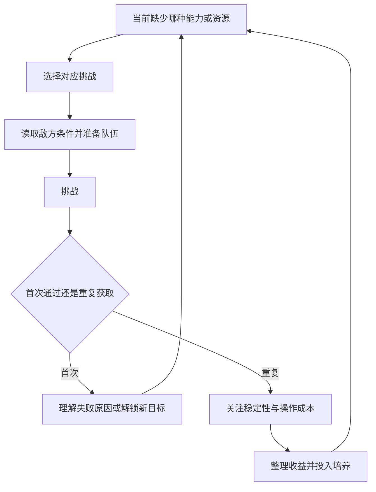

# PVE：同一支队伍，面对不同的检验题

阴阳师 · 国服 App · 副本 / 挑战

## 设计目的与系统分组

PVE既负责让玩家理解战斗，也负责持续产出成长材料。按设计作用区分，比把所有副本排成一个长清单更清楚。

| 类别 | 本版归入的内容 | 检验什么 |
|---|---|---|
| 剧情推进 | 探索与故事章节 | 学习机制、理解角色与世界 |
| 材料供给 | 御魂、觉醒等资源副本 | 队伍的稳定执行与获取效率 |
| 机制挑战 | 秘闻等带特定条件的挑战 | 玩家是否调整职责和应对方式 |
| 首领与阶段目标 | 逢魔等首领玩法 | 对指定目标组织持续输出与生存 |

分类依据[玩家资源路线记录](https://www.taptap.cn/moment/445963482421002278)与[维护公告中的副本活动](https://bbs.4399.cn/thread-view-tid-50384879)。这是功能地图；次数、开放等级、日程与奖励不混成一张当前规则表。

## 玩家循环



首次挑战强调学习，重复挑战强调可持续执行；两者应有不同的便利功能。

## UI 与功能设计

```ui-analysis
yy-pve
```

- **选择页：** 展示主要产出与挑战条件，帮助玩家从缺口找到入口，而非只记副本名字。

- **准备页：** 告知模式限制与队伍条件；推荐阵容需要解释成立条件。

- **结算页：** 区分首次奖励、重复收益与活动加成，不让一次额外奖励误导长期效率判断。

- **重复执行：** 2026 新区公告提到挑战效率改善。它能减少已有方案的重复时间，但是否降低完整日常负担，仍需要记录一次登录的所有活动。[新区公告](https://www.taptap.cn/moment/852285475547776231)

## 常驻内容的职责分工

以下按玩法目的归组，不把所有副本写成“打怪领奖励”。名称与基础用途参考[历史入门记录](https://www.taptap.cn/moment/15220000474270426)、[御灵副本资料](https://news.17173.com/z/yys/content/08022019/164849461.shtml)及[契灵上线介绍](https://u.360.cn/news/article/362965/)。具体开放等级、每日次数与奖励数值随版本核实。

| 内容组 | 代表内容 | 主目标 | 与其他系统的连接 |
|---|---|---|---|
| 剧情推进 | 探索与主线 | 认识世界、验证基础阵容 | 经验、章节资格、叙事回看 |
| 成长材料 | 觉醒、经验与金币相关内容 | 补足已选养成对象的缺口 | 角色成长、资源管理 |
| 装备追求 | 御魂及衍生挑战 | 取得可用装备并优化方案 | 御魂筛选、强化与整理 |
| 机制解题 | 秘闻、地狱鬼王等 | 解决特定限制或高难挑战 | 阵容替换、收藏奖励、排名 |
| 主角扩展 | 御灵、契灵相关挑战 | 扩展主角或外观目标 | 御灵与契灵分别管理 |
| 协作资源 | 妖气封印、石距等组队入口 | 与其他玩家共同获得资源 | 房间、队长、准备、结算 |
| 周期目标 | 逢魔与活动首领 | 在开放窗口完成阶段目标 | 日程、协作、榜单与活动商店 |

这张表是功能索引，未将每个历史模式宣称为当前都可进入。式神委派、平安百物语、平安奇谭等支线可以归入派遣或叙事挑战；完整当前入口仍需要实机逐项对照。

## 从首次通过到稳定刷取

1. **选副本。** 先看需要的材料，再判断是否满足资格。奖励预览必须区分必得、概率掉落、首通与次数奖励。

2. **组队准备。** 检查敌人机制、队伍职责与资源消耗。合作模式还要确认队长权限与队员准备状态。

3. **尝试与复盘。** 首次失败定位“没能行动、伤害不足、机制未处理”中的哪一类，再回到配速、成长或换人。

4. **形成稳定方案。** 从能通关转为可重复：失败率、平均用时和需要干预的次数一起看。

5. **批次结束后整理。** 掉落转为御魂、材料与货币，分别进入培养或库存。不要让玩家刷完一批才发现背包处理比战斗更累。

## 评价效率不能只算最快一局

**分析算例，非原作数据：** A队成功率100%，每局60秒；B队成功率80%，每局45秒，失败后平均花30秒重新准备。若单次成功奖励相同且失败没有奖励，A每次成功约60秒，B为（45＋20%×30）÷80%＝63.75秒。B的成功截图更快，长期效率反而更低。

这个比较还没计入体力、操作次数和组队等待。真正的采样应记录至少成功率、全部尝试耗时、消耗及收益，不能只挑最快录像。

## 房间、自动与奖励的参考交互

| 状态 | 主操作 | 必须提示 |
|---|---|---|
| 未解锁 | 查看前置目标 | 缺等级还是缺通关资格 |
| 已解锁 | 选层级与阵容 | 消耗、奖励、特殊限制 |
| 等待队友 | 邀请、准备、退出 | 谁未准备、谁有开始权限 |
| 战斗中 | 手动 / 自动、退出 | 当前批次和退出后果 |
| 结算 | 查看掉落、再次挑战 | 首通与重复奖励分别列出 |
| 批次停止 | 调整或返回 | 体力不足、失败、背包满或队伍解散 |

以上状态是参考产品设计；自动连续挑战的具体权限与当前原作纸人规则另行核实。附录为单人和三人协作共用的关卡、扣费、随机掉落与重连规则提供完整默认值。
## 数值与取舍

评价资源路线应同时看成功率、单次收益、消耗、等待和整理时间。只看最快一局会忽略失败和组队准备。我的迁移建议是先让玩家稳定完成一条路线，再开放更复杂的选项；否则大量入口只会制造“每天都该做”的负担。

当前副本全量表与实测效率未完成。开发附录的三波挑战仅为参考切片，不代表原作某副本配置。

[战斗](../systems/行动条与鬼火战斗.md) · [御魂](../systems/御魂构筑与整理.md) · [社交](../systems/阴阳寮与师徒协作.md)
