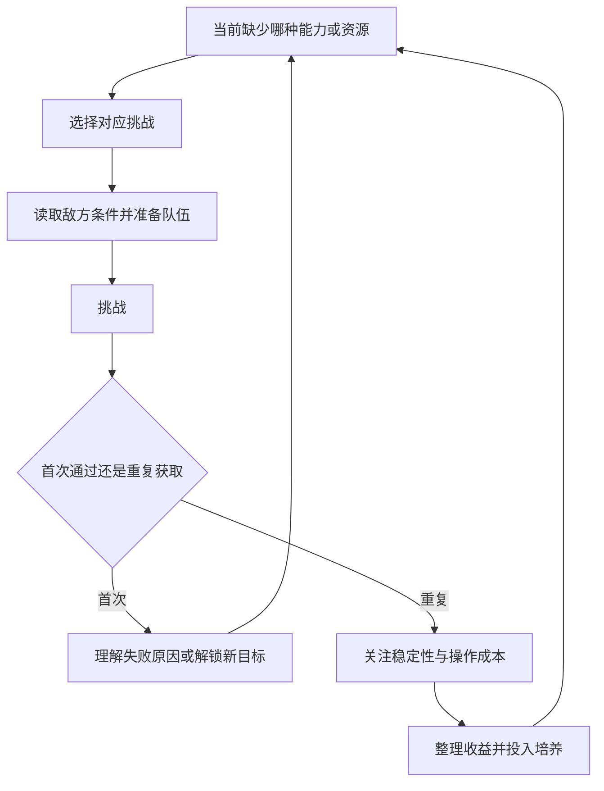

# PVE：同一支队伍，面对不同的检验题

阴阳师 · 国服 App · 副本 / 挑战

## 设计目的与系统分组

PVE既负责让玩家理解战斗，也负责持续产出成长材料。按设计作用区分，比把所有副本排成一个长清单更清楚。

| 类别 | 本版归入的内容 | 检验什么 |
|---|---|---|
| 剧情推进 | 探索与故事章节 | 学习机制、理解角色与世界 |
| 材料供给 | 御魂、觉醒等资源副本 | 队伍的稳定执行与获取效率 |
| 机制挑战 | 秘闻等带特定条件的挑战 | 玩家是否调整职责和应对方式 |
| 首领与阶段目标 | 逢魔等首领玩法 | 对指定目标组织持续输出与生存 |

分类依据[玩家资源路线记录](https://www.taptap.cn/moment/445963482421002278)与[维护公告中的副本活动](https://bbs.4399.cn/thread-view-tid-50384879)。这是功能地图；次数、开放等级、日程与奖励不混成一张当前规则表。

## 玩家循环



首次挑战强调学习，重复挑战强调可持续执行；两者应有不同的便利功能。

## UI 与功能设计

```ui-analysis
yy-pve
```

- **选择页：** 展示主要产出与挑战条件，帮助玩家从缺口找到入口，而非只记副本名字。

- **准备页：** 告知模式限制与队伍条件；推荐阵容需要解释成立条件。

- **结算页：** 区分首次奖励、重复收益与活动加成，不让一次额外奖励误导长期效率判断。

- **重复执行：** 2026 新区公告提到挑战效率改善。它能减少已有方案的重复时间，但是否降低完整日常负担，仍需要记录一次登录的所有活动。[新区公告](https://www.taptap.cn/moment/852285475547776231)

## 数值与取舍

评价资源路线应同时看成功率、单次收益、消耗、等待和整理时间。只看最快一局会忽略失败和组队准备。我的迁移建议是先让玩家稳定完成一条路线，再开放更复杂的选项；否则大量入口只会制造“每天都该做”的负担。

当前副本全量表与实测效率未完成。开发附录的三波挑战仅为参考切片，不代表原作某副本配置。

[战斗](../systems/行动条与鬼火战斗.md) · [御魂](../systems/御魂构筑与整理.md) · [社交](../systems/阴阳寮与师徒协作.md)
