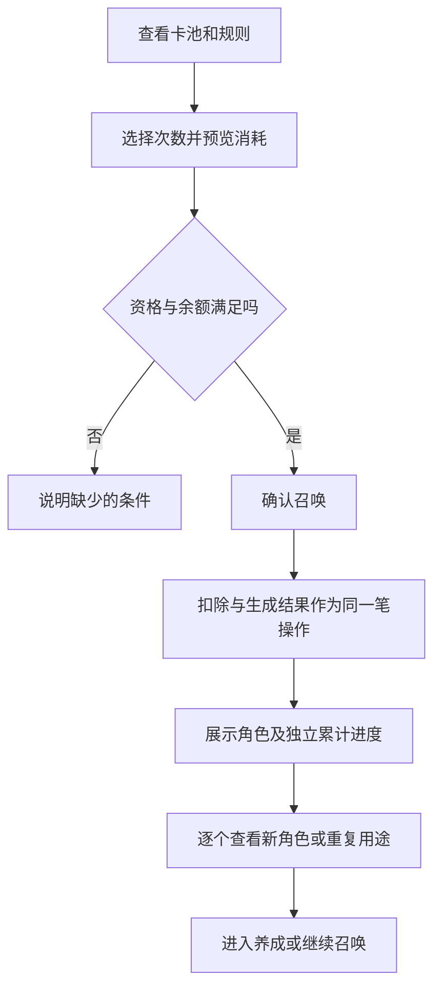

# 召唤与角色获取：获取目标，也管理预期

阴阳师 · 国服 App · 角色获取

## 设计目的

获取系统为角色收集提供阶段目标。这里应分开看三个问题：玩家希望谁、通过什么路径获得、获得之后能否进入队伍。**一次抽取的兴奋，不能代替后续可用性的设计。**

## 系统功能与证据

- **召唤与活动规则：** 不同召唤活动有自己的参与条件、资源和有效期。2025 年维护公告包含专属限时符咒等内容，说明资源适用范围本身也是需要传达的规则。[历史官方公告](https://bbs.4399.cn/thread-view-tid-50384879)

- **新区与成长获取：** 2026 年新区公告提供角色和召唤福利，改变新账号起点；它属于指定新区活动，不是所有账号每天可重复获得的资源。[2026 新区说明](https://www.taptap.cn/moment/852285475547776231)

- **多路径获取：** 玩家经验中还涉及碎片、协作与活动目标。不同路径适合解释不同程度的可预期性，不能把全部角色获取简化为一个抽卡按钮。[玩家开荒记录，2024](https://www.taptap.cn/moment/445963482421002278)

## 玩家操作顺序

1. 确认当前卡池、时间、适用角色和使用资源。

2. 阅读本池概率与累计规则，判断是否符合自己的目标。

3. 选择次数，确认消耗，取得结果。

4. 判断培养、保留或其他用途，再进入对应系统。

## UI 与预期管理

```ui-analysis
yy-summon
```

- **规则与资源同屏：** 补充线框把适用范围放在操作附近，避免主视觉吸引了注意力，限制却只留在深层说明。

- **累计只属于明确范围：** 若不同池不共享次数，必须直接说明。缺少当前卡池证据时，本版不会填入一个看似完整的“通用保底”。

- **结果之后有用途：** 新角色引导到职责与培养条件；重复结果应解释实际去向。不能把未核实的转化规则替原作补齐。

## 商业化与数值评价

概率、活动奖励与资源获取速度共同影响等待，但它们不能脱离具体卡池相加。评估付费前，应分别列免费路径和付费增加的次数/效率，再讨论预期；本版没有运行消费模拟，也不做抽卡购买建议。

## 获取渠道不是同一个概率池

| 路线 | 玩家做什么 | 产出形态 | 需要写清的限制 |
|---|---|---|---|
| 召唤 | 使用适用资源参与当期卡池 | 角色或活动相关结果 | 卡池范围、适用资源、概率、累计条件、截止时间 |
| 碎片合成 | 积累指定角色的碎片 | 指定角色 | 碎片归属、所需数量、是否具备获取资格 |
| 活动或新区奖励 | 达成规定进度并领取 | 随机 / 自选 / 指定奖励 | 账号与区服资格、可选范围、领取期限 |
| 社交互助 | 祈愿与赠予等协作 | 定向积累 | 可赠类型、次数和数量上限；需按当前规则核对 |

官方[2025年8月27日公告转载](https://bbs.4399.cn/thread-view-tid-50384879)同时列出新区奖励与联动召唤。两者的资格与计数不同，不能在产品中显示成一条总进度。

### 历史案例：联动印花与稀有角色保底并行

2025年8月27日至9月2日的夏目友人帐联动复刻，公告给出：印花基础获得概率1%，连续39次未获得时第40次获得；五种印花用于角色兑换；另有连续59次未获得SP/SSR后第60次获得的规则。这里仅拆解该活动，不将其当作常驻卡池规则。[活动规则](https://bbs.4399.cn/thread-view-tid-50384879)

1. **一次召唤可能推进多条计数。** “稀有角色没出多久”与“印花没出多久”要分别记录。

2. **获得一种奖励不等于所有计数清零。** 重置哪条进度由对应规则决定，界面需要分别解释。

3. **角色已有与没有的价值不同。** 同一个结果可能用于首次获取，也可能转为重复资源；这会改变后期玩家的期待。

4. **活动结束必须有明确结果。** 计数是否保留、剩余道具能否兑换，需要独立规则；该案例未核实的继承关系不作推断。

## 一次召唤的完整操作路径



流程中的事务处理是补充设计。结果先确定再播放表现；跳过动画不能重新抽取，断线不能让一次支付换成两次结果。

## 获取之后：为什么抽到仍然不够用

- **获得阶段提供情绪峰值。** 新角色的稀有度、演出和角色形象告诉玩家“得到了什么”。

- **养成阶段决定可用时间。** 星级、技能、御魂与队友缺口决定角色何时能进入常用队伍。

- **引导应交接目标。** 获取后给出职责、适用玩法和培养入口，比立刻要求再抽更能让角色价值被感知。这是设计建议，不是对原作转化率的断言。

## 参考实现的概率与配置表

附录明确给出参考卡池的概率、60抽规则、碎片数量、重复转换、资源优先级、十连逐次结算和活动结束处理。该方案使用自设角色集合，可直接实现并测试，不冒充原作卡池。
## 适用与限制

适合借鉴的是目标表达、规则透明与结果用途衔接。完整卡池、当前概率、保底继承、退款及跨渠道支付均待专项取证；开发附录只给有限抽取演示的事务规则，不包含真实支付。

[式神养成](../systems/式神与阴阳师养成.md) · [活动商业化](../systems/活动与商业化.md)
