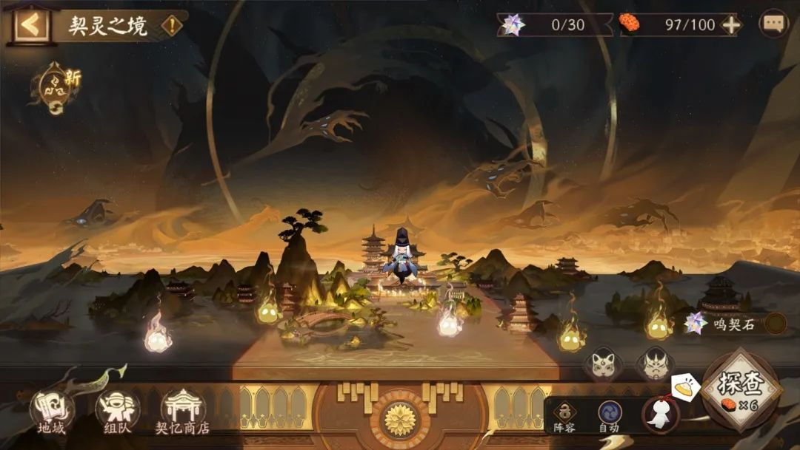
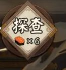
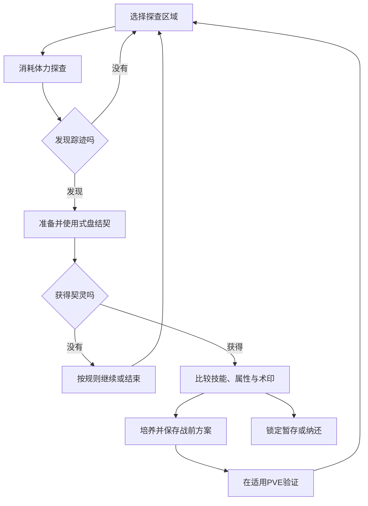

# 契灵与术印：把主角配置接入新的收集循环

阴阳师 · 国服 App · 主角扩展 / PVE / 收集

## 设计目的与原作范围

契灵为已经建立基础阵容的玩家提供新的配置目标。它连接探查、结契、培养和战前选择，收益最终回到对怪物战斗。它与御灵不是同一对象，不应因为名字相近就合并到一张升级表里。

本页事实以[2023年上线介绍](https://u.360.cn/news/article/362965/)为历史样本：60级入口、体力探查、式盘结契、培养及纳还、术印、怪物战斗适用、契忆商店。后续首领与自动结契有变更线索，但本轮未取得完整当前规则，不并入历史流程。

## 系统功能与资源

| 功能 | 输入 | 输出 / 状态 | 玩家判断 |
|---|---|---|---|
| 探查 | 体力与区域选择 | 发现契灵踪迹的机会 | 是否继续投入这一轮获取 |
| 结契 | 式盘与挑战条件 | 获得契灵的机会 | 使用什么资源、是否协作 |
| 培养 | 契灵或养成材料 | 等级与能力成长 | 先用已有对象，还是寻找更匹配的对象 |
| 配置 | 契灵、主角及适用规则 | 战前方案 | 术印和属性是否符合当前目标 |
| 纳还与兑换 | 多余契灵、契忆等 | 整理库存与资源回流 | 保护正在使用或有潜力的对象 |

具体消耗、成功率和经验值在已读材料中不完整，附录另给完整参考表。

## 探查入口：消耗贴近操作



画面底部同时安排地域、组队、商店、阵容和自动入口；右下探查按钮带有体力图标与“×6”。这一张图只能证明该历史画面显示的消耗，不能证明所有探查层级都固定消耗6点。



这种布局把“下一次要花什么”放到确认动作附近。若自动执行多次，参考设计还应显示总预算与停止条件，不能只显示单次费用。

## 玩家循环



图解概括历史机制与玩家判断；失败后是否保留踪迹、式盘返还与重试次数等由具体版本决定，不能由流程箭头推断。

## UI与状态

```ui-analysis
yy-contract
```

1. **获取页：** 地域、资格、剩余资源、踪迹状态和探查费用。

2. **对象页：** 名称、等级、星级、技能、属性、术印与锁定；术印要能点开说明作用对象。

3. **培养页：** 材料选择、目标等级、前后差值、总消耗及保护原因。

4. **应用页：** 当前主角、契灵、适用模式和已有方案的变化。跟随展示与战斗生效分开显示。

这些是参考界面信息结构，未冒充原作当前布局。

## 数值与设计判断

- **获取深度：** 不仅追求获得，还追求契灵与目标玩法的适配；如果属性、技能和术印同时随机，识别成本会显著增加。

- **成长深度：** 已有对象可培养，让“不够理想但能用”的结果仍有阶段价值。投入是否可回收会影响玩家敢不敢过渡。

- **适用范围：** 历史上线介绍限定怪物战斗，并曾对部分排名活动设置过渡期。这类隔离有助于控制新增系统对既有竞赛的冲击；不能据此断言当前所有模式的适用范围。

- **迁移取舍：** 我会先让一种配置差异对应一种可辨认的战斗收益，再扩充术印组合。否则只是增加一套需要刷、却难以解释价值的装备。

[主角基础养成](../systems/式神与阴阳师养成.md) · [PVE资源路线](../systems/PVE挑战与资源路线.md) · [资源账本](../systems/资源与商店.md)
