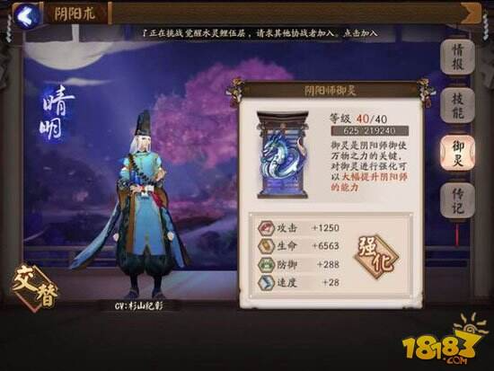
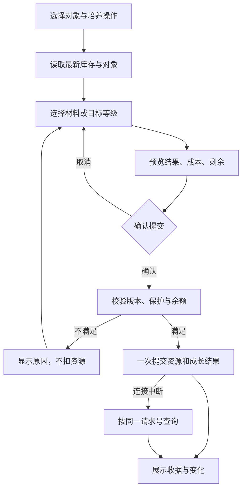

# 式神与阴阳师养成：两条成长线，怎样汇入同一支队伍

阴阳师 · 国服 App · 局外养成 · 修订 2 · 2026-10-18

**式神解决“队伍里每个位置能做什么”，阴阳师解决“主角如何组织和支援整支队伍”。** 两者有各自的经验、技能和强化对象，不能用一个“提升战力”按钮混写。本篇先拆原作，再给出参数齐全的参考设计；原图为注明日期的历史界面。

## 01 系统地图：这次具体拆哪些内容

| 对象 | 成长内容 | 输入 | 结果 |
|---|---|---|---|
| 式神 | 等级 | 战斗/育成经验 | 基础属性提高，受当前星级上限限制 |
| 式神 | 星级 | 同星级素材、金币 | 提高等级上限；等级与星级是两个状态 |
| 式神 | 技能 | 同名式神、御行达摩等 | 技能等级与效果改变 |
| 适用式神 | 觉醒 | 对应觉醒材料 | 外观、属性或技能节点改变，按角色配置 |
| 式神培养工具 | 经验储存、一键育成、转换 | 经验池、升星素材或转换道具 | 缩短重复操作、转移已有投入 |
| 阴阳师 | 等级与角色解锁 | 账号成长、剧情条件 | 主角基础能力与可选择角色 |
| 阴阳师 | 阴阳术 | 技能解锁/升级、携带选择 | 改变支援方式与阵容配合 |
| 阴阳师 | 御灵 | 御魂等强化资源 | 阴阳师属性加成与技能成长 |
| 后续扩展 | 契灵、术印等 | 独立获取与培养资源 | 另一个成长分支，不能与御灵混称 |

基础机制依据[玩家操作记录，2021](https://www.taptap.cn/moment/15220000474270426)；御灵界面依据[小k的界面分析，2016](https://m.18183.com/yys/201610/725188.html)。契灵已有[官方介绍，2023](https://www.taptap.cn/moment/410488205989643650)。本篇基础养成参考覆盖前八行；契灵作为外部模块接入，不声称覆盖其全部品类与版本。

## 02 式神升级：先看经验，再看等级上限


原图来源：[鸭梨的攻略，2021-12-31修订](https://www.taptap.cn/moment/15220000474270426)。图中未选材料，目标已经40级，因此“金币0”只代表这个空预览，不能据此判断升级免费。

### 升级与升星为什么分开

- **升级是持续增长。** 战斗、结界与材料育成提供经验；不同来源最终汇入角色等级，不应把所有升级都写成吞材料。

- **升星是阶段门槛。** 达到当前等级上限后，还要准备同星素材。素材本身也需要培养，因此总成本来自一棵培养树，而不只是目标角色最后按一次按钮。

- **暴食鬼是操作层工具。** 先将材料转入经验池，再用于一键育成。经验池和升星素材仍是两本账，“一键”没有免掉培养成本。[经验储存记录，2021](https://www.taptap.cn/moment/141580112968550257)

### 局部看：一次升级需要确认什么


这一块承担交易确认：**谁会改变、改变多少、消耗多少。** 参考设计进一步列出材料拥有、消耗和剩余。例如19级、当前经验1,800的普通式神升20级：“经验池12,000→11,900，金币5,000→4,990，等级19→20”。这与下文曲线一致，比一句“升级成功”更容易核对。

## 03 原作材料表：用途与数量分别核实

### 各类材料用在哪里

| 材料/资源 | 用途 | 数量与使用边界 |
|---|---|---|
| 式神经验 | 提升等级 | 当前完整经验表未取证，下文提供独立参考曲线 |
| 招福达摩、大吉达摩 | 提供育成经验 | 产出与素材自身等级有关，不能用一个固定值代表全部 |
| 奉为达摩、同星式神素材 | 升星 | 历史规则为当前星级数个同星素材，详见下表 |
| 御行达摩、同名式神 | 技能成长 | 与普通经验分账；技能上限、重复本体单独校验 |
| 觉醒材料 | 适用式神觉醒 | 类型、档位、数量按角色，不能由一个角色推广到全库 |
| 金币 | 育成、升星等 | 各操作分别报价，不能套统一比例 |
| 御魂等强化资源 | 御灵成长 | 素材实例与已装备/锁定/被方案引用的对象分开 |

材料用途依据上方历史操作记录；这是功能索引，不是2026全角色价目表。

### 升星条件与消耗：历史常规路线

| 操作 | 目标等级条件 | 素材消耗 | 历史金币费用 | 新等级上限 |
|---|---:|---|---:|---:|
| 2星→3星 | 20 | 2个2星素材 | 20,000 | 25 |
| 3星→4星 | 25 | 3个3星素材 | 30,000 | 30 |
| 4星→5星 | 30 | 4个4星素材 | 40,000 | 35 |
| 5星→6星 | 35 | 5个5星素材 | 50,000 | 40 |
| 6星 | 上限40 | 本表无继续升星项 | — | 40 |

条件与素材依据[2021记录](https://www.taptap.cn/moment/15220000474270426)，费用依据[2016官方论坛玩家计算转载](https://shouyou.gamersky.com/gl/201610/822532.shtml)。年份不同，**不能拼成2026现行配置**。费用不含素材自身的培养成本。下文参考明确采用这套升星结构，其余数值独立设定。

## 04 技能、觉醒与转换：不同的投入，改变不同状态


### 技能培养

1. 选目标，查看各技能当前等级、上限及下一档效果。
2. 选技能材料，不与普通经验素材混在默认批量选择中。
3. 如果升级结果随机分配，确认页显示候选范围，提交后显示实际改变的技能。
4. 全技能满级时禁止投入；同名素材被锁定、上阵或预设引用时受保护。

原作材料用途有历史依据；默认保护和确认流程为补充设计。特殊式神的技能规则需要逐角色配置，不能由通用公式推定。

### 觉醒

- 觉醒配置同时包含材料配方、前置、前后属性、技能变化和外观切换。角色不支持觉醒时，应显示“不适用”，而非“材料不足”。

- 当前全角色觉醒配方未取得。下文参考给出两种完整配方及“不支持觉醒”分支，用来实现数据驱动逻辑；不把自设配方写成原作攻略。

### 转换

- 历史资料记录了转换道具与等级范围，当前全部例外未核实。不能只写“转换练度”，还要逐字段确定。

- 参考版本交换星级、等级与当前经验；技能、觉醒、装备、锁定和实例身份不交换。道具扣一次，两个对象一起落库。这里的字段边界为补充设计。

## 05 阴阳师成长：等级、技能和御灵分别管理



来源：[18183小k，2016-10-30](https://m.18183.com/yys/201610/725188.html)，保留原水印。画面显示御灵40级，以及攻击、生命、防御、速度加成；这些是该账号的历史显示值，**不是每升一级固定加这些数值**。

### 阴阳师等级与角色解锁

- 阴阳师不是式神素材，不能吞另一位阴阳师升星。等级随账号成长；角色选择与剧情解锁属于另一层状态。历史结构见[历史主角与御灵成长说明，2016](https://news.4399.com/yyssy/xinde/m/704269.html)。

- 参考中，账号共用1—60级经验；四位基础角色各自保存解锁、御灵、技能和携带方案。剧情服务发放解锁标记，切换不消耗或复制经验。具体参考解锁条件列在后表。

### 阴阳术：升级技能与携带技能是两件事

1. 进入阴阳术，先选择阴阳师，再查看可用技能。
2. 升级决定技能效果；配置决定这场战斗携带什么。
3. 选择时显示目标、冷却、作用范围与队伍需求，不能用“战力更高”替代判断。
4. 保存后更新准备方案；已经开始的战斗继续使用入场快照。

技能切换与御灵带来技能成长见[历史操作记录](https://www.taptap.cn/moment/15220000474270426)。快照、校验及参考槽位数属于补充设计。

### 御灵：资源如何变成主角能力

- **对象关系：** 晴明—神龙、神乐—白藏主、源博雅—黑豹、八百比丘尼—孔雀，是基础历史样例，不声称是当前完整名单。[历史御灵介绍](https://news.17173.com/z/yys/content/08022019/164849461.shtml)

- **投入与结果：** 御魂可作强化资源；御灵提高阴阳师属性。历史记录提到40级上限与每5级带来技能成长，但不能据此反推整条经验曲线、所有成长系数和特殊角色规则。

- **名称边界：** 御魂是式神装备，也可能被消耗；御灵是阴阳师的培养对象；契灵是后来的独立系统。数据结构和材料入口都要区分。

## 06 可开发参考：完整材料与消耗配置

**本节所有数字都是补充设计。** 参考采用历史升星结构，补齐曲线与异常，用于实现基础养成模块；不作为《阴阳师》当前数值攻略。页尾可下载完整配置、逐级表与计算器。

### 经验曲线：覆盖全部合法等级

L是当前等级，“需求”指L升到L+1；不含已经获得的当前经验。

| 对象 | 合法等级 | 每级需求 | 上限处理 |
|---|---|---|---|
| 普通式神 | 1—40，星级上限20/25/30/35/40 | 100×L | 手动投入只扣到当前星级上限所需的经验 |
| 奉为达摩型素材 | 同上 | 50×L | 同上；此倍率为参考值 |
| 阴阳师共用等级 | 1—60 | 200×L | 60级不继续累积，不收取额外资源 |
| 各阴阳师御灵 | 1—40，同时不高于账号等级 | 150×L | 只扣实际需要的御灵池经验 |

| 目标等级 | 普通式神累计经验 | 阴阳师累计经验 | 御灵累计经验 |
|---:|---:|---:|---:|
| 2 | 100 | 200 | 150 |
| 20 | 19,000 | 38,000 | 28,500 |
| 25 | 30,000 | 60,000 | 45,000 |
| 30 | 43,500 | 87,000 | 65,250 |
| 35 | 59,500 | 119,000 | 89,250 |
| 40 | 78,000 | 156,000 | 117,000 |
| 60 | 不适用 | 354,000 | 不适用 |

从1级0经验到N级的累计需求：每级系数×N×(N−1)÷2。任意中间等级由公式得到；下载表展开了每一级。

### 材料与金币消耗

| 配置项 | 单位产出/数量 | 金币成本 | 扣除与约束 |
|---|---:|---:|---|
| 小经验札（参考） | 1,000式神经验 | 入池免费 | 扣1件，加经验池1,000；池容量1,000,000 |
| 大经验札（参考） | 10,000式神经验 | 入池免费 | 同上；溢出容量整笔拒绝 |
| 投入式神经验 | 正整数；实际扣至上限 | 向上取整（实际经验÷10） | 池与金币同时扣；满级不扣 |
| 升星 | 当前星级s个同星素材 | s×10,000 | s为2—5；目标等级满；素材不含目标 |
| 技能培养 | 同名普通式神1个或技能达摩1个 | 10,000/次 | 未满技能中等概率选1个，加1级；上限5 |
| 觉醒·配方A | 风低16、水低16、风中8、水中8 | 0 | 目标未觉醒且模板支持A |
| 觉醒·配方B | 风中16、火中16、风高8、火高8 | 0 | 目标未觉醒且模板支持B |
| 御灵素材入池 | 1—6星御魂依次500/750/1,000/1,250/1,500/1,750经验 | 0 | 仅+0、未装备/锁定/被方案引用素材；池容量1,000,000 |
| 御灵升级 | 按曲线算实际需求 | 0 | 扣御灵池，不能扣式神池 |
| 转换 | 通用转换券1张 | 0 | 交换星级/等级/经验；双方没有进行中的培养请求 |
| 阴阳师升级 | 战斗/任务服务发放经验 | 0 | 唯一rewardId去重，客户端不可自报奖励 |

### 阴阳师的完整参考配置

| 项目 | 参考规则 |
|---|---|
| 四位基础角色解锁 | 晴明默认；神乐、源博雅、八百比丘尼分别需story-03、story-07、story-15剧情标记；不是原作章节断言 |
| 技能与槽位 | 每位角色有普攻、增伤、护盾、驱散四种参考能力；普攻固定，三种主动选两个不同技能；不是原作四人的技能复刻 |
| 技能成长 | 初始1级、上限5；御灵到5/10/15/20/25/30/35/40各发1点；玩家指定未满技能升1级，“指定分配”为参考改动 |
| 里程碑 | 跨多级逐个发点；每个里程碑只发一次；全满时剩余点保留但不可消耗 |
| 攻击 | 100+10×(账号等级−1)+5×(御灵等级−1) |
| 生命 | 1,000+100×(账号等级−1)+50×(御灵等级−1) |
| 防御 | 50+5×(账号等级−1)+2×(御灵等级−1) |
| 速度 | 100+floor((御灵等级−1)/5) |
| 契灵接口 | 外部模块提供校验后的属性增量与模式许可；没有配置的扩展不自动开放，不与御灵强化混用 |

## 07 操作与异常：照文档能做出一笔完整交易



- **保护：** 锁定、上阵、预设引用、寄养/派遣对象不可当素材；确认时重新验证。目标自身锁定仍可升级，锁定保护的是“被消耗”。

- **非法输入：** 空选择、重复ID、目标混进素材、星级不符、未知模板、负数/小数都拒绝；不能只靠前端灰置。

- **事务：** 全部成功或全部不扣。超时沿用原请求号查询，不能再发一笔；服务器版本变化则重新报价。

- **一键育成：** 先生成全部升级/升星步骤和总账再确认，不自动买材料、不自动吃稀有对象。缺高星素材时明确缺几件。

### 三个可核算的例子

1. **升级：** 普通式神19级、当前经验1,800，申请500经验。升20级只差100，实际扣100经验及10金币，结果20级0经验；另外400仍在池中。2星不能直升21级。

2. **升星：** 2星20级目标、两件2星可消耗素材、25,000金币。成功后3星20级、5,000金币，两件素材删除；材料之一锁定则全部不变。

3. **御灵：** 账号10级，御灵4级500经验，投入200。4→5需600，结果5级100经验并增加1技能点；同请求重试不能重复发点。

## 08 UI与验收：每项功能都有输入和结果

| 页面/状态 | 必须显示 | 操作与反馈 |
|---|---|---|
| 对象选择 | 名称/实例、星级/等级、技能/觉醒、保护 | 切对象清空旧报价 |
| 升级/升星 | 上限、素材与金币拥有/需要/剩余 | 不足显示差额 |
| 技能/觉醒 | 候选技能或觉醒前后、完整配方 | 随机结果不能冒充确定收益 |
| 阴阳术配置 | 技能等级、目标/冷却、槽位 | 禁止重复，保存回写准备方案 |
| 御灵 | 等级经验、账号限制、属性前后、技能点 | 素材与经验池分开 |
| 转换 | 两边交换/不交换字段、道具余量 | 二次确认，原子交换 |
| 提交中/超时 | 当前操作与状态 | 禁止新交易，按原请求查询 |

验收覆盖：所有等级上限、跨多级、最后1点经验、余额刚好/少1、重复素材、保护对象、满技能、重复觉醒、转换回滚、重复发奖、并发版本冲突与断线重试。下方开发附录定义数据、计算、接口和验收结果。配置计算器可验证曲线与成本；真实账号服务与完整客户端尚未实现。

```reference-download
growth
```

[战斗与鬼火](../systems/行动条与鬼火战斗.md) · [御魂构筑](../systems/御魂构筑与整理.md) · [召唤获取](../systems/召唤与角色获取.md)
