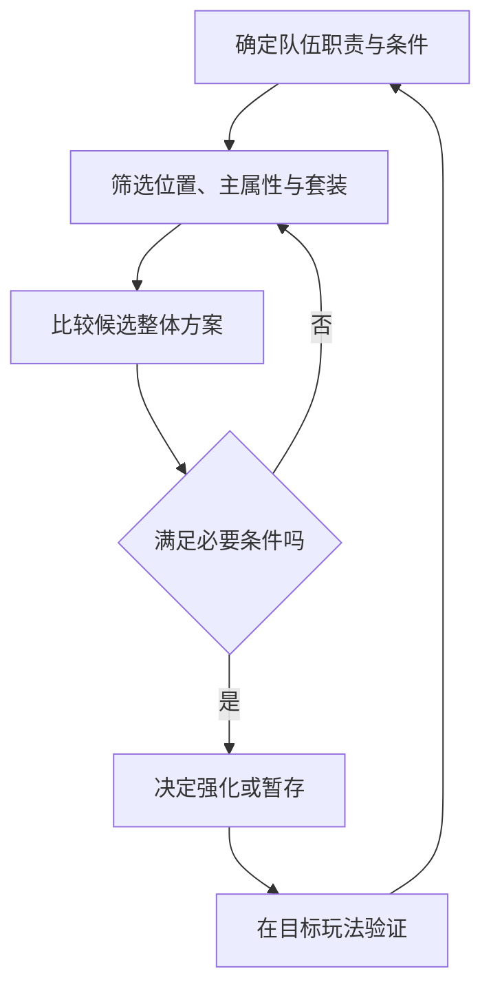

# 御魂构筑与整理：好装备必须放进队伍里判断

阴阳师 · 国服 App · 装备 / 构筑 / 资源整理

## 设计目的与功能

御魂让角色能力从固定答案变成可调整方案。它同时承担装备成长和长期掉落目标；随之而来的问题，是玩家如何从大量单件中认出“对这套队伍有用”。

- **位置与属性：** 六个装备位置、主属性与副属性形成组合条件。

- **套装效果：** 常见两件与四件组合提供属性或机制，不能只比较单件数字。历史首领御魂更新还引入了面向怪物战斗的专用组合。[首领御魂公告，2018](https://www.taptap.cn/moment/15217123987030075)

- **强化与整理：** 强化后的属性结果改变保留价值；整理需要结合未来用途，不能把当前未装备等同于无价值。位置和强化结构参考[历史入门说明](https://www.taptap.cn/moment/15210316736497577)。具体词条池与概率仍待当前面板核对。

## 选择流程



图解是构筑分析方法，不是原作自动配装算法。

## 为什么数值更高也可能更差

- **条件收益：** 历史狂骨分析将伤害收益与鬼火关联。同样的套装，在不同耗火环境中价值不同；这里采用这一关系，不照抄旧文里的配队推荐与系数。[御魂分析，2022](https://www.taptap.cn/moment/257945364034748643)

- **整体约束：** 一件装备提高输出速度，却可能让它跑到供火或增益角色之前。因此对比面板必须有“队伍条件”这一层。

- **替换成本：** 强化、拆分和重新配装会占用资源与时间。收藏一件潜力装备也有管理成本，筛选器应帮助表达用途，而不是只给稀有度排序。

## UI：目标条件、候选与结果放在一起

```ui-analysis
yy-souls
```

这里是补充设计：①先选职责；②查看位置与候选；③比较两套整体面板；④展示未满足的条件。没有原作当前御魂界面的完整采证，不将这张图称为原界面还原。

## 试一试：配装约束原型

```interactive-demo
souls
```

演示使用自设的“辅助先于输出、输出暴击至少90%”条件。你可以切换候选，看到攻击更高但条件失效的情况；条件并非原作通用配装建议。

## 整理与保护的参考设计

1. 先过滤用途，再选择候选，避免在全库中逐个翻找。

2. 显示已装备、锁定和被方案引用的状态；批量处理默认排除它们。

3. 在确认前预览具体对象和收益；筛选变化后重新计算，不能继续处理旧选择。

4. 操作结果可追溯；网络重试不得重复扣除。此处是开发建议，原作服务器实现未知。

## 评价与边界

最值得借鉴的是装备与队伍条件的连接；最需要控制的是“有用的随机”变成“无止境整理”。本版原型只验证条件反馈，不模拟真实掉落、强化随机或全库优化。

[战斗](../systems/行动条与鬼火战斗.md) · [资源与商店](../systems/资源与商店.md)
