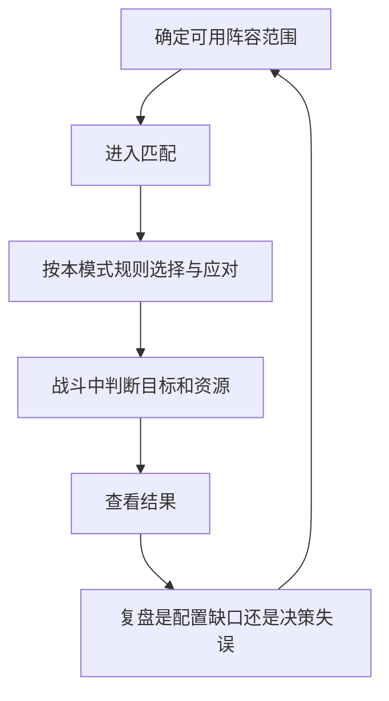
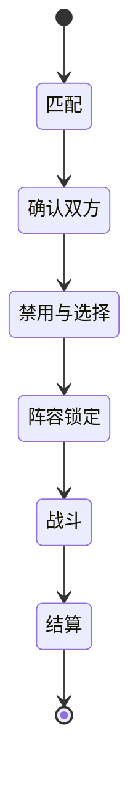

# 斗技：对手让阵容无法成为永久答案

阴阳师 · 国服 App · 玩家对抗

## 设计目的

斗技把队伍构筑放进会回应你的环境。它能够延长既有角色和御魂的用途：不仅追求一次稳定输出，还要考虑对手如何限制这套方案。

## 系统功能

- **战前应对：** 历史玩家对局分析讨论了翻牌、特定段位的禁选和阵容替代。角色名单相同，选择顺序和应对策略仍可能改变结果。[白鹿的斗技分析，2024-11-21](https://www.taptap.cn/moment/608709233134799212)

- **战中判断：** 行动顺序、资源与控制共同决定兑现机会。先手与后手是策略条件，不能简化成“速度最高必胜”。

- **阶段目标：** 排名与奖励为重复参与提供方向，但本版不照抄旧段位分数、开放时段和当前积分结算。

## 对局流程图



禁选和翻牌规则需要按具体模式、段位与日期确定；图中不假定所有对局都有相同步骤。

## UI：让变化可理解

```ui-analysis
yy-pvp
```

- **已公开信息与待选择内容分区。** 玩家应知道目前确认了什么，剩下什么机会；倒计时要服务决策，避免和装饰竞争。

- **受限对象有明确原因。** 未拥有、模式禁用、已选和操作超时的反馈应区分，不能统一显示灰色。

- **结算给出下一步。** 胜负不是充分复盘信息。补充设计建议保留关键出手与状态记录，帮助玩家找到可调整的环节。

## 斗技把队伍构筑变成对手之间的交互

副本允许围绕固定目标优化；斗技中，对手会针对启动条件选人、禁用或改变操作。配队的评价对象因此从“平均伤害”变成“在对方干预下还能完成什么”。

[2024年玩家斗技记录](https://www.taptap.cn/moment/608709233134799212)展示了先手、中速、后手体系以及禁用后替换的思路。本文借用这些结构解释博弈，不沿用当期阵容排名、具体配速和上分结论。

| 环节 | 玩家决策 | 设计作用 | 容易产生的问题 |
|---|---|---|---|
| 战前准备 | 选主体系和备选成员 | 把长期养成转为可用选项 | 只养一套固定名单，遇到禁用无法替换 |
| 选人 / 禁用 | 保留核心、隐藏方向、针对对手 | 让信息逐步暴露 | 读不懂对手技能就难以选择 |
| 开局 | 启动、控制、保留资源 | 检验配速与关键条件 | 一速不等于必胜，资源链可能被打断 |
| 中盘 | 解控、生存、转火、反打 | 让优势可以改变 | 状态数量过多时，失败难以解释 |
| 结算 | 查看胜负与积分变化 | 给长期练习提供目标 | 只显示输赢，无法帮助下一次调整 |

## 三种体系的不同成本

- **先手：** 争取先完成控制或输出链。收益在于主动安排战局，代价是对速度、启动资源与核心存活有要求。

- **中速：** 留出应对空间，利用增益、解控与反打保持循环。收益在于调整余地，代价是技能与对手知识要求更高。

- **后手：** 先承受对方动作，再用生存和响应效果改变局面。它不是“无需速度和操作”，而是把条件转移到承伤、抗性和响应机制。

## 选人状态必须对双方公平



这是参考状态图，不代表原作所有分段采用相同禁用流程。开发附录为一套固定规则竞技模式定义选择顺序、计时、超时默认动作、重连、平局和积分；原作各分段、活动赛与协同斗技另设模式配置，不能复用一条“通用斗技规则”。

## 我会怎样检查公平与可读性

1. **先查信息对称。** 双方在同一阶段能看到什么，锁定后是否还能修改，断线能否偷看后重选。

2. **再查失败解释。** 关键动作为什么不能执行：没火、被控、目标失效还是时间耗尽，应各自有反馈。

3. **最后看长期门槛。** 评价新角色时，同时记录角色可用率、御魂达标成本与替代方案，不用总胜率掩盖账号资源差异。

可借鉴的是“逐步暴露信息，让准备与临场判断相接”。直接复制庞大角色池和高门槛装备，会把策略学习变成漫长准备。
## 养成与公平感

竞技并不自动意味着等属性。评价时应区分角色获取、御魂积累、对局知识与临场选择分别贡献多少。当前匹配算法、隐藏分和胜率分布没有公开依据，本版不反推它们。

值得借鉴的是对手选择让阵容不断需要解释；代价是版本知识、阵容准备与对局时间。迁移到小体量项目时，应先保证少量反制关系能被看懂，再增加禁选与角色深度。

[战斗](../systems/行动条与鬼火战斗.md) · [御魂](../systems/御魂构筑与整理.md)
