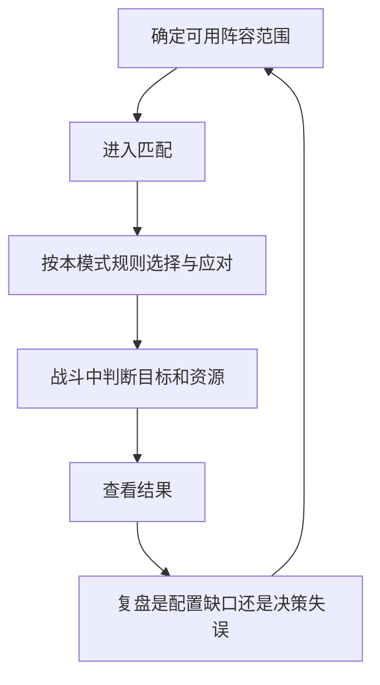

# 斗技：对手让阵容无法成为永久答案

阴阳师 · 国服 App · 玩家对抗

## 设计目的

斗技把队伍构筑放进会回应你的环境。它能够延长既有角色和御魂的用途：不仅追求一次稳定输出，还要考虑对手如何限制这套方案。

## 系统功能

- **战前应对：** 历史玩家对局分析讨论了翻牌、特定段位的禁选和阵容替代。角色名单相同，选择顺序和应对策略仍可能改变结果。[白鹿的斗技分析，2024-11-21](https://www.taptap.cn/moment/608709233134799212)

- **战中判断：** 行动顺序、资源与控制共同决定兑现机会。先手与后手是策略条件，不能简化成“速度最高必胜”。

- **阶段目标：** 排名与奖励为重复参与提供方向，但本版不照抄旧段位分数、开放时段和当前积分结算。

## 对局流程图



禁选和翻牌规则需要按具体模式、段位与日期确定；图中不假定所有对局都有相同步骤。

## UI：让变化可理解

```ui-analysis
yy-pvp
```

- **已公开信息与待选择内容分区。** 玩家应知道目前确认了什么，剩下什么机会；倒计时要服务决策，避免和装饰竞争。

- **受限对象有明确原因。** 未拥有、模式禁用、已选和操作超时的反馈应区分，不能统一显示灰色。

- **结算给出下一步。** 胜负不是充分复盘信息。补充设计建议保留关键出手与状态记录，帮助玩家找到可调整的环节。

## 养成与公平感

竞技并不自动意味着等属性。评价时应区分角色获取、御魂积累、对局知识与临场选择分别贡献多少。当前匹配算法、隐藏分和胜率分布没有公开依据，本版不反推它们。

值得借鉴的是对手选择让阵容不断需要解释；代价是版本知识、阵容准备与对局时间。迁移到小体量项目时，应先保证少量反制关系能被看懂，再增加禁选与角色深度。

[战斗](../systems/行动条与鬼火战斗.md) · [御魂](../systems/御魂构筑与整理.md)
