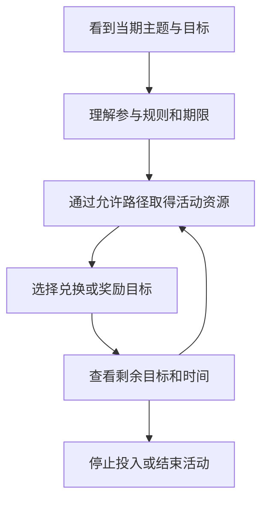

# 活动与商业化：让长期账户拥有当期目标

阴阳师 · 国服 App · 持续运营 / 内购

## 设计目的

活动改变玩家今天优先做什么，同时把角色、故事和奖励组织为一个有期限的目标。商业化则需要说明付费增加了什么，不能只罗列商城里有多少商品。

## 三类设计点

- **进度奖励与付费资格组合。** 2026 年十月花合战信息把等级达成和花札购买连接到外观奖励。它的关键是玩家能否提前判断自己的时间足够、购买后还缺什么条件。[官方当期信息](https://www.taptap.cn/app/12492/topic?page=4&type=official)

- **充值与身份展示连接。** 曜之阁活动将指定充值条件对应到场景与配套展示资源；从匹配到翻牌都能出现，扩大了展示机会。[官方说明](https://www.taptap.cn/moment/843879539892293296)

- **活动内资源与收集目标。** 10 月 14 日开启的萌神诞世记使用专门道具获取装扮等内容，说明活动会建立独立的资源入口与收集关系。具体抽取概率和成本本版未核实。[活动公告](https://www.taptap.cn/moment/858824843267672342)

## 玩家流程与节奏



付费应作为规则明确的可选路径展示，而非在每一步都默认发生。

## UI：先让人看懂，再让人决定

```ui-analysis
yy-liveops
```

- **时间拆开显示：** 活动参与、奖励领取、商店关闭分别注明。

- **奖励拆开显示：** 已获得、已达成未领取、需要进度、需要额外资格分别表达。

- **支付前说明剩余条件：** 避免玩家把购买资格误解成立即拿到全部奖励。

- **预告区别于开放：** 10 月 21 日糖果奇妙夜在本次研究日仍未开始，只能用于分析已公布的活动结构。[预告](https://www.taptap.cn/moment/859180565801207277)

## 我的评价

活动能把库存资源重新连接到目标，也会叠加日程与理解成本。应观察活动是否给玩家一个清楚的终点，以及不参与者能否继续原本的成长路线。没有同期参与、付费和留存数据，本版不以商业成绩为这些设计背书。

开发附录只覆盖任务进度、奖励领取和结束处理，不实现真实支付；价格、概率及完整活动经济需要另行取证。

[角色获取](../systems/召唤与角色获取.md) · [资源商店](../systems/资源与商店.md) · [角色叙事](../systems/角色叙事与外观.md)
